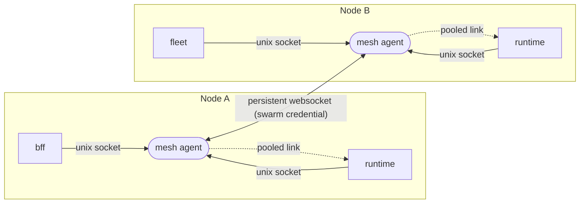
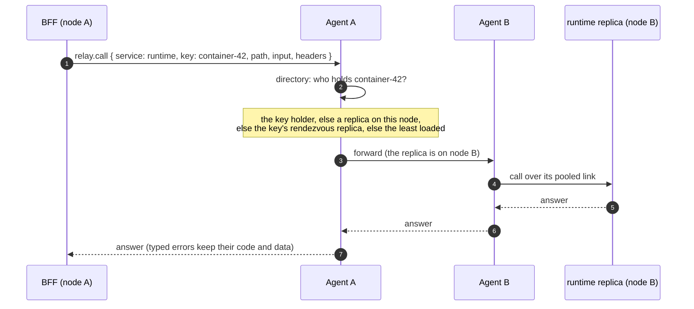
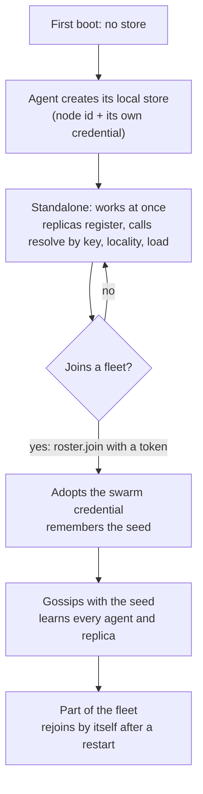
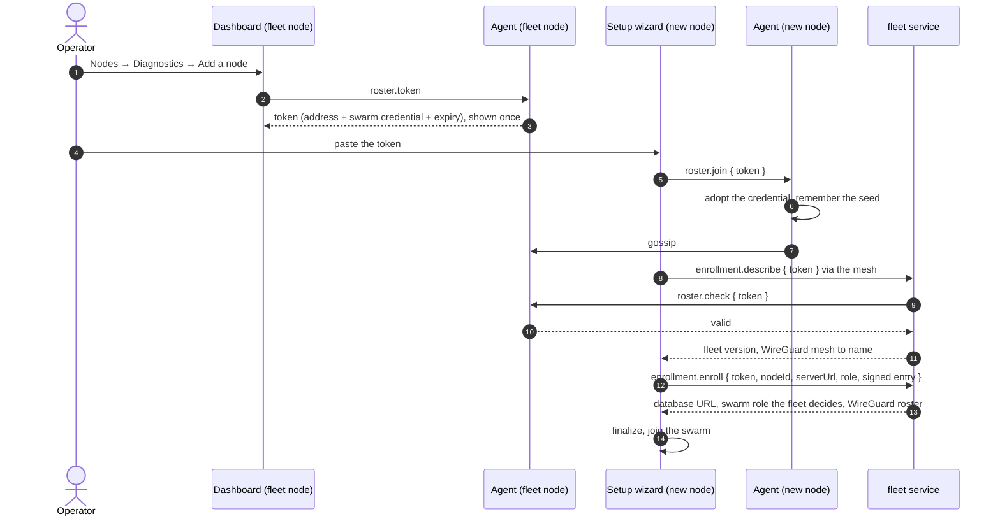

The node agent — formerly the mesh agent — owns every node-local concern: the mesh transport, the doors, the node
record, its settings and labels, and its join tokens.

<DocMeta source="docs/architecture/node-agent-service.md" scope="canonical" />

## In one paragraph

Every node runs one **mesh agent**. Services on that node never open a connection to another service on their own:
they ask their local agent. The agent knows which replicas of every service exist in the fleet, keeps the persistent
links to the other agents, picks the right replica (the one holding the resource, else one on the same node, else the
least loaded), carries the call and brings the answer back. A node starts alone and works at once; it joins a fleet
later with a **join token**. Nothing about a node is configured through environment variables.

## The words

| Word | Meaning |
|---|---|
| **Node** | One machine of the fleet. Its id is generated by its agent on first boot (`node-<uuid>`) and never changes. |
| **Agent** | The `node-agent` service, one per node. Owns the directory, the links to other agents, the routing and the node-local store. |
| **Replica** | One running copy of a service (for example one `runtime`). It registers with its local agent every few seconds. |
| **Directory** | The agent's map of every live replica: service, node, address, load, and the resource **keys** each one holds. Replicated between agents by gossip. |
| **Key** | A resource a replica holds in memory (a container id, a deployment, a terminal session). A call about a key goes to the replica that holds it. |
| **Relay** | The one procedure a service calls on its agent (`relay.call`) to reach another service. |
| **Lease** | A short-lived, agent-signed grant for a direct link to one replica, used when relaying the bytes would put too much on the agent. |
| **Join token** | What a node already in the fleet hands to a new node so it can join. Shown once, expires, carries the swarm's credential. |

## The picture

Two doors, two kinds of trust:

- **The node door** is a unix socket (`run/agent.sock` in the agent's data directory). It serves the services of the
  same node, and it is the only door that serves the `node` router (`node.state`, `node.configure`): a peer agent
  cannot address them, so no node can configure another. The file permissions are the only credential, so **a service
  never holds the swarm's secret**.
- **The network door** is the agent's HTTP port, with a websocket at `/mesh/ws`. It serves the other agents and is
  guarded by the swarm's credential, checked when the socket is opened.

The routers behind those doors are declarative: a procedure class extends `MeshController` and lists its methods in a
`static procedures` map (door, group and contract per method), and the agent's transport
module resolves them at boot and owns the sockets and loops. No mesh or node procedure is mounted on HTTP.

Everything on the mesh is **oRPC over the RPC protocol on a persistent websocket**, never the OpenAPI link: calls,
streams and redirects share long-lived connections instead of paying a connection setup per request. Every
server-side client is built with `createEffectClient`, so a call is an Effect and gets retry, timeout, tracing,
interruption and typed errors from Effect.

## How a call travels

A service calls another service with an ordinary typed client. Under it, the link is `serviceLink`: each call becomes
`relay.call` on the local agent, with the target named as `{ service, key?, node?, heavy? }`, the procedure path and
input, and **the caller's own headers**.

### What the agent does with one call

Every relayed call goes through the same four questions, in this order. The first answer that applies wins.

<MeshRelayDecision />

1. **Is the call pinned to another node?** Per-node operations (a node's containers, a terminal on a given node) name a
   node. If it is not this one, the agent forwards the call to that node's agent, which serves its own node only.
2. **Does the lease policy say direct?** The agent steps aside and answers `MESH_DIRECT` (see below).
3. **Otherwise it resolves a replica and calls it**, as in the next section, over a pooled link, with the same path and
   input untouched. It routes on the procedure and headers only and does not re-parse the payload.
4. **If the replica answers `MESH_REDIRECT`**, the agent replays the call on the replica it names, up to 3 hops, then
   returns the result or stream. The caller only ever sees the final answer.

### How the agent picks a replica

In this order, stopping at the first that applies:

1. the replica that **holds the key** (the directory knows, because replicas announce their keys);
2. a replica **on the agent's own node**: locality, a service replicated on this node is served from this node and
   never crosses to another;
3. the replica a **rendezvous hash** of the key names, so the same key keeps landing on the same replica;
4. the **least loaded** replica.

A call can also be **pinned to a node** (`node`), which the agent forwards to that node's agent. The runtime uses this
for per-node docker operations.

### Redirects are answered by the agent

If the replica that receives a call does not hold the resource, it fails with a dedicated error code,
`MESH_REDIRECT`, naming the replica that does. The call reached the replica through an agent, so the **agent** receives
that error: it resolves the named replica and replays the call there (up to 3 hops, with a loop guard), and remembers
`key -> replica` for 5 seconds so the next call goes straight there. The caller never sees a redirect.

### Direct leases: when the agent steps aside

By default the agent carries the call. It answers with `MESH_DIRECT` instead, a grant `{ replica, address, token, ttl }`
for a direct link to that exact replica, when:

| Reason | Condition |
|---|---|
| `heavy-procedure` | the procedure is marked `heavy` in its contract (streams, uploads, big reads) |
| `caller-request` | the caller asked for `{ mode: "direct" }` |
| `agent-overloaded` | the agent's event-loop lag, bytes per second or open streams pass a limit |
| `hot-pair` | one caller/target pair passes a call rate |

The caller's link follows the grant by opening (or reusing) a pooled websocket to the replica and replaying the call
there; the replica checks the token. A refused or expired lease falls back to the relayed path. The defaults (50 ms
lag, 64 MB/s, 512 streams, 200 calls/s per pair) are starting points, not measurements.

**Pools live inside the link.** Callers and handlers never see a connection: the link keeps a small multiplexed pool
per target, closes idle connections, reconnects with backoff and evicts unhealthy ones.

## Walk through eight stories

The same machinery, seen from eight situations. The picture has three nodes with an agent each (the tall bar) and a few
service replicas (the blue boxes). **Pick a story, then step through it**: each step lights up the agents involved and
draws the hop that just happened, with the earlier hops dimmed.

<MeshStories />

How to read it:

- **The tall bars are the mesh agents**, one per node. A service box is always attached to the agent of its own node
  and never to a box on another node: a service talks to its local agent only. The dashed rectangles are the nodes.
- **The line colour is the kind of contract the call is on.** Coral: the **node router** (per-node operations). Purple:
  the **external router** (an ordinary service call), and a dashed purple line is a **redirect** the agent receives and
  answers. Green: the **peer router** (replicas asking each other). Amber: a **direct lease**, drawn thick when the
  caller's link to a replica is open.
- **The strip at the bottom is the overlay network.** Brokered calls travel agent to agent over the persistent links;
  only a direct lease uses the overlay to reach a replica without the agent in the middle.
- **Each story carries a status**, because not every story is wired yet:
  - *Built*: it works in the code today (container logs, list projects, log in, terminal).
  - *Mechanism built*: the agent side is built and tested, but no service uses it yet (a service answering
    `MESH_REDIRECT`; deployment streams over a lease).
  - *Design*: the story is the target, not the code (fleet-wide usage through the agent, replicas asking their peers).

The stories in short:

| Story | What it shows |
|---|---|
| **Container logs** | A call pinned to a node: the agent forwards it to that node's agent, which reads its own docker socket. The stream returns over the same links. |
| **List projects** | Locality: the service is on every node, so the agent serves it from its own node and nothing crosses the network. |
| **Log in** | No local replica: the agent picks the least loaded replica of the whole fleet from the gossiped directory and the answer comes back the same way. |
| **Terminal** | A stateful session on a node: opened through the pinned path, then output and keystrokes stream over links that are already open. |
| **Deploy** | A redirect: the replica that receives the call does not hold the resource and names the one that does; the agent replays the call there. |
| **Live deploy log** | A direct lease: a long, heavy stream on one resource, so the agent hands the caller a signed grant and carries none of the bytes. |
| **Fleet usage** | A fan-out: one call with the target "all nodes" is answered by every agent from its own node and merged. |
| **Find a resource** | Replicas asking each other (`peers.ask`), ending in a redirect to the one that holds the resource. |

## How a service takes part

At boot, after its port is bound and its dependencies are proven, a service looks for the agent's socket
(`NODE_AGENT_SOCKET`, default `/var/lib/deployer/node-agent/run/agent.sock`). With none, it runs exactly as it always
did, alone. With one it calls `joinServiceMeshOnNode`, which:

- **registers** the replica with its agent every 5 seconds (address, load, the keys it holds), with a lease four times
  that long, so a dead replica ages out of every directory;
- **serves its contracts over its own websocket** (the mesh endpoint is the service's HTTP port, `/mesh/ws`);
- **asks its agent whether to trust a peer** (`access.verify`), because only the agent holds the credential. The peer
  presents the swarm's credential (an agent relaying) or a lease token (a caller the agent sent). The answer is cached
  for 30 seconds, and an agent that cannot be reached refuses the peer: unknown is not trusted.

**A service does not implement its contracts twice.** Its controllers already sit behind the pipeline that makes it
what it is: Better Auth, guards, interceptors, the Effect context, error mapping. So the mesh endpoint is a **loopback
router**: each procedure of each contract becomes the same call on the service's own HTTP surface on `127.0.0.1`,
carrying the caller's headers. The hop to the controller is in-process; the persistent link is agent to replica.
Typed errors keep their code and data, dates are revived by the contract's output schema, and an event stream stays a
stream. A service serves several contracts whose paths are relative to their own root, so each is mounted under its
**contract id** (a fingerprint of its procedure paths, computed the same way by caller and service).

**Credentials ride along.** One connection serves many callers: each call carries the caller's own cookie or
authorization header, so the service authenticates the caller exactly as if it had been called directly.

Without an agent, the shared service client (`ServiceClient`) and the BFF's registry fall back to calling each
service's origin directly. That is how a node works alone, and how tests run.

## Contracts: three routers, none public

A service in the mesh keeps three kinds of contract apart, in a non-public `mesh/` folder of its contract package:

| Router | Called by | Contains |
|---|---|---|
| `external` | other services and the BFF | the service's mesh-facing procedures |
| `peer` | the service's own other replicas | resource lookup, state handover, forwarded requests |
| `node` | the local agent, for per-node operations | containers, logs, files, usage, inventory |

They are never exported from the public contract index, so the web client and the generated API docs never see them.
The runtime's node router lives in `packages/contracts/runtime/mesh/node`.

## The runtime on the mesh

The runtime answers its node router (`mesh.node`) from its own docker engine and announces **every container id on the
node as a key**, so a question about a container reaches the node that owns it.

- **Questions about one container** go first to the node that announced that container id, then to every other node if
  that fails or nobody announced it.
- **Questions with no owner** (a list, a catalog) go to every node, this one included; each answers from its own engine
  only. A list therefore reports the node that answered.
- **Runtime events are pulled, not broadcast.** The node router serves a node's own event stream
  (`events.stream`); each node follows every other node's stream with one reconnecting loop per node, re-reading the
  set of nodes every few seconds. A slow or absent node costs only its own stream, and nothing is buffered for it.
  Every event carries the id of the node it happened on.

A runtime with no agent is simply alone on its node: every question to the mesh answers with nobody.

## A node's life: alone first, fleet later

The same life as a diagram you can step through: the node boots alone, two runtimes register, it brokers calls between
them with nobody else around, then it redeems a join token, gossips, serves a cross-node call, hands out a direct lease
and loses a replica.

<MeshLifecycle />

In the picture, each agent shows its **directory** (one line per replica it knows: service, node, load and the key it
holds). Node B is dimmed until the node has joined. The coloured arrows are, in order of appearance: green,
a replica **registering** with its agent; purple, a **call** and its answer; coral, **join and gossip** between agents;
amber, a **grant** (dashed) and the **direct link** it opens (thick).

- **First boot.** The agent owns the node's local store, a SQLite file in its data directory (`NODE_AGENT_DATA_DIR`, default
  `/var/lib/deployer/node-agent`, owner-only permissions). It generates the node id and a standalone credential and
  keeps them, so a node is the same node after a restart.
- **Everything else is in memory** and rebuilt by registration and gossip: the directory, the key hints, the pooled
  links, the load counters. Two runtimes on one node already find each other, redirect and relay exactly as in a
  fleet; there is just nobody else to gossip with.
- **Gossip.** Agents exchange what they know every 5 seconds: the replicas they hold and the agents they can reach. One
  reachable seed is enough, because an exchange also carries the agents the peer knows of. A node's own replicas come
  only from registration, never from a peer, and records expire on the clock of the agent that stamped them, so agent
  clocks must be kept in sync.
- **Environment variables are dev-only.** `MESH_NODE_ID`, `NODE_AGENT_SECRET`, `MESH_SEEDS` and `MESH_ADVERTISE_URL` let
  a developer or a test pin a value or form a stack without a token. A real node sets none of them.
- **Deployment variables.** `NODE_AGENT_BIND_ADDRESS` binds the peer door to the node's LAN/overlay address instead of
  every interface; `NODE_AGENT_DOCKER_SOCKET` and `NODE_AGENT_STATE_DIR` say where the engine socket and the WireGuard
  config live. `node.status.advertiseAddress` is the address this agent advertises, and every tier replica advertises
  `ws://<that host>:<its port>/mesh/ws` (`MESH_ADVERTISE_URL`), which is what makes a replica resolvable by name.

## Adding a node to a fleet

The operator brings one thing: a join token.

- The wizard steps are `agent_join` → `mesh_handshake` → `version_check` → `register_node` → `finalize`.
- **The token is the only authorization**, and the agent checks it: the fleet holds no credential, so it asks its own
  agent `roster.check`, which says whether the token is the swarm's and still good and never returns the credential. A
  node with no agent enrolls no one.
- **The fleet decides the swarm role.** A joining node can neither promote itself to manager nor found a rival swarm.
- A node **behind** the fleet's version is refused; one ahead may join.
- The new node's id is the one its agent generated, so enrollment never renames it.
- The old exchange (a Better Auth sign-in on a remote node, a one-time grant, a shared secret, a peer service token)
  is gone, with the setup probes that served it.

## What the dashboard shows

Fleet serves the mesh view from the agent of its own node; it keeps no picture of its own. `MeshViewService` asks
`roster.view` (this node and the agents it knows of) and `directory.snapshot` (every replica):

| Procedure | Answers |
|---|---|
| `getLocalNode`, `listPeers` | nodes: id, address, whether it is this one |
| `membershipSnapshot` | nodes plus replicas (service, node, load, announced keys) |
| `streamTopology` | the snapshot, sent again whenever it changes |
| `lookupResource` | which replica a call about a key would reach, and why (`directory.resolve`) |
| `issueJoinToken` | a join token (`roster.token`) |

Nothing is measured by the platform, so there is no link latency, jitter or loss on screen. A node without an agent is
a swarm of one: it lists itself, has no replicas, and cannot issue a token (it holds no swarm credential).

## Load and failure

- **One relay per node, not one gate.** Each agent carries only its own node's services, and locality keeps most calls
  on one node. It routes on the procedure and headers only and forwards the payload untouched.
- **An agent restart** drops in-flight calls on that node and nothing else: callers keep their last directory
  snapshot and their active leases, and retry idempotent calls on reconnect.
- **Replicas die quietly.** Registration is a heartbeat with a lease; a replica that stops beating leaves every
  directory when its record expires.
- **A broken peer costs one link.** A refused handshake counts as a failed attempt and fails the waiting calls after a
  bounded number of tries.

## Where the code lives

| What | Where |
|---|---|
| The agent service | `apps/api/services/node-agent` (directory, broker, relay, roster, join tokens, local store) |
| Agent contracts | `packages/contracts/node-agent` (`directory`, `relay`, `roster`, `access`; errors `MESH_REDIRECT`, `MESH_DIRECT`) |
| Caller side: pooled links, grants, relay link, `serviceLink` | `packages/mesh/client` (`@deployer/mesh-client`) |
| Websocket server, credential check | `packages/mesh/server` (`@deployer/mesh-server`) |
| A service joining the mesh, loopback router | `packages/mesh/service` (`@deployer/mesh-service`) |
| Runtime node router, node mesh, event relay | `apps/api/services/runtime/src/modules/docker/domains/containers/mesh`, `.../common/mesh`, `.../core/mesh` |
| Dashboard view, enrollment | `apps/api/services/fleet/src/modules/{mesh-view,enrollment}` |
| WireGuard driver, doors, Docker engine | `apps/api/services/node-agent/src/network` (`wireguard.service.ts`, `doors/`) |
| Join flow on the new node | `apps/api/shared/src/core/modules/setup/services/remote-initialization.service.ts` |

Design decisions and the questions behind them are recorded in `docs/qa/node-agent/`; the long design and build log is
`docs/architecture/node-agent-service.md`.

## What it replaced, and what is not the same thing

The old control plane is gone from `@deployer/shared`: the topology service (peer sessions, membership, health, the
trust keyring and strict mode, stream routing, queue replication, control envelopes), the topic bus, the resource
dispatcher and its `/mesh/:entityKey/:methodName` route, the query executor, the ownership resolver and the stream
manager. What remains of `MeshCoreModule` is the node's identity and configuration, the registry of the fleet's nodes,
and the ping, metrics, event-stream and node-configuration procedures.

The **WireGuard overlay** (the encrypted network between nodes, the ingress doors, the cluster settings) is a
separate concern from routing, and it now lives entirely in this service. `apps/mesh-agent`, `@deployer/mesh-network`
and the shared `node-agent` client module were deleted on 2026-10-30: the agent keeps the key pair in its store, derives
its address, advertises the overlay in the roster, applies `wg syncconf` from the planned peers, serves `node.status`
and `node.settings` on the node door, and converges the doors from `node.doors` on a 5 s tick. Enrollment is a join
token (`roster.token` + `roster.join`), the fleet checks it with `roster.check`, labels are written with `node.labels`,
and a member is cut off with `roster.block`.

## Multi-hop relay

A pinned call that cannot open a direct link is forwarded through another agent: the same `relay.call` carries
`via: { visited, ttl }`, the next hop prefers agents that taught this one about the target, and loops are refused by
`visited`. Forwarded calls are always brokered (never leased — the caller cannot reach the replica directly), a peer's
own error is never retried elsewhere, and failed direct links are remembered for 30 s. Bounds: `MESH_RELAY_MAX_HOPS`
(default 2, `0` disables, clamped to 8), `MESH_RELAY_NEXT_HOP_ATTEMPTS`. Counters: `node.status.relay` (`forwarded`, `noRoute`,
`unreachable`). Design: `docs/architecture/mesh-multihop-relay.md`.

## Not built yet

Non-runtime services announce no keys by design: keys are per-resource affinity (a deployment, a terminal session), and
project/fleet/identity/health hold no such resource — their `peers/info` reports an empty list rather than a fabricated
one. `nodeId` and `load` in that answer come from the agent's `node.status` (identity + its lease-policy sample).

## Recipes

**Call another service from a service.** Use the shared `ServiceClient` (or the BFF's registry): it uses the local
agent when the node has one and calls the origin directly otherwise. Never open a connection to another service
yourself.

**Make a call go to the replica that owns a resource.** Announce the resource id as a key from your replica's
heartbeat (`keys: () => [...]` in `joinServiceMeshOnNode`), and name the key in the relay target (`{ service, key }`) when you call. The shared `ServiceClient` does not choose a key for you yet; the runtime's node mesh does.

**Add a per-node operation.** Add the procedure to the service's `mesh/node` contract, implement it in the node router
from the service's own engine, and call it with a node-pinned call (or fan out to every node).

**See what the fleet looks like.** Dashboard → Nodes → Diagnostics shows the nodes, the replicas, a replica lookup
and a join-token button.
