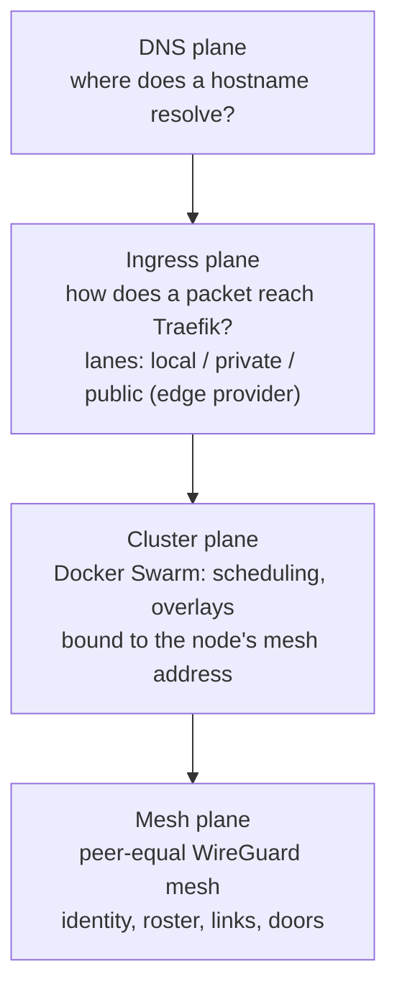
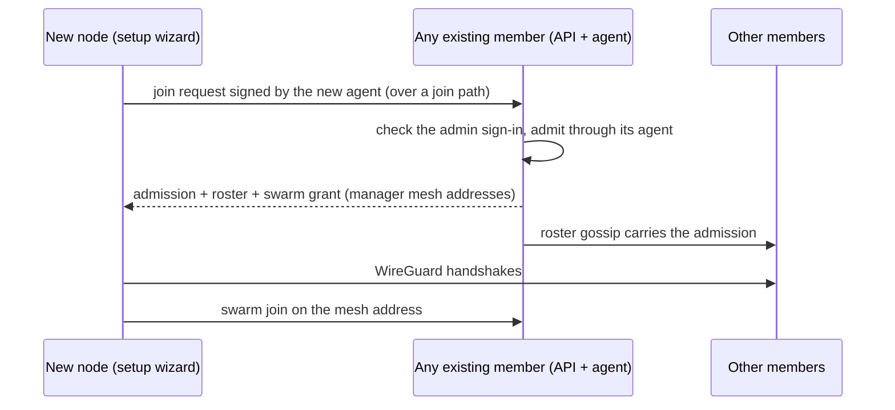

<DocMeta source="docs/edge-mesh-architecture.md" scope="canonical" />

<DocCallout title="Status: current behavior" tone="success">
This page is the operator-facing summary of `docs/edge-mesh-architecture.md`, which holds the full design and the reasoning behind it. Decisions and the questions behind them are recorded in `docs/qa/edge-mesh/`.
</DocCallout>

## The invariant

A deployer node needs **no public IP, no inbound firewall rule, no port forwarding, and no listening socket on a public interface**. The single exception is one you opt into explicitly: the `direct` edge provider, which opens `:80`/`:443` on every node.

Everything a node needs from outside it gets by **dialling out**. Two consequences follow, and they are physical facts rather than design choices:

- Two machines that both refuse inbound connections can only find each other through a third party. Here that third party is **any other member of the mesh** that already reaches both of them, never a dedicated server.
- A client on the internet can only reach a node through something public: a tunnel provider the node dials out to (Cloudflare), or a node the operator deliberately exposed (`direct`).

## Four planes

Each plane has one job, and each sits on the one below it:

The mesh exists before Swarm (Swarm rides on it), Swarm exists before Traefik (Traefik is a swarm service), and DNS only ever points at something the ingress plane already serves.

## Mesh plane

There is **no controller, coordinator or lighthouse** — every member can do anything another member can. Each node runs one `deployer-mesh-agent` container:

| Property | Value |
|---|---|
| Runtime | plain container, `restart: unless-stopped` — not a swarm service, because it must exist before Swarm does |
| Network | `host` (the mesh interface is a host interface, so Swarm and the doors can bind it) |
| Capability | `NET_ADMIN` (it creates the WireGuard interface) |
| State | `deployer-mesh-state` volume: the node's keys and its copy of the roster |
| Started by | setup or the API, whichever reaches the node first; the API supervises the agent on its own node |

The agent generates the node's signing and WireGuard keys on first boot (private keys never leave the node), **derives the node's mesh address from its WireGuard key** inside the cluster CIDR (default `100.88.0.0/16`, so nobody has to be online to allocate an address), and gossips a **signed roster** to a few random members every 5 seconds over the mesh.

The roster is replicated state with no owner: admissions, member entries, revocations and cluster-wide settings, each signed by a member and merged the same way on every node. Losing any one member — including the one that founded the cluster — loses no data. The cluster-wide settings it carries are:

| Setting | Holds |
|---|---|
| `ingress.lanes` | which lanes are on, their domains, the door port (entry port), the public edge provider and its options, console visibility |
| `edge.<provider id>` | what that edge provider created (e.g. the Cloudflare tunnel id and connector token) |
| `node.doors` | the doors every agent converges, derived from `ingress.lanes` by the API |

Because they live in the roster, these settings survive the API being rescheduled to another node.

**Links.** For each peer the agent tries, best first: a shared LAN address, a declared public address (only a `direct` node has one), a hole-punched address learned through public STUN, other LAN addresses, and finally a relay through another member (see [Limits](#current-limits)). The WireGuard UDP port is never published or forwarded; WireGuard does not answer a packet that does not carry a valid key, so to a scanner it looks closed.

## Cluster plane: Swarm rides the mesh

Swarm advertises, listens and carries its data path on the node's **mesh address** (`AdvertiseAddr` and `ListenAddr` `<mesh address>:2377`, `DataPathAddr` `<mesh address>`). Ports 2377/7946/4789 are therefore bound on the mesh interface only, and overlay traffic between nodes is encrypted by WireGuard. When the node has no mesh interface (no WireGuard module, or the agent cannot run), Swarm binds loopback and the node runs as a single-node cluster.

A join grant only ever hands out manager mesh addresses.

## Ingress plane: three lanes

Traefik is a `global` swarm service on every node, with **no Docker socket and no config volume**. It polls its routes from the API over the platform overlay (HTTP provider), so every node serves identical routes, and a node that loses the API keeps serving the last configuration it fetched.

Each lane is a separate Traefik entrypoint with its own **door** — a small listener in front of Traefik that the node's mesh agent runs:

| Lane | Enabled | Who can reach it | Hostnames |
|---|---|---|---|
| `local` | always | this machine only — the door binds `127.0.0.1:<entry port>` | `<label>.{prefix}deployer.localhost` |
| `private` | opt-in | mesh members — the door binds `<mesh address>:<entry port>`; with "allow same-network join" a second door also binds the node's LAN address | `<label>.<private domain>` (default `deployer.internal`) |
| `public` | opt-in, served by **one** edge provider | the internet, through the provider | `<label>.<public domain>` + verified custom domains |

The entry port defaults to 80 (`DEPLOYER_TRAEFIK_HTTP_PORT` seeds it once); after that it is part of `ingress.lanes` and is changed on **Network → Ingress & edge**. A door that cannot bind its port is reported as failed in that page's doors table.

**Doors are containers, not swarm publishes,** because a swarm publish always binds every interface. Only a plain container can bind loopback-only or mesh-only, and the agent is the one process present on every node to create them.

**The rescue route.** The local door also forwards the platform's own hostnames (`api.*` and `web.*`) straight to the API and web containers when Traefik does not answer (connection refused, 502/503/504 from the door itself). So on the machine itself the console stays reachable at its usual URL while Traefik is down; other hosts get a 502 until Traefik is back. A 502 returned by Traefik for an application passes through untouched.

### Route visibility

Every route has a label (its subdomain on the generated lanes) and a visibility:

| Visibility | Served on |
|---|---|
| `private` | local + private |
| `public` | local + private + public |

Services choose their visibility (default `public`). The platform console has one stack setting, console visibility (default `public`, so webhooks and OAuth callbacks work once a public lane exists). A public route on a stack with no public lane simply has no public router.

## Edge providers

The public lane is "reach Traefik's `public` entrypoint from the internet", and *how* is the business of exactly **one edge provider** chosen by the operator. Built in today:

| Provider | Kind | What it costs you | HTTPS |
|---|---|---|---|
| `cloudflare-tunnel` | tunnel — dials out | a Cloudflare account added as a DNS provider with tunnel management enabled; connector replicas on the cluster; no inbound port, no public IP | Cloudflare terminates TLS |
| `direct` | inbound | every node opens `:80` (and `:443` with TLS) and needs a public address you declare on Network → Ingress & edge; you must tick an explicit acknowledgement that inbound ports will open | Let's Encrypt (HTTP-01) on the `public-tls` entrypoint |

Traefik never publishes a port that was not acknowledged, even if the setting is edited by hand. `direct` is kept because it is the only public path with no third party; a `direct` node also helps the mesh, since its declared public address becomes a link candidate that NATed members can reach.

**Switching providers** provisions the new edge first, then points the lanes at it, then tears the old one down. If the new edge cannot be created, nothing changes. DNS names that only the old edge used are removed.

### Adding an edge provider (developers)

Providers are plugins; no code outside a provider names one. To add one:

1. Implement `EdgeProvider` (`apps/api/shared/src/core/modules/edge/edge-provider.ts`) in an `@Injectable` that calls `registry.register(this)` in its constructor.
2. Register the class in the module that owns its integration (account-backed providers live next to their DNS integration under `modules/providers`).
3. Describe its options in the descriptor (`boolean`, `text`, `dns-account`). The web renders the form from it, with no UI change.

A tunnel-style provider returns a `connector()` (image, credentials, args, replicas) that the generic `EdgeConnectorSupervisorService` runs as one swarm service; an inbound provider returns its published ports from `ingress()` and sets `opensInboundPorts`. Provider state goes in its `edge.<provider id>` cluster setting, never in a node-local store.

## DNS plane

DNS is separate from ingress: enabling an edge creates no record by itself. The DNS plane reconciles on every lane change and every 10 minutes, through whichever DNS provider account owns the zone:

| Lane | Record |
|---|---|
| public | what the edge provider asks for — Cloudflare Tunnel: `*.<domain>` CNAME to the tunnel (proxied); Direct: `*.<domain>` A records to the nodes' declared public IPs |
| private, domain in a managed zone | `*.<private domain>` A records to the nodes' mesh addresses |
| local | none — `*.localhost` always resolves to loopback |

A zone no connected account owns is shown as **manual** on Network → DNS, with the exact record to create.

## Where to find it in the console

Every plane has one page under **Network**:

| Page | What you do there |
|---|---|
| Overview | lanes at a glance, exposure, mesh health, DNS status, join paths |
| Ingress & edge | turn the local/private lanes and the public edge on or off, entry port, console visibility, node public addresses (inbound edges), this node's doors |
| Mesh | members as this node sees them (link path, last handshake, endpoints), revoke a member, how a node joins |
| DNS | lane record sets and whether they converged |
| Domains | project custom domains, served on the public lane |

Changing lanes, the edge or mesh membership requires a platform admin.

## Joining a node

A fresh machine has no mesh address yet, so it can only dial an address or a name. Network → Mesh (and Overview) list the **join paths** this cluster offers and how many members are behind each:

- **Same network** — an existing member's private lane also binds its LAN address ("allow same-network join"); the new node dials `http://<member LAN address>:<entry port>` with `Host: api.<private domain>`. No public IP, no DNS, no provider account.
- **Public lane** — the new node dials the public hostname, carried by the active edge provider.

The journey:

1. Install the deployer on the new machine and open **its** setup wizard (served on that machine only).
2. Choose **"Join an existing cluster"** and enter one of the join paths shown on Network → Mesh.
3. Sign in with an admin account of the existing cluster. A one-time join grant is issued for this node.
4. The new node's mesh agent signs a join request; **the member it reached admits it**, and the signed roster gossips to every other member. No central server records it, and any member can admit.
5. Its WireGuard links come up, then it **joins Swarm over its mesh address**. It appears on Network → Mesh within seconds.

## Revoking a member

On Network → Mesh, **Revoke** a member (a reason is required and kept in the signed revocation). Every member drops it on the next gossip round and stops accepting its WireGuard key; it cannot come back without a new admission. A node cannot revoke itself — do it from another member's console. Revocation is a mesh operation: it does not remove the node from Swarm's node list, but with its key refused the node can no longer reach the other members.

## Current limits

- **Two members both behind strict (symmetric) NAT cannot link yet.** The relay through a third member is planned and modelled, but not available; one of them needs a LAN path, a hole-punchable NAT, or a `direct` peer.
- **Operator-laptop membership is a stub.** `deployer mesh connect` (running the agent on a laptop as a non-scheduling member, so the private lane works from anywhere) is not implemented yet.
- **Nodes that already share a swarm are not admitted automatically.** A single-node install upgrades by itself (the API founds a one-member mesh at boot), but a node that already shares a swarm with others is not given a mesh of its own. Re-run the join flow on each of them (setup → "Join an existing cluster") so a member admits it and Swarm moves onto mesh addresses. The public lane must also be turned on again once after upgrading, because the old node-local edge settings are not migrated.
- Agent upgrades are not yet pushed through the mesh: setup or the API re-creates the agent on the node they run on.

## Related documentation

- [Swarm Orchestration](/docs/deployment/swarm-orchestration) — Swarm on top of the mesh
- [API-Centric Deployment Architecture](/docs/deployment/api-centric-deployment-architecture) — supervisors and the platform Traefik
- [Onboarding & Lifecycle](/docs/deployment/onboarding-and-lifecycle) — access matrix and the local door's rescue route
