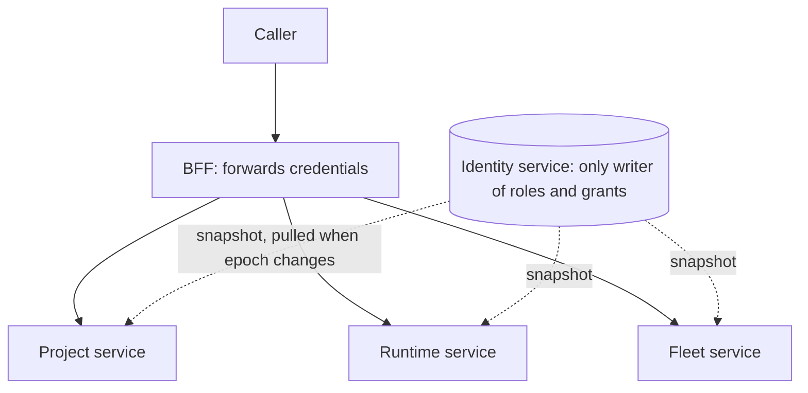
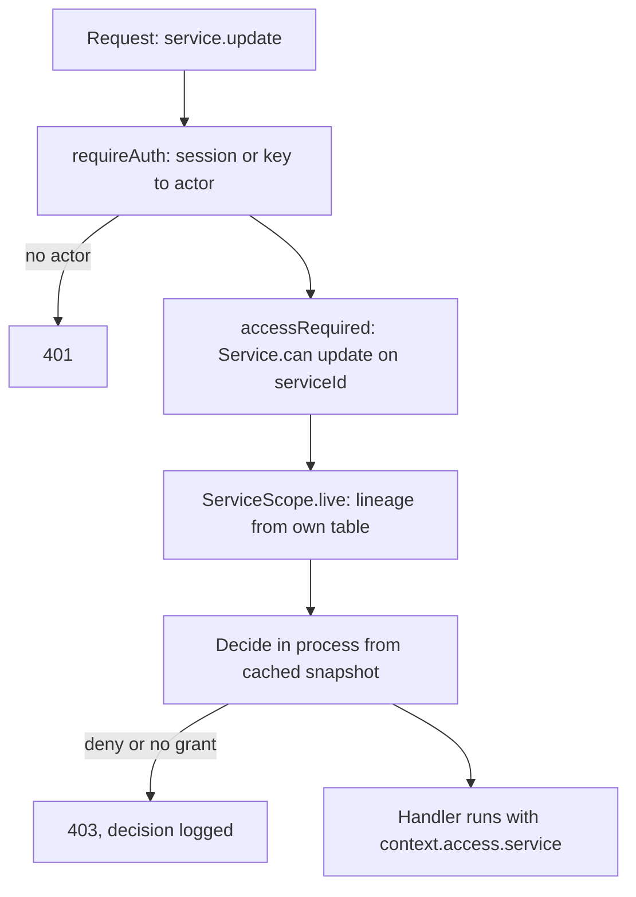
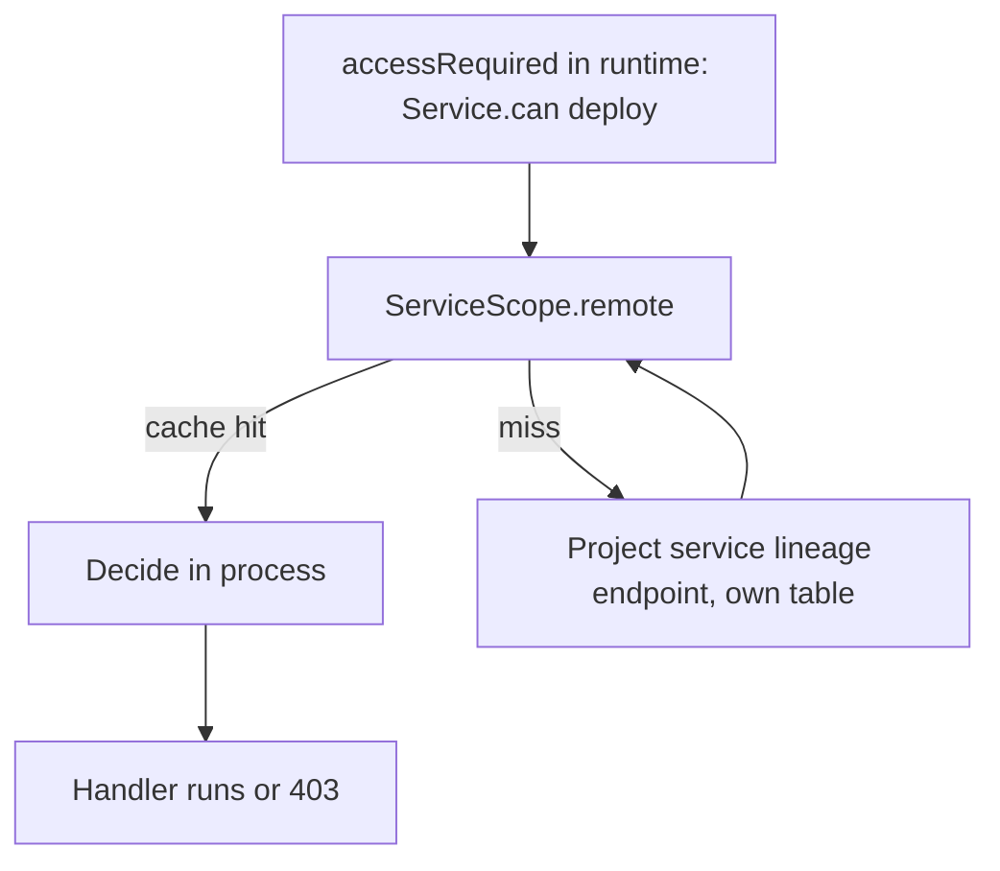
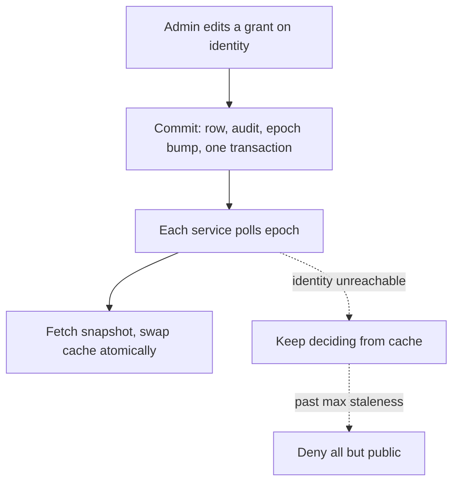
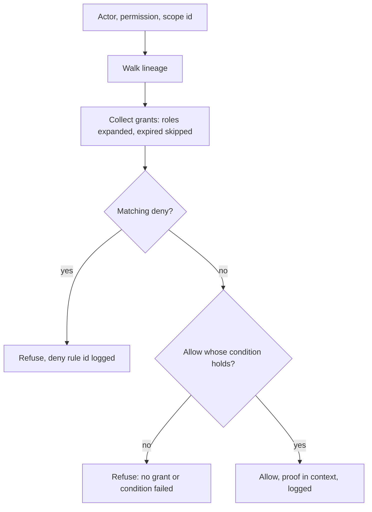

# Access requirements — how a procedure declares and proves what it needs

Status: **accepted design, 2026-11-05** (operator review of the proposals recorded in
[`docs/qa/permissions/access-requirements-2026-11-05.md`](../qa/permissions/access-requirements-2026-11-05.md)).
**First slice implemented 2026-11-05** (section 12); everything else is design, except where marked *exists*. Items and phases are in
[`PERMISSIONS-ROADMAP.md`](../audit-2026-10-25/PERMISSIONS-ROADMAP.md) (`AUTHZ-0xx`). This file supersedes the parts of
that roadmap that put the declaration on the contract (`.access()` / `.meta(access(...))`).

Related: [`effect-orpc-conventions.md`](./effect-orpc-conventions.md) (services, middleware, errors),
[`PERMISSIONS-ROADMAP.md`](../audit-2026-10-25/PERMISSIONS-ROADMAP.md) (phases), `docs/audit-2026-10-25/permissions/model-research.md`
(why this model).

---

## 1. The rules

1. **Contracts declare nothing about access.** A contract is schema: input, output, errors. Who may call it is a property of the
   *implementation*, written where the handler is written, so a reader of the controller sees exactly what is required.
2. **Code names permissions, never roles.** `service:deploy` exists in code; "maintainer" is a row of data. No controller,
   middleware, service or web component mentions a role name (outside the seed and the break-glass recovery path).
3. **Nothing is opaque.** Every requirement is a typed value in the controller: the permission, the scope it is checked in,
   how the scope id is found in the input, and what extra rules apply. The middleware's type says what it proves.
4. **One vocabulary, two places.** The same requirement object is used as a middleware (`accessRequired`) and inside a
   handler (`access.require`), because some decisions need data that only exists after a load.
5. **Checks are ordinary Effect services.** Scope resolution, conditions and the decision are `Context.Service` tags
   provided by Layers, like every other service. There is no second kind of object and no hand-rolled factory.
6. **Scope kinds and conditions are plugins.** Adding a resource, a scope kind or a condition type means adding a file and a
   Layer, not editing a central switch.
7. **Policy has one writer; decisions happen everywhere.** Identity owns roles and grants. Every service decides in-process
   from a cached snapshot. Resource data is read only by the service that owns it.
8. **Forgetting the check is impossible, not discouraged.** A procedure that does not declare access fails to compile and
   fails the boot audit.

## 2. Vocabulary

| Term | Meaning |
|---|---|
| **Permission** | `resource:action`, typed from the catalog (`service:deploy`). Has a risk tier and a *natural scope kind*. Code. |
| **Resource** | a plugin describing one kind of thing (`Service`, `Project`, `User`, `Node`): its id key, how to load it, its parent (lineage), its actions. Defined once by the service that owns the data. |
| **Requirement** | one typed demand: `Service.can("deploy").on("serviceId")`. Built from a resource. |
| **Access proof** | the typed value a passed check leaves in `context.access.<name>` (or returns as `Authorized<…>`). Only the access machinery can create one. |
| **Scope** | `platform`, or `project`, `environment`, `service`, `node` with an id. A grant on a scope reaches everything below it. |
| **Lineage** | the chain from a scope up to the platform (`service → project → platform`), supplied by the resource plugins. |
| **Role** | a named bundle of permissions. **Data**, assignable, editable. System roles are seeded rows. |
| **Grant** | `(subject, role or permission, scope, allow/deny, condition?, expiry?)`. Data. |
| **Condition** | a predicate on a grant, stored as data and validated by its plugin (`environment not production`, `owner`, `time`). |
| **Guardrail** | an extra proof an *action* needs whoever holds it (fresh TOTP, second approver). Code, attached to the permission or the requirement. |
| **PAP / PDP / PEP** | policy administration (identity), policy decision (in-process `Authz`), policy enforcement (the middleware or handler call). |

## 3. What the controller looks like

```ts
procedure(serviceContract.deploy)
  .use(requireAuth())                                   // required first: a type error without it
  .use(accessRequired(Service.can("deploy")))           // `.on` inferred: the input has `serviceId`
  .effect(function* ({ context }) {
    context.access.service.id     // string
    context.access.service.row    // ServiceRow, loaded once for the check and reused
  });
```

### 3.1 The forms

| You write | Means |
|---|---|
| `Service.can("deploy")` | permission `service:deploy`, scope kind `service` (from the catalog), id from `input.serviceId` (the resource's `idKey`). |
| `.on("sourceId")` / `.on(({ input }) => input.target.id)` | the id lives elsewhere. Typed against the contract's input. Required when the input lacks the resource's `idKey`. |
| `User.can("list")` | platform-wide permission; `.on` is a type error. |
| `Project.can("create-service").on("targetProjectId")` | an action the catalog marks as checked on the parent. |
| `.as("source")` | name in `context.access`. Default is the resource name; two requirements on the same resource need `.as`. |
| `.onEach("serviceIds")` | one requirement over a list; all must pass; the refusal names the failing ids. |
| `accessRequired(a, b)` | several requirements, all must pass, one decision-log group, context keyed by name. |
| `anyOf(a.as("owner"), b.as("admin"))` | either; `context.access.matched` says which. |
| `User.can("update").on("userId").orSelf()` | passes when the id is the caller's, no permission needed. |
| `.notAbove()` | the subset rule (section 6.3): the target's effective permissions must be a strict subset of the caller's. |
| `.requiring(freshTotp("5m"))` | a guardrail: extra proof for the action. |
| `.loaded()` | keep the row the plugin loaded in `context.access.<name>.row`. |
| `accessSelf(reason)` | the caller acts on their own record; only authentication is checked; the handler must scope to `actor.id`. |
| `accessPublic(reason)` | the only anonymous form; the reason is mandatory and listed in the generated public surface. |
| `accessDeferred(reason)` | the decision is made in the handler (section 5). |

### 3.2 Typing

- `accessRequired(...)` builds an oRPC middleware typed with `$context<AuthenticatedContext>()`, so placing it before
  `requireAuth()` is a compile error.
- The terminal `.effect()` / `.handler()` of `procedure()` requires `context.access` in its type. Only `accessRequired`,
  `accessSelf`, `accessPublic` and `accessDeferred` produce it.
- The Effect requirements of the middleware (`ScopeResolver<K>`, `Authz`, each condition tag) join the procedure's `R`.
  The existing requirement flow then fails the boot, naming the missing plugin, when a service forgets to provide one.
- `.as(name)` makes `context.access` a record; a duplicate name is a compile error.

### 3.3 Why the declaration is not on the contract

A contract is shared with the web and the CLI. Putting policy there made the declaration remote from the code that must
honour it, made it metadata nothing forced anyone to read (a controller that bypassed `procedure()` was silently open), and
could not express rules that depend on loaded data. A requirement written in the controller is read by the people editing
the controller, is checked by the type system, and is inspectable by the boot audit.

## 4. Resources and plugins

```ts
// owned by the service that owns the data (project service)
export const Service = defineResource("service", {
  idKey: "serviceId",
  parent: (row) => Project.at(row.projectId),     // lineage: service -> project -> platform
  load: ServiceRepository.find,                   // an Effect service; the row type flows out of it
  actions: catalog.service,                       // typed: "read" | "create" | "update" | "deploy" | ...
});
```

A resource contributes a `ScopeResolver<K>` tag:

```ts
interface ScopeResolver<K extends ScopeKind> {
  readonly kind: K;
  readonly lineage: (id: string) => Effect.Effect<readonly ScopeRef[], ScopeNotFound>;
  readonly facts:   (id: string) => Effect.Effect<ScopeFacts<K>, ScopeNotFound>;   // owner, environment kind, state
}
```

- **`live`** is provided by the service that owns the entity and reads its own tables.
- **`remote`** is provided by every other service that needs that scope. Same tag, same interface, implemented over the
  owner's client with a short cache. It is not a second kind of service: it is a second Layer.
- **Conditions** are plugins too (`AccessCondition<"environment">`, `owner`, `time`): a tag with a `check`, an args schema
  and a type name, so a grant's stored condition is validated and evaluated by the same plugin.
- The **catalog** gains a scope kind per resource and an optional per-action override (`service:create` is checked on the
  parent project). The kind is never written in a controller.

Where the plugin files live: section 8.

## 5. Gating inside the handler

Some scopes are known only after a load, or need another service. The same descriptors work in the handler:

```ts
procedure(serviceContract.transfer)
  .use(requireAuth())
  .use(accessDeferred("the target project is only known after loading the service"))
  .effect(function* ({ input }) {
    const svc  = yield* ServiceRepository.find(input.serviceId);
    const from = yield* Service.require("update").on(svc.id);                   // Authorized<"service:update">
    const to   = yield* Project.require("create-service").on(input.targetProjectId);
    return yield* ServiceTransfer.run(from, to, svc);                           // demands the proofs
  });
```

- `X.require(...)` fails with the tagged `AccessDenied`; `X.check(...)` returns a boolean for lists, flags and UI hints.
- `require` returns an `Authorized<Permission, Scope>` proof that only the access machinery can construct. A mutating
  service method takes it as a parameter, so calling it without a decision does not compile (`AUTHZ-014`).
- **Mandatory without a middleware.** `accessDeferred(reason)` satisfies the typed declaration; the request boundary
  (`inBoundary`) tracks decisions per request and fails a deferred procedure that finishes with none (enforce) or logs
  `access never decided` (shadow).
- A coarse middleware check plus a fine handler check on the loaded resource is allowed and common.

## 6. The model: roles are data

### 6.1 Grants

```
Subject  <  Grant  >  (Role | single Permission)  in a Scope
user                    effect: allow | deny
API key / token         condition: optional data policy
service / system        expires_at, granted_by, revoked_at
```

- A key or token's reach is `owner's permissions ∩ token scopes`; it can never exceed its owner.
- The UI's "role" of a user is the set of role grants they hold; there is no privileged `user.role` in the model.
  (Better Auth still reads `user.role` for its own admin endpoints until it is driven from grants; see section 11.)

### 6.2 Resolution

1. Collect every live grant (not revoked, not expired) on the lineage of the requested scope.
2. Expand roles to permissions.
3. **A matching deny on the lineage wins over every allow.**
4. Each allow's condition is evaluated by its plugin against the facts (`environmentKind`, `ownerId`, time).
5. The result carries the rule ids that decided it; the same data answers "why was I refused?".

The pure core is `decide` in `@deployer/auth/authz` *(exists)*; the lineage walk, grant expansion and conditions are
added around it. Results are cached by the epoch counter that every grant or role edit bumps.

### 6.3 No ranks: the subset rule

Rank comparisons (`outranks`, `refuseAdminAction`) are role names leaking into code. They are replaced by capability
dominance:

- You may **grant or change** only permissions you hold yourself.
- You may **act on an account** only when its effective permissions are a strict subset of yours (`.notAbove()`).
- Project owners may delegate only permissions marked delegable and only within their project.

### 6.4 What stays in code

- **Conditions vs guardrails.** What depends on *who holds the grant* (not production, owner, expiry) is data on the grant.
  What depends on *the action* (fresh TOTP, second approver) is a guardrail in code, so it cannot be forgotten when granting.
- **Recoverability.** At least one active subject must always hold the permissions to assign roles and edit grants;
  removing the last holder is refused. A protected seeded `superAdmin` role cannot be deleted, only cloned. A host CLI
  (`deployer authz recover`) restores access when the UI is unusable.

### 6.5 Examples

| Want | Grants |
|---|---|
| read project B, no edit | role "viewer" on `project:B`, or `project:read` on B |
| deploy but not edit | a custom role with `service:read`, `deployment:*`, `service:deploy` and no `service:update` |
| editor everywhere except B | "editor" at platform scope + deny `project:write` on `project:B` |
| deploy anywhere but production | "deployer" with condition `environment not production` |
| two days of access | any grant with `expires_at` |
| only my own | condition `owner`, for personal resources (API keys) |

## 7. Topology: who owns what, who decides



- **PAP, identity.** Owns the authz tables (`roles`, `grants`, role versions, decisions, epoch). Edits, explain, decision
  log, snapshot, epoch. The single writer, registered in `table-ownership.ts`.
- **PDP, every service.** The in-process `Authz` service decides from the cached snapshot: no database call, no call to
  identity per request.
- **PEP, every service.** The middleware and handler calls. The BFF forwards the caller's credentials; services are
  reachable internally, so each enforces its own endpoints.
- **Resource data stays with its owner.** A service reads only its own tables. A scope owned elsewhere is resolved by that
  owner's `live` resolver, reached through the `remote` Layer with a cache.

### 7.1 A request on a local resource



### 7.2 A request on a foreign resource



### 7.3 Policy change



### 7.4 The decision



## 8. Where the code lives

| Piece | Location |
|---|---|
| catalog, `decide`, grant/role model *(pure, shared with the web)* | `packages/auth/src/authz/` *(exists; gains scope kinds and the grant model)* |
| `accessRequired`, `accessSelf/Public/Deferred`, `defineResource`, `Access`, plugin interfaces, `Authorized` | `packages/nest/effect/src/access/` *(grows from `authz.ts`)* |
| snapshot loader, epoch cache, generic plugins (`PlatformScope`, `environment`, `owner`, `time`), `AccessLive` | `apps/api/shared/src/core/authz/` |
| authz tables, role and grant editing, explain, decision log, snapshot endpoint, `User` resource | `apps/api/services/identity/src/modules/authz/` |
| `Project`, `Service` resources | `apps/api/services/project/src/modules/*/access/*.resource.ts` |
| `Deployment` resource; remote `Service` and `Project` resolvers | `apps/api/services/runtime/` |
| `Node`, `Cluster` resources | `apps/api/services/fleet/` |
| admin contracts (`authz.roles.*`, `authz.grants.*`, `authz.explain`, `authz.catalog`) | `packages/contracts/identity/modules/authz/` |
| permission manifest for the web | generated from the resource descriptors; consumed by `apps/web` |

## 9. Enforcement and CI

| Check | Fails when |
|---|---|
| type check | a procedure's terminal `.effect()` lacks `context.access`; `accessRequired` precedes `requireAuth()`; `.on` is missing though the input lacks the id key; a duplicate `.as` name |
| boot audit | a mounted procedure has no access descriptor in its middleware chain (also catches code that bypasses `procedure()`) |
| boundary check | an `accessDeferred` procedure finished with no recorded decision |
| `check:authz-catalog` | a permission has no bundle or no scope kind; a role references an unknown permission |
| generated 403 matrix | a procedure or role changed without the snapshot |
| lint | a role name literal outside the seed and recovery; a service importing a table it does not own |

## 10. Migration from what exists

- `procedure()` currently appends `authzGate` inside a `Proxy`; that step is removed. The gate becomes the explicit
  `accessRequired` middleware.
- About 160 contract declarations (`.meta(access(...))`: identity ~50, fleet ~42, project ~70) are *interim*. Their permission
  names carry over; the declaration moves into the controller (`AUTHZ-012`). The contract annotations are then deleted.
- `requirePlatformRole([...])`, `refuseAdminAction`, `platformRoleRank` are replaced by permissions and the subset rule.
- `RoleCatalogueRefresher` stops reading the `roles` table directly once the snapshot path exists.
- `AUTHZ_MODE` (`off|shadow|enforce`) stays and lives inside `accessRequired`, so the types and the decision log are
  identical in every mode.

## 11. Open decisions and unverified claims

Open decisions (operator):

1. **Snapshot source.** Services fetch a snapshot from identity (real service boundary) or read the authz tables
   read-only with identity as the declared single writer. Recommendation: read-only tables first, behind the same
   `PermissionStore` port so switching is one Layer.
2. **Maximum staleness** of a snapshot when identity is unreachable, and what then stays open (public routes only).
3. **Epoch signal:** poll or push.
4. **Admin and deploy.** The platform `admin` role currently holds no `deploy` bundle; confirm that is intended.
5. The five decisions already listed in `PERMISSIONS-ROADMAP.md` section 14 still stand.

Unverified until the spike (`AUTHZ-016`):

- `.on` inference from the contract's input through oRPC's `.use(...)`, and the "authenticated first" type check, in the BFF
  whose contexts are unions (the repo has hit narrowing problems there before). Fallback: an always-explicit `.on("key")`.
- `.as(name)` records with three or more requirements, and the readability of the resulting compile errors.
- Scope inheritance in the store today (`AUTHZ-053` is listed as not built): whether a project-level grant reaches its
  services.
- Better Auth's admin plugin driven by grants instead of `user.role`.
- Per-request cost of the lineage walk and `.notAbove()` (needs a per-request cache; no measurement yet).
- Cross-service scope resolution latency and its invalidation.

## 12. What is implemented, and what the spike found (2026-11-05)

Implemented in `packages/nest/effect/src/access/` (exported from `@deployer/nest-effect`), with type tests next to the
behaviour tests, and used by identity's user controller (all 15 procedures; the contract declarations were removed):

| Piece | State |
|---|---|
| `defineResource`, `Resource.can(action)` typed by the catalog, `.on(field or dotted path)`, `.as(name)`, `.orSelf()` | done |
| `accessRequired(...)` (variadic, authenticated-first, typed `context.access`, duplicate names are a compile error), `accessSelf`, `accessPublic`, `accessDeferred` | done |
| scope plugin tags (`ProjectScope`, `EnvironmentScope`, `ServiceScope`, `NodeScope`) and the scope plugin's contribution to the procedure's `R` | done; no `live` implementation exists yet (the project service writes them) |
| boot audit: `auditRouter`, `auditController`, `assertAccessDeclared` (with a ledger) | done as library functions; **not yet wired into the host** |
| `X.require(...)` in a handler, `Authorized<…>` proofs, `onEach`, `anyOf`, `.notAbove()`, `.requiring(...)`, `.loaded()` | not built |
| removal of the `Proxy` auto-append in `procedure()` | not done: the legacy gate now defers to an access proof when one is present |
| lint rule requiring an access middleware in every `procedure(...)` chain, with a per-app ledger | not built |

Spike results (`AUTHZ-016`):

- **`.on` is enforced by the type system, once `RequirementProcedure.use` carries the procedure's input.** It was typed
  `any` there, so a middleware locating by an input field was never checked. It now is: a procedure whose input lacks the
  field does not accept the middleware. Dotted paths (`params.id`) are typed (`NestedInput`).
- **Authenticated-first holds with the real `requireAuth()`** (identity compiles). In a package without the
  `DefaultInitialContext` augmentation the ordering is a compile error. *Unverified:* in services where the augmentation
  already carries `auth`, whether placing `accessRequired` before `requireAuth()` is still refused; the boot audit and the
  runtime `UNAUTHORIZED` are the backstops.
- **Sequential `.use(accessRequired(...))` calls replace each other's `access` key** (oRPC merges contexts with `Omit`), so
  several requirements are one variadic call. This is now a rule, not a preference.
- **The requirement flow works unchanged.** A procedure's requirements are one `Marked` union of the handler's yields and the
  middleware's scope plugins; a platform requirement contributes none (asserted with `RequiredBy`).
- **A platform resource's id is a subject, not a scope.** `User.can('list')` takes none; `.on('params.id')` names the subject
  `.orSelf()` compares with the caller.
- **The catalog's own action set is the vocabulary**; the runtime also refuses a name the catalog lacks (`isPermission`).
- **A bug in the previous gate was found and fixed.** `authzGate` continued with oRPC's `done()`, which ends the chain early
  with no output, so with `AUTHZ_MODE` at `shadow` or `enforce` every permitted call returned `undefined` and the handler never
  ran. It now calls `next()`, and the existing spec asserts the handler's result. It went unnoticed because the default is `off`.
