# Effect layer catalog: the services the platform builds once and reuses everywhere

Status: proposal, 2026-10-26. Read-only pass: nothing was built, linted, tested or run; the only file written is this one. Companion to `effect-target-architecture.md` (strata, composition root, oRPC boundary, packaging) and `authz-authn-design.md` (Actor, Grants + Guardrails). This document answers one question those two leave open: **which concrete Tags and Layers exist, who owns them, in what order are they built, and which piece of today's ad-hoc glue each one deletes.**

Evidence convention: `path:line` is current code read in this pass (paths relative to `v3/`); "(per audit)" means taken from an existing audit file and not re-read; counts marked "(grep)" were produced by a plain text search in this pass and are order-of-magnitude, not audited. API names follow the design docs' reading of `effect@4.0.6` (`Context.Service`, `Layer.effect`, `Effect.fn`, `Redacted`, `Schedule`, `Scope`); every code sketch below is a design sketch that Template v1 must compile against the installed `effect/ai-docs` before it is trusted. One note on names: the identity service's actor helper is today called `actorFromContext` (`apps/api-services/services/identity/src/core/utils/actor.utils.ts:23-28`), while the audit and `EFF-082` call it `actorOf`; they are the same thing and this document uses `actorOf(context)` for the pattern and cites the real file.

Constraints inherited from the operator that shape every entry (from `MEMORY.md` and the roadmap): mesh first and no central source of truth; nodes never open inbound ports; `v3` keeps no compatibility shims; zod stays at contract edges and Effect Schema is used only for Effect-only payloads (jobs, outbox events, claims, config); services are Layers and Effect owns the process; Nest becomes an island that shrinks to zero.

---

## 0. How to read an entry, and the rules every layer obeys

Every entry has the same fields: **Home** (package) · **Stratum** (L0 infra, L1 domain, L2 request-ambient, L3 application; see target doc 2.1) · **Interface** (method signatures with error `E` and requirement `R`) · **Live / Test** · **Deps** · **Lifecycle** (scoped resource? finalizers?) · **Replaces** (today's code, `path:line`) · **Roadmap** (items implemented or unblocked) · **Enables** (competitor gap or differentiating idea) · **Effort** (S / M / L, scale in 0.3).

### 0.1 Non-negotiable rules (a layer that breaks one is not done)

1. **One Tag, one Live, one Test.** Tag + Live in one file; `XTest` in `x.test-layer.ts`, importable from specs and `testing/` only (target 2.3, D-F). Ids are `"<package-or-service>/<Area>/<Name>"`, stable strings.
2. **`R` of public methods is `never` or `Ambient`** (`CurrentActor | Correlation`). Infra requirements are closed at layer build, never leaked per call (P2). The one exception is `CurrentTx` which `Db` reads internally.
3. **`E` is a closed union of tagged errors**, each declared with `domainError(tag, kind)` when it can reach a handler, or `InfraError` (never reaches a handler; repositories and adapters map it to a domain kind or `orDie`). No `cause: unknown` catch-alls.
4. **Every Promise is lifted with `fromAbortable((signal) => ..., mapError)`**; a `tryPromise` that ignores the signal is a lint error (P5).
5. **Resources are scoped** (`Effect.acquireRelease` inside `Layer.effect`/`Layer.scoped` equivalent); a layer that opens a pool, socket, child, timer or subscription closes it in a finalizer, in reverse dependency order.
6. **Time, randomness, ids, environment, filesystem, process, network are services** (rows A3, A1, F1, F5). `Date.now()`, `new Date()`, `randomUUID()`, `process.env`, `console.*`, `child_process`, raw `fetch` in L1-L3 are lint errors. Today: 787 clock/id call sites, 116 `process.env` reads, 32 `console.*` calls in `apps/api-services` + `packages/nest` outside specs (grep).
7. **Secrets are `Redacted<string>` from the moment they enter the process** (config, header, DB read) until the last adapter that must unwrap them. `Redacted.value` appears only in adapters (A2 `SecretBox`, F2 git askpass, E1 claim signing, D7 channel adapters).
8. **Live layers leave their dependencies open; features never `Layer.provide` L0 internally** (target 2.1). Assembly is `InfraLive`, `DomainLive`, `AppLive` in the service root.
9. **A Test layer is required with the Live layer, in the same PR.** It must be behaviour-faithful for the contract (same errors, same idempotency), driven by `TestClock`, with no `vi.fn()` (EFF-032 / target 7.3).
10. **Mesh-first guard**: no layer introduces a single always-on coordinator that nodes must reach. Anything cluster-wide persists either in the Postgres the platform already owns (control tier) or in the signed roster (mesh records), and a node-local layer (`LocalDb`, `StateStore`) is never the system of record for cluster facts (ARCH-068).

### 0.2 Package homes (from target doc 10.1)

| Package | Short | Holds |
|---|---|---|
| `@deployer/effect-core` | **core** | pure and Bun-free: errors, `Actor`, `Ambient`, `IdGen` contract, `Correlation`, `fromAbortable`, claim types, `ResiliencePolicy` types, `Redacted`/`Config` helpers, branded id types |
| `@deployer/effect-orpc` | **orpc** | `makeApi`, `handle`, `requestContext`, `authzFromMeta`, `HttpEdge`, stream bridge, `ServiceClients`, claim glue |
| `@deployer/effect-infra` | **infra** | `Db`, `Logger/Observability`, `KeyRing`, `CommandRunner`, `FileSystem`, `EventBus`, `Outbox`, `JobQueue`, `Scheduler`, `Probes`, `runMain`, `CircuitBreaker`, plus the new modules below |
| `@deployer/effect-testing` | **testing** | `ContractHarness`, `TestApp`, `PgTestDb`, `InfraTest`, fakes, wiring spec |
| `@deployer/effect-nest` | **nest** (temporary) | `EffectHost`, `NestIsland`, `facade(Tag)` |
| per-service (`apps/api-services/services/<svc>/src/...`) | **svc** | Repository, Service, Policy, feature adapters |
| **new, proposed here:** `@deployer/effect-platform` | **platform** | adapters to Docker, Swarm, Git, Traefik, WireGuard/mesh, DNS, registries, archive extraction, notifier channels. Depends on core + infra; consumed by runtime, fleet, project and the BFF. Rationale: runtime and fleet both need `DockerEngine`; today that duplication lives in `packages/nest/docker` + `apps/api-services/shared` (62k lines) and the shared kit must not become the next `shared` (EFF-117). Platform adapters are **ports with fakes**, so a service imports `Tag + Test`, never a concrete Docker client. |
| **new, proposed here:** `@deployer/effect-authz` | **authz** | `Authn` verifiers, `Authz`, `PermissionResolver`, `PolicyStore`, `ApprovalStore`, `StepUpStore`, `DecisionLog`, decision core (pure). Maps to `packages/auth/src/authz/**` in `authz-authn-design.md` section 5; kept as a separate package so identity, BFF and every service import the *client side* (`Authz`, `CurrentActor`, `Authorized`) without pulling the stores. |

Two new packages beyond the four planned. Decision **D-L1** below asks to confirm them; the alternative (put both into `effect-infra`) makes `effect-infra` depend on `drizzle` schema owners and Better Auth types, which breaks "mesh-agent depends on effect-core plus the Bun-only subset of infra".

### 0.3 Scale

| Effort | Meaning (one engineer, includes Test layer, docs, lint rule where relevant) |
|---|---|
| **S** | up to 1 day; mostly a port with a fake |
| **M** | 2 to 4 days |
| **L** | about 1 to 2 weeks (a design decision, a spike, or many adapters) |

---

## 1. Catalog index

### 1.1 One table

`Spike` = needs a time-boxed spike before it is trusted (target 11.4). `Wave` = build order (section 3). Roadmap column lists only the highest-leverage IDs; each entry lists more.

| # | Layer / service | Home | Str | Eff | Wave | Top roadmap IDs |
|---|---|---|---|---|---|---|
| **A. Foundation** | | | | | | |
| A1 | `AppConfig` + `ConfigSource` + secrets (`Redacted`) | infra | L0 | M | 0 | EFF-028, EFF-130, SEC-017, SEC-018, SEC-020 |
| A2 | `KeyRing` + `SecretBox` + `Signer` (key ids, AAD, rotation) | infra | L0 | L | 1 | SEC-016, SEC-019, SEC-039, IDEA-027, IDEA-028 |
| A3 | `Clock` / `Random` / `IdGen` | core + effect | L0 | S | 0 | EFF-030, OBS-086, EFF-152 |
| A4 | `Logger` + `Correlation` + `Tracer` + `Metrics` (`Observability`) | infra | L0 | M | 0 | EFF-024..027, OBS-005, SEC-045, IDEA-067 |
| A5 | `TelemetryExporter` (OTel traces, Prometheus, log drain) | infra | L0 | M | 4 | OBS-049, OBS-045, OBS-064, OBS-065, EFF-145 |
| A6 | `FileSystem` + `Workspace` (temp dirs, quotas, cleanup) | infra | L0 | S | 1 | DEPLOY-040, DEPLOY-055, DEPLOY-022 |
| **B. Data** | | | | | | |
| B1 | `Db<Owner>` + `CurrentTx` | infra | L0 | L (spike S2) | 0 | EFF-018..020, EFF-156, EFF-106, EFF-113 |
| B2 | `Repository` base (`makeRepository`, filter/sort compiler, `Authz.filter` hook) | infra + svc | L1 | M | 1 | SEC-034, IDEA-008, ARCH-081, PROJ-001/002 |
| B3 | `Migrator` + `MigrationsProbe` + `MigrationLock` | infra | L0/L3 | M | 1 | ARCH-041..045, ARCH-042 |
| B4 | `OwnershipGuard` (table ownership, per-owner role) | infra + lint | L0 | S-M | 1 | ARCH-047, ARCH-063 |
| B5 | `LocalDb` (bun:sqlite) | infra | L0 | M | 3 | ARCH-068, EFF-021 |
| B6 | `Idempotency` store | infra | L0 | S | 2 | DEPLOY-093, ARCH-078, D-11 |
| B7 | `ClusterSettings` + `FeatureFlags` | infra + platform | L0/L1 | M | 3 | NET-049, IDEA-036, IDEA-041 |
| **C. Identity and authorization** | | | | | | |
| C1 | `RequestContext` + `AbortBridge` | orpc | L2 | M | 0 | EFF-014, EFF-015, EFF-008 |
| C2 | `Authn` + verifiers + `CurrentActor` + `Principal`/`Credential` resolvers | authz | L2 | L | 1 | EFF-014, EFF-082, ARCH-054..056, AUTH-019 |
| C3 | `ClaimIssuer` / `ClaimVerifier` | authz + infra | L0 | M | 1 | SEC-030, IDEA-011, ARCH-054, EFF-016 |
| C4 | `Authz` + `PolicyStore` + `PermissionResolver` + `ResourceResolver` | authz | L1 | L | 1 | SEC-001 (SUB-A), SEC-033..038, IDEA-001/006/009/010 |
| C5 | `ApprovalStore` + `StepUpStore` (+ elevation) | authz | L1 | M | 3 | AUTH-030, IDEA-023/025/042, DEPLOY-009 |
| C6 | `AuditLog` + `DecisionLog` | authz | L1 | M | 2 | OBS-071..076, OBS-085, EFF-131, IDEA-014 |
| C7 | `RateLimiter` + `Quota` | infra | L0 | S-M | 2 | SEC-041, ARCH-076, IDEA-035/036 |
| **D. Messaging and jobs** | | | | | | |
| D1 | `EventBus` (in-process `PubSub`) | infra | L0 | S | 2 | OBS-003, EFF-066, EFF-132 |
| D2 | `Outbox` (writes inside the tx) | infra | L0 | M | 2 | OBS-001, ARCH-062, IDEA-003 (SUB-C) |
| D3 | `OutboxConsumer` + dead letters + cursor store | infra | L3 | M | 2 | OBS-001/002/088, EFF-127 |
| D4 | `JobQueue` (Postgres lease + heartbeat) | infra | L0 | L | 2 | DEPLOY-014..022, 027, EFF-122 |
| D5 | `Worker<J>` (`FiberMap`, interrupt-based cancel) | infra | L3 | L | 2 | DEPLOY-017, DEPLOY-021, EFF-152 |
| D6 | `Scheduler` + `Cron` + `Lease` (leader) | infra | L0/L3 | M | 3 | FEAT-030..032, OBS-030, OBS-056, CLUSTER-059, EFF-129 |
| D7 | `Notifier` + channel adapters + `DeliveryLog` | platform | L1 | L | 3 | OBS-012..026, FEAT-120, EFF-097 |
| D8 | `WebhookInbound` (verifier + idempotency + trigger registry) | platform | L1/L3 | M | 2 | DEPLOY-091..098, FEAT-082, DEPLOY-013 |
| **E. Service-to-service** | | | | | | |
| E1 | `ServiceClients` + `ResiliencePolicy` + `CircuitBreaker` + `Bulkhead` | orpc + infra | L0 | L | 1 | EFF-016/017, ARCH-058/076/078/079, SEC-031 |
| **F. Process, source, network egress** | | | | | | |
| F1 | `CommandRunner` / `Process` | infra | L0 | M | 1 | EFF-123, DEPLOY-049, SEC-014 |
| F2 | `GitClient` | platform | L0 | M | 2 | DEPLOY-028/029/040/043, SEC-013, DEPLOY-129 |
| F3 | `ArchiveExtractor` (safe zip/tar) | platform | L0 | M | 1 | SEC-014, SEC-040, DEPLOY-031, DEPLOY-119 |
| F4 | `UploadStore` | platform | L0/L1 | M | 2 | DEPLOY-032, DEPLOY-033, DEPLOY-031 |
| F5 | `SafeHttp` (SSRF-safe `HttpClient`) | infra | L0 | S-M | 1 | SEC-013, NET-004, OBS-019, NET-040 |
| **G. Container platform** | | | | | | |
| G1 | `DockerEngine` port | platform | L0 | L | 3 | CLUSTER-006/034/057, DEPLOY-056..062, DEPLOY-057 |
| G2 | `Swarm` port (+ `SwarmSpec` mapper, `NodeAdmin`) | platform | L0 | L | 4 | CLUSTER-018/042/055/056, DEPLOY-058..063 |
| G3 | `Registry` + `ImageStore` + `ImageScanner` | platform | L0 | L | 4 | CLUSTER-049..052, DEPLOY-037/051/052, IDEA-016..019 |
| G4 | `BuildPipeline` + `BuilderRegistry` + `RunnerRegistry` + `ReleaseManifestStore` (SUB-B) | svc runtime + platform | L1 | L | 3 | DEPLOY-001..006/011/014/044..050, IDEA-002/039/040 |
| G5 | `Saga` (compensation scope) | infra | L1 | M | 4 | CLUSTER-018, DEPLOY-080, IDEA-043, EFF-126 |
| G6 | `Storage` + `Backup` + `BackupSchedule` | platform | L0/L1 | L | 4 | FEAT-010..016, IDEA-029/030, NET-091 |
| **H. Health** | | | | | | |
| H1 | `Probe` + `Probes` + `Readiness` + `ProbeScheduler` + `HealthStore` | infra | L0/L3 | M | 0 to 3 | EFF-054..069, OBS-003/030/031/036, ARCH-065 |
| **I. Edge and network** | | | | | | |
| I1 | `EdgeProvider` registry + `IngressPlan` + `EdgeState` | platform | L0/L1 | M | 4 | NET-050/051/080/042/049, NET-007, SEC-022 |
| I2 | `Traefik` (config writer + `RouteVerifier`) | platform | L0 | M | 4 | NET-015/016/043/023, IDEA-044 |
| I3 | `Dns` + `DnsAccounts` + `Cloudflare` adapter | platform | L0 | M | 4 | NET-001/002/017/018/030/035/036/038/039/041 |
| I4 | `DomainVerification` (worker, challenge, ownership) | svc project + platform | L1 | M | 4 | NET-010..014, NET-012, NET-028..033 |
| I5 | Mesh clients: `AgentApi`, `RosterReader/Writer`, `MeshTrust`, `ReachabilityProbe` | platform | L0 | L | 4 | NET-072..093, IDEA-004/005, NET-057..069, SEC-036 |
| **J. Secrets and environment** | | | | | | |
| J1 | `SecretVault` (envelope encryption, reveal discipline) | authz/infra | L1 | L | 3 | PROJ-020..023, IDEA-024/027/028, SEC-021 |
| J2 | `EnvStore` + `EnvResolver` (layers, refs, masking) | svc project | L1 | L | 3 | PROJ-021..030, DEPLOY-023/048/063, PROJ-035 |
| **K. Testing** | | | | | | |
| K1 | `TestKit` (`TestClock`, `FakeDocker`, `PgTestDb` rollback, `ContractHarness`, fakes) | testing | all | L (spans waves) | 0 to 4 | EFF-030..032/138/151..158, SEC-038, OBS-081/082 |
| **L. Transformers** | see section 6 (22 helpers, T1 to T22) | core/infra/orpc/nest | | S each | 0 to 2 | |

Counts: 6 foundation + 7 data + 7 identity/authz + 8 messaging/jobs + 1 service client + 5 process/egress + 6 container + 1 health + 5 edge/network + 2 secrets + 1 testkit = **49 services**, plus 22 transformers.

### 1.2 Effort roll-up (one engineer)

Count by size: 17 L, 25 M, 3 S-M, 4 S (49 services). Rough sum using S=0.3 ew, M=0.7 ew (3 days), L=1.5 ew: 17 L (about 25 ew) + 28 M / S-M (about 19 ew) + 4 S (about 1 ew), so order of magnitude **45 ew** in total, of which about **12 ew is Wave 0 to Wave 1** and unblocks nearly all P0 security and the first usable template. This catalog **overlaps** the 30 to 46 ew migration plan in the target doc (step 0 builds A1, A3, A4, B1, C1, H1, K1 core; steps 2 to 5 build C2, C3, E1, D4, D5); it does not add to it. What it adds is Waves 3 and 4 (product-facing platform adapters), which were out of scope there.

### 1.3 Dependency diagram

Arrows point from a layer to what it **requires** (downward only, L3 to L0). Dashed arrows are optional or test-only.

```mermaid
graph TD
  subgraph L3[L3 application leaves]
    HttpEdge[HttpEdge + routers]
    Worker[Worker JobQueue]
    Consumers[OutboxConsumer]
    SchedL3[Scheduler / Cron]
    ProbeSched[ProbeScheduler]
    Readiness
  end
  subgraph L2[L2 request ambient]
    RC[RequestContext + AbortBridge]
    Actor[CurrentActor]
    Corr[Correlation]
    ReqInfo[RequestInfo]
  end
  subgraph L1[L1 domain / cross-cutting domain]
    Authz
    Resolver[PermissionResolver + ResourceResolver]
    Policies[PolicyStore]
    Approvals[ApprovalStore + StepUpStore]
    Audit[AuditLog + DecisionLog]
    Notifier
    BuildPipe[BuildPipeline + Builders + Runners]
    Manifest[ReleaseManifestStore]
    Vault[SecretVault + EnvStore]
    DomainVerif[DomainVerification]
    Saga
    Repo[Repository base]
    WebhookIn[WebhookInbound]
  end
  subgraph L0[L0 infrastructure and ports]
    Config[AppConfig]
    KeyRing[KeyRing + SecretBox + Signer]
    Clock[Clock Random IdGen]
    Obs[Logger Tracer Metrics]
    Db[Db Owner + CurrentTx]
    Outbox
    Bus[EventBus]
    JobQ[JobQueue]
    Lease[Lease]
    RL[RateLimiter]
    Idem[Idempotency]
    Svc[ServiceClients + Resilience]
    Claims[ClaimIssuer + ClaimVerifier]
    Cmd[CommandRunner]
    Git[GitClient]
    Arch[ArchiveExtractor]
    Http[SafeHttp]
    FS[FileSystem + Workspace]
    Docker[DockerEngine]
    Swarm
    Reg[Registry + ImageStore]
    Edge[EdgeProvider + Traefik]
    Dns[Dns + Cloudflare]
    Mesh[Mesh clients + Roster]
    Storage[Storage + Backup]
    Settings[ClusterSettings + FeatureFlags]
    Probes
  end

  HttpEdge --> RC --> Actor
  RC --> Claims --> KeyRing --> Config
  HttpEdge --> Authz --> Resolver --> Repo --> Db
  Authz --> Policies --> Db
  Authz --> Approvals --> Db
  Authz --> Audit --> Outbox --> Db
  Authz --> Clock
  Repo --> Authz
  Worker --> JobQ --> Db
  Worker --> Cmd
  Worker --> Saga
  Consumers --> Outbox
  Consumers --> Bus
  Notifier --> Http
  Notifier --> Vault
  Consumers --> Notifier
  SchedL3 --> Lease --> Db
  SchedL3 --> Clock
  ProbeSched --> Probes --> Obs
  Readiness --> Probes
  BuildPipe --> Docker --> Cmd
  BuildPipe --> Git --> Cmd
  BuildPipe --> Arch --> FS
  BuildPipe --> Manifest --> Db
  BuildPipe --> Reg
  BuildPipe --> Vault --> KeyRing
  Vault --> Db
  Docker --> Swarm
  WebhookIn --> Idem --> Db
  WebhookIn --> KeyRing
  WebhookIn --> JobQ
  DomainVerif --> Dns --> Http
  DomainVerif --> JobQ
  Edge --> Settings --> Db
  Edge --> Mesh
  Svc --> Claims
  Svc --> Obs
  Storage --> Http
  Storage --> Vault
  Db --> Config
  Obs --> Config
  Obs --> Corr
  Outbox --> Clock
  JobQ --> Clock
  RL --> Clock
  Settings --> Bus
```



Reading guide: **A1 (Config), A3 (Clock/IdGen), A4 (Observability), B1 (Db)** are the four roots; nothing in the picture works without them. **C3 (Claims) and A2 (KeyRing)** are the next pivot: every cross-service and every machine-credential path hangs off them. **F1 (CommandRunner)** is a second root for everything that today shells out (git, docker build, unzip, wg).

### 1.4 What "build once, reuse everywhere" means here

| Used by | Layers they all assemble in their own `InfraLive` |
|---|---|
| every service (BFF, identity, project, runtime, fleet, health) | A1, A3, A4, B1 (own `Owner`), B3, C1, C2/C3 (verify side), C4 (client side), C6, E1, H1 |
| services with background work (runtime, fleet, BFF) | D1..D6, G5 |
| services touching Docker/Git/files (runtime, fleet) | F1..F4, G1..G3 |
| mesh-agent (plain Bun, no Postgres) | A1, A3, A4, F1, A2 `Signer` subset, I5 agent side; **nothing** from B or C |

---

## 2. The catalog

Code sketches for the nine most important layers are in section 4; entries here state interfaces compactly and point at them.

### Group A. Foundation (L0)

#### A1. `AppConfig` + `ConfigSource` + secrets

- **Home** infra (`AppConfig.fromEnv(schema)`, `AppConfig.fromRecord`), contract types in core. **Stratum** L0. **Effort** M.
- **Interface**
  ```ts
  class AppConfig extends Context.Service<AppConfig, ServiceConfig>()("infra/AppConfig") {}        // plain typed record, secrets are Redacted<string>
  const AppConfig.fromEnv: <S>(schema: ConfigSchema<S>) => Layer<AppConfig, ConfigError, ConfigSource>
  class ConfigSource extends Context.Service<ConfigSource, { read(key: string): Effect<Option<string>, ConfigSourceError> }>()("infra/ConfigSource") {}
  // Live sources, in priority order: Docker secret file `<KEY>_FILE`, env, `.env` (dev only). Test: record.
  ```
  `ConfigError` aggregates **all** missing/invalid keys in one failure (target 2.2). Per-feature config slices (`DbConfig`, `AuthConfig`) are derived with `AppConfig.pick`, never read from the environment again.
- **Live / Test** `ConfigSourceLive` (env + `*_FILE`, SEC-020) / `ConfigSource.fromRecord({...})`.
- **Deps** none. **Lifecycle** pure; builds first; failure exits the process with the dependency/config class (exit 5, as `health/src/main.ts` does today).
- **Replaces** 116 raw `process.env` reads (grep), e.g. `apps/api-services/shared/src/config/drizzle/schema-codecs.ts:41-50` (`AUTH_SECRET` read inline, "production" branch), `shared/src/server/health/indicators/redis.indicator.ts:35` (raw `DEPLOYER_REDIS_URL`), `shared/src/server/bootstrap.ts:22,23,62`; `EnvService` (`packages/nest/env/src/env.service.ts`, zod values) becomes the *schema source* of `AppConfig`, not a Nest provider.
- **Roadmap** EFF-028 (Config as an Effect service), EFF-130 (`Config.redacted` for platform secrets), EFF-063, SEC-017 (required + validated in prod), SEC-018 (separate secrets by purpose: session / column encryption / ingress token), SEC-020 (`*_FILE`), EFF-151 (tests that `Redacted` never leaks).
- **Enables** secure-by-default install (no default passwords, secrets from files). Not a competitor-gap item; it is the precondition for the security posture the platform claims (SEC-020).

#### A2. `KeyRing` + `SecretBox` + `Signer` (key ids, AAD, rotation)

- **Home** infra. **Stratum** L0. **Effort** L. Pure crypto on Bun `crypto`/WebCrypto; no external service.
- **Interface**
  ```ts
  type KeyId = Brand<string, "KeyId">
  class KeyRing extends Context.Service<KeyRing, {
    current(purpose: KeyPurpose): Effect<KeyHandle, KeyUnavailable>                 // purpose = "column" | "claim" | "session" | "ingress" | "backup"
    byId(kid: KeyId): Effect<KeyHandle, UnknownKeyId | KeyRetired>
    rotate(purpose: KeyPurpose): Effect<KeyId, KeyRingError, CurrentActor>          // add new key, old stays verify/decrypt-only for one TTL
    jwks(): Effect<ReadonlyArray<PublicJwk>>                                        // public keys only
  }>()("infra/KeyRing") {}
  class SecretBox extends Context.Service<SecretBox, {
    seal(plaintext: Redacted<string>, aad: Aad): Effect<SealedBox, SealError>       // {v, kid, nonce, ct, tag}; AAD binds table+row+column
    open(box: SealedBox, aad: Aad): Effect<Redacted<string>, OpenFailed | UnknownKey>   // GCM cannot distinguish wrong AAD from tampering: one error
    reseal(box: SealedBox, aad: Aad): Effect<SealedBox, OpenFailed | UnknownKey | SealError>   // for the rotation sweep
  }>()("infra/SecretBox") {}
  class Signer extends Context.Service<Signer, {
    sign(claim: Uint8Array, kid?: KeyId): Effect<Jws, KeyUnavailable>
    verify(token: Jws): Effect<Verified, InvalidSignature | UnknownKeyId | Expired>
  }>()("infra/Signer") {}
  ```
- **Live / Test** `KeyRingLive` (keys from `AppConfig` bootstrap + a `keyring` table owned by identity; HKDF derives per-purpose data keys from one root so SEC-018 separation holds even before multiple secrets exist) / `KeyRing.Fixed([...])`, `SecretBox.Identity` (no-op box for tests that do not care) and `SecretBox.Real(KeyRing.Fixed)` (for crypto property tests).
- **Deps** `AppConfig`, `Clock`, `Db<identity>` (only the table-backed key store; mesh-agent uses `KeyRing.fromFile`). **Lifecycle** pure; a scoped refresher (`Schedule.spaced`) reloads the ring so `kid` rotation propagates without restart.
- **Replaces** the module-level singleton `registry` and `configureEncryption(provider)` plus the per-call `scryptSync(key, salt, 32)` with a 32-byte random salt per value in `packages/nest/schema/src/codecs/codec-registry.ts:26-45,98-116` (single key derived from `AUTH_SECRET` at `shared/src/config/drizzle/schema-codecs.ts:31-50`, no key id, no AAD, no rotation); `createHmac` secrets derived ad hoc in `shared/src/core/modules/platform-ingress/services/ingress-provider-token.ts:37-45` and `mesh-trust.service.ts:60-71`.
- **Roadmap** SEC-016 (P0, fix key derivation), SEC-019 (key ring: key id, AAD, HKDF, rotation tool), SEC-039 (codec tests), SEC-018, SEC-022/NET-007, PROJ-020/021 (env var encryption), IDEA-027/110 (node-scoped sealed secrets, key-ring codec), IDEA-028 (rotation registry), AUTH-008 (constant-time compares: `Signer.verify`/`SecretBox.open` are the only compare points), ARCH-013/040.
- **Enables** Coolify encrypts webhook secrets with a per-migration change (`bench-coolify.md:14`) but no key-rotation story is noted in the benchmarks; a key id + AAD + rotation story and a revoke-rekey sweep is the base of IDEA-027 (node-scoped secrets), IDEA-030 (recovery kit) and IDEA-038 (epoch transition).
- **Note** Drizzle column codecs call `SecretBox.seal/open` through a thin synchronous-boundary adapter (`codec-registry.ts` is sync); the sketch (4.1) shows the async-at-repository variant that avoids a global registry. Decision **D-L2**.

#### A3. `Clock` / `Random` / `IdGen`

- **Home** `Clock`, `Random` are Effect built-ins; `IdGen` in core. **Stratum** L0. **Effort** S.
- **Interface** `IdGen { next(): Effect<Id>; correlation(): Effect<CorrelationId>; token(bytes: number): Effect<Redacted<string>> }` (uuidv7 for time-ordered ids; `token` for webhook/hook secrets, from `Random`/`crypto.getRandomValues`).
- **Live / Test** `IdGenLive` / `IdGen.Sequential` ("id-1", "id-2"), `TestClock`, seeded `Random`.
- **Deps** `Clock`, `Random`. **Lifecycle** none.
- **Replaces** 787 `Date.now()` / `new Date()` / `randomUUID()` sites (grep), hot spots: `apps/api-services/services/runtime/src/modules/docker/repositories/facade/docker.repository.ts` (41), `services/project/src/modules/project/repositories/project.repository.ts` (35), `runtime/.../deployment.repository.ts` (28), `traefik.repository.ts` (26), `deployment.service.ts` (24). Specific: `deployment-queue.worker.service.ts:122` (`workerId = typed:${randomUUID()}`), `:407` (`setTimeout(resolve, delayMs)` sleep), `deployment-queue-lifecycle.service.ts:124,179,192,384,595` (ids, lease times, `reapExpiredLeases(now = Date.now())`), `rate-limit.middleware.ts:85`, uptime bug `health.controller.ts:72` (per audit).
- **Roadmap** EFF-030 (deterministic time tests), EFF-152 (worker lease tests with `TestClock`), OBS-086/EFF-054 (uptime regression), DEPLOY-015/DEPLOY-020/DEPLOY-021 (lease, retry, timeouts are only testable with a fake clock).
- **Enables** not user-visible; it is the precondition for reliable lease/retry/cron tests, hence for a deploy queue that survives `kill -9` (`bench-coolify.md:17`: durable queue + captured logs + real cancel are table stakes; ours is in-memory today).

#### A4. `Logger` + `Correlation` + `Tracer` + `Metrics` (`Observability`)

- **Home** infra (`ObservabilityLive`), `Correlation` in core. **Stratum** L0 (+ L2 for `Correlation`). **Effort** M.
- **Interface** Effect's `Logger` replaced by `LoggerLive` (JSON in prod, pretty in dev, delegating to `@deployer/logger`), annotations `{service, correlationId, actorId, route, deploymentId?}`; `Effect.fn("Service.method")` gives spans; `Metrics` is a small helper set (`counter`, `histogram`, names fixed in one file) over `Metric`.
- **Live / Test** `ObservabilityLive` (+ optional `OtelTracer.layerGlobal`, traces only per DEC-EFF-12) / `Logger.Test` collecting `LogLine[]`, no-op `Tracer`.
- **Deps** `AppConfig`, `Correlation` (read-only annotation). **Lifecycle** flush on scope exit.
- **Replaces** 32 `console.*` calls (grep): `shared/src/server/preflight/preflight.service.ts:170`, `services/*/src/main.ts` (2 each: e.g. `health/src/main.ts:47,50`), `mesh-query-builder.ts` (5), `traefik-event.service.ts`; every Nest `new Logger(Class.name)` (`local-event-outbox-dispatcher.service.ts:16`) once its owner is migrated; `codec-registry.ts` `logger.error("Encryption error:", { error })` (leaks cause shape).
- **Roadmap** EFF-024..027, OBS-005 (correlation propagation), IDEA-067 (universal correlation id: deploy to build to container to request to alert), SEC-045 (log hygiene), ARCH-066, OBS-049.
- **Enables** the "one correlation id from webhook to running container" experience; competitors have per-deploy logs only. Needs E1 (propagation), D3 (events carry `correlationId`), G4 (manifest stores it).

#### A5. `TelemetryExporter`

- **Home** infra. **Stratum** L0. **Effort** M. `Prometheus` text endpoint over `Metrics`, OTLP traces behind a flag, log drain sink (syslog/HTTP/Loki) as `LogSink` adapters.
- **Live / Test** `PrometheusLive`, `OtlpLive`, `LogSink.Http` / in-memory. **Deps** A4, `SafeHttp` (F5), `AppConfig`. **Lifecycle** scoped batcher, flush on close.
- **Replaces** nothing (new). Related: `@effect/opentelemetry` peer-range conflict (EFF-145, `sdk-logs <0.300`), hence traces only.
- **Roadmap** OBS-049, OBS-045, OBS-064/065 (drains), EFF-026/027, EFF-145. **Enables** parity with Coolify/Dokploy "export to Prometheus/Grafana" asks and Axiom/New Relic style drains (OBS-065).

#### A6. `FileSystem` + `Workspace`

- **Home** infra. **Stratum** L0. **Effort** S.
- **Interface** `FileSystem { read/write/stat/mkdirp/rm/rename/readDir, tempDir(prefix) : Effect<Path, FsError, Scope> }`; `Workspace.acquire(deploymentId, {maxBytes, ttl}) : Effect<WorkDir, WorkspaceError, Scope>` creates a per-deployment directory, enforces a byte quota, deletes on scope exit (and a sweeper deletes crashed leftovers by mtime).
- **Live / Test** Bun `Bun.file`/`node:fs/promises` (typed errors, abortable) / in-memory map.
- **Replaces** `GitService.cleanupDeployment` with no callers (`git.service.ts:115-118`: `fs.rmSync(..., {recursive})`, DEPLOY-040), `fs.existsSync/mkdirSync/createWriteStream` in `extractTar` (`git.service.ts:141-165`), mesh-agent atomic write helper `apps/mesh-agent/src/state-store.ts:25` (`writeFile` temp + `rename`).
- **Roadmap** DEPLOY-040, DEPLOY-022, DEPLOY-055. **Enables** workspaces that cannot leak disk on a failed build; prerequisite for F3/F4.

---

### Group B. Data

#### B1. `Db<Owner>` + `CurrentTx`

- **Home** infra. **Stratum** L0. **Effort** L (spike S2: server-side cancel via `pg_cancel_backend`). Full design and sketch in target doc 6.1-6.3; the catalog adds only the cross-cutting contract: **one `Db` per service**, parametrised by `TableOwner` (type-level restriction of the relational query API to owned tables plus `SHARED_TABLES`).
- **Interface** `use(fn: (db, signal) => Promise<A>): Effect<A, DbError>`, `transaction(effect, opts?): Effect<A, E | DbError, R>`, savepoints for nesting, `DbError = DbUnavailable | DbConstraint {kind, constraint} | DbSerialization | DbTimeout | DbCancelled`.
- **Live / Test** `PgDbLive(owner)` (pool via `acquireRelease`) / `PgTestDb` (Testcontainers, per-test rolled-back tx), `Db.InMemory` (rule-only tests).
- **Deps** `AppConfig`, `Clock`. **Lifecycle** pool closed last on scope exit; every `transaction` is `acquireUseRelease` on a dedicated connection; interrupt runs `pg_cancel_backend(pid)` finalizer.
- **Replaces** `BaseDatabaseService.db` throwing synchronously (`packages/nest/database-core/src/base-database.service.ts:41-47`), `GlobalDatabaseService` placeholder pool + lifecycle-phase gating (`events/outbox/local-event-outbox-dispatcher.service.ts:~27-45` polls until the real URL exists), the 11 callback-style `db.transaction(async tx => ...)` sites (`service.repository.ts:183,502,623,659`, `project.repository.ts:241,297,335`, `deployment.repository.ts:399,456,588,738`, per audit).
- **Roadmap** EFF-018/019/020/156, EFF-106 (project tx sites), EFF-113 (runtime tx sites), ARCH-045 (`isHealthy` un-awaited), DEPLOY-018 (guarded terminal-state UPDATEs live in repositories using `Db.use`), SEC-014's DB peers, ARCH-042 (advisory lock via B3).
- **Enables** cancellable deploys and requests that do not leave 30 s queries behind; "kill a deployment and the DB work stops" is a reliability claim competitors cannot make.

#### B2. `Repository` base

- **Home** infra (`makeRepository`) + each service's repositories. **Stratum** L1. **Effort** M.
- **Interface**
  ```ts
  makeRepository<Owner, Table, Row, Domain>(spec: {
    table: Table; owner: Owner; toDomain: (r: Row) => Domain; toRow: (d: Draft<Domain>) => InsertRow
    filters: FilterSpec; sorts: SortSpec; scope?: AccessScope        // scope = { type: "project", idColumn, resolver } for Authz.filter
  }): {
    byId(id: Id): Effect<Domain | null, DbError>
    list(q: ListQuery): Effect<Page<Domain>, DbError, Authz | CurrentActor>   // applies Authz.filter(...) as an SQL predicate
    insert / update / delete / exists                                         // single statements; each takes Db.use
    guardedUpdate(id, from: Status[], patch): Effect<Domain, DbError | StaleState>   // CAS: UPDATE ... WHERE status IN (...) RETURNING
  }
  ```
  `list` reuses the existing filter-to-SQL compiler (`listBuilder` / `createFilterConfig` from `@repo/orpc-utils`, noted in the authz design 0.1) and **requires** `Authz` so an unscoped list cannot be written (the `SEC-006`/`PROJ-001` class of bug is a type error, not a review item).
- **Live / Test** `Repository.Live` over `Db` / `Repository.Test` (`Ref<Map>`-backed with the same constraint errors).
- **Deps** `Db`, `Authz` (list only), `Clock`, `IdGen`. **Lifecycle** none.
- **Replaces** the per-service hand-written queries with `Date.now()` stamps, the N+1 in `fleetOverview` (`serviceRollUps` per project, ARCH-081), `GuardedUpdate` ad hoc code in `deployment.repository.ts`, the identity `UserRepository` double-lookup races (EFF-095).
- **Roadmap** SEC-034 (SQL pushdown for every list), IDEA-008, PROJ-001/002, SEC-006, DEPLOY-018, ARCH-081, EFF-095.
- **Enables** "viewer sees only their projects" without per-endpoint code: per-project scoping (the audit's P0 cluster) done once instead of per endpoint.

#### B3. `Migrator` + `MigrationsProbe` + `MigrationLock`

- **Home** infra. **Stratum** L0 (probe L3). **Effort** M.
- **Interface** `Migrator.apply(owner): Effect<Applied, MigrationFailed, Lease>` (run only from the BFF CLI `setup-db` or an init job); `MigrationsProbe` compares journal head to applied and fails `Readiness` on mismatch; `MigrationLock = Lease` keyed `"migrate"` on a Postgres advisory lock.
- **Live / Test** Drizzle-kit journal reader + `pg_advisory_lock` / in-memory journal.
- **Replaces** boot-time migration with substring error matching ("already"), no lock, weak readiness `count(*) > 0` (ARCH-041/043, per audit), `apps/api-services/bff/src/cli/commands/setup-db.command.ts` (becomes a thin caller).
- **Roadmap** ARCH-041, ARCH-042 (P0 advisory lock around migrations, default-admin creation, supervisor start), ARCH-043, ARCH-044, EFF-?: none. **Enables** safe rolling upgrades of the platform itself (IDEA-031 zero-downtime self-upgrade needs "refuse to serve on schema mismatch").

#### B4. `OwnershipGuard`

- **Home** infra (runtime guard) + lint rule + generator. **Stratum** L0. **Effort** S-M.
- **Interface** `OwnershipGuard.assertOwned(owner, table)` at `Db` construction (compile-time via `OwnerDb<Owner>`, run-time at layer build against `TABLE_OWNERSHIP` in `packages/nest/schema/src/ownership/table-ownership.ts`); generator `ownership:roles` emits per-owner Postgres `GRANT` scripts (D-4: after cutover).
- **Replaces** convention-only ownership and the `"monolith"` owner member (ARCH-031, ARCH-047).
- **Roadmap** ARCH-047, ARCH-063 (per-service PG roles), SEC-011. **Enables** a hard boundary that makes "the identity service cannot read deployments" true at the database, not just in code review.

#### B5. `LocalDb` (bun:sqlite)

- **Home** infra. **Stratum** L0. **Effort** M. Same shape as `Db` (`use`, `transaction`) over `bun:sqlite`; tables `local_queue_jobs`, `local_event_outbox`, `local_build_cache`, `local_runtime_processes` (per target 6.1).
- **Replaces** `packages/nest/database-local/src/local-database.service.ts`, `supervisors/database/local-db-supervisor.service.ts` (bun:sqlite), `local_*` tables in `packages/nest/schema/src/local/**` and the node-local `node_config` holding DB URL/mesh secret (ARCH-068).
- **Policy (mesh-first, D-6)** `LocalDb` is **only** for node-local, reconstructible state: build cache, process table, short-lived scratch. The job queue and outbox move to Postgres (D4, D2). Cluster facts live in `ClusterSettings` (B7) or the roster (I5). A layer that needs cross-node facts must not require `LocalDb`.
- **Roadmap** ARCH-068, EFF-021, ARCH-052 (shared SQLite volume vs `USER nestjs`), DEPLOY-025. **Enables** nodes that can restart without a central store reachable (island mode, NET-083).

#### B6. `Idempotency`

- **Home** infra (table `idempotency_keys` per owner, TTL 24 h per D-11). **Stratum** L0. **Effort** S.
- **Interface** `claim(scope: string, key: string, requestHash: string): Effect<Claimed | Duplicate<Result> | Conflict, DbError>`; `complete(scope, key, result)`. One primitive for inbound webhooks (D8), the `Idempotency-Key` header on writes (E1 retries), job `enqueue` dedupe (D4).
- **Live / Test** Postgres atomic insert-on-conflict / `Ref<Map>` + `TestClock` expiry.
- **Replaces** an unwired `WebhookIdempotencyService.claim()` (DEPLOY-093, per audit), none on retried writes.
- **Roadmap** DEPLOY-093 (P0), ARCH-078 (retries only when idempotent), DEPLOY-118, D-11. **Enables** safe auto-retry of deploy triggers; double-clicked deploys and replayed GitHub deliveries produce one deployment.

#### B7. `ClusterSettings` + `FeatureFlags`

- **Home** `ClusterSettings` in platform (keyed JSON values with compare-and-set), `FeatureFlags` in infra over it. **Stratum** L0/L1. **Effort** M.
- **Interface**
  ```ts
  ClusterSettings { read<A>(key, schema: ZodType<A>): Effect<Option<A>, SettingsError>
                    write<A>(key, schema, value: A, opts?: { expect?: Revision }): Effect<Revision, SettingsError | StaleRevision>  // CAS (NET-049)
                    changes(key): Stream<Revision> }
  FeatureFlags    { enabled(flag: FlagKey): Effect<boolean, never, CurrentActor | Clock>  // actor/env/percentage aware; default-off for unknown
                    explain(flag): Effect<FlagDecision> }
  ```
  Backing store is a replicated cluster setting (mesh settings / platform table), never a node-local store (the edge store comment says exactly this: `edge-provider.ts` header "never in a node-local store").
- **Live / Test** `ClusterSettingsLive` over today's `ClusterSettingsService` (island adapter first) / in-memory with CAS.
- **Replaces** `EdgeStateStore` (`shared/src/core/modules/edge/edge-state.store.ts:25-39`, `settings.read/write` with no CAS), ad hoc flags (`ENABLE_MASTER_TOKEN`, `MANAGED_TRAEFIK_ENABLED`, `MESH_AGENT_DATAPLANE`, AUTH-004, NET-043/044) and the free-floating `ingress.lanes`, `node.doors` keys.
- **Roadmap** NET-049 (per-key CAS), AUTH-004, NET-043/044, IDEA-036/041 (freeze windows, change-rate guards read settings), DEPLOY-065/046. **Enables** dark-launching platform features without env redeploys, and operator-visible "experimental" toggles (Coolify has global settings; no competitor has CAS-safe cluster settings).

---

### Group C. Identity and authorization (SUB-A)

#### C1. `RequestContext` + `AbortBridge`

- **Home** orpc. **Stratum** L2. **Effort** M. Provides, per request, `RequestInfo`, `Correlation`, `CurrentActor` (via C2) and wires `AbortSignal` to fiber interruption (target 4.2, 4.5). It is the single place where the oRPC `context` is read; nothing downstream sees it.
- **Interface** `requestContext: ORPCMiddleware` (sketch in target 4.2); `AbortBridge.run(effect, signal)` = `Effect.runPromiseExit(effect, { signal })` plus a `FiberSet`-tracked root so shutdown can await in-flight requests (EFF-008).
- **Live / Test** as designed / `RequestContext.Test({ actor, headers })` used by `ContractHarness`.
- **Replaces** `orpc-context.ts:19-28` global `EffectServices` interface augmentation, the shared host injecting `REQUEST` into the ORPC config factory (`apps/api-services/shared/src/server/orpc-host.ts`, per audit; EFF-015 request-scope bubbling), per-controller `context.auth` plumbing.
- **Roadmap** EFF-014, EFF-015, EFF-008, EFF-031 (callProcedure that includes middleware), EFF-012/013. **Enables** correlation ids and actor on every log line for free.

#### C2. `Authn` + verifiers + `CurrentActor` / `Principal` / `Credential` resolvers

- **Home** authz. **Stratum** L2 (the produced `CurrentActor`), verifiers are L0 adapters. **Effort** L (spread over Waves 1 and 3: session + claim first; api token, service token, mesh, webhook, setup claim as they are needed).
- **Interface**
  ```ts
  class CurrentActor extends Context.Service<CurrentActor, Actor>()("auth/CurrentActor") {}          // no default; see 2.4
  class Authn extends Context.Service<Authn, {
    authenticate(req: RequestInfo): Effect<Actor, Unauthenticated | AuthnUnavailable>               // exactly-one-credential rule; anonymous only when NO credential present
  }>()("auth/Authn") {}
  interface AuthnVerifier<K extends CredentialKind> {
    readonly kind: K
    matches(headers: Headers): Option<Raw<K>>                                                       // pure
    verify(raw: Raw<K>, origin: Origin): Effect<Actor, Unauthenticated | AuthnUnavailable>
  }
  // layers: SessionVerifier (BFF only; Better Auth), ActorClaimVerifier (all services), ApiTokenVerifier, ServiceTokenVerifier,
  //         MeshVerifier, WebhookVerifier(D8), SetupClaimVerifier
  ```
  The shape of `Actor`, `Principal`, `Credential`, `Ceiling`, `Delegation` is `authz-authn-design.md` 2.3, adopted verbatim.
- **Live / Test** one `AuthnLive` = `Layer.mergeAll(verifiers...)`, a service enables the verifiers it needs (services: claim only; BFF: session + api token + device; runtime webhook controller: webhook) / `Actor.admin`, `Actor.user(id)`, `Actor.system(name)`, `Actor.service(name)`, fixtures signed by `KeyRing.Fixed`.
- **Deps** `Signer`/`ClaimVerifier` (C3), `Clock`, Better Auth handle (BFF only, wrapped as `BetterAuthSession` port: `getSession(headers, {fresh}): Effect<Session | null, AuthnUnavailable>`), `Db` (token constraints).
- **Lifecycle** pure per request.
- **Replaces (before/after in 4.3)** `actorFromContext(context)` (`apps/api-services/services/identity/src/core/utils/actor.utils.ts:23-28`: `{ userId, role: role ?? "user" }`, with the unknown role `"user"` flagged by EFF-082) called as the first argument of every service method (`user.controller.ts`: list, findById, create, update, setBanned, delete); the AsyncLocalStorage credential relay `apps/api-services/bff/src/clients/service-auth-context.ts:38-60` (cookie, authorization, `x-mesh-internal-key` copied onto every fan-out leg); the double session lookup (AuthGuard + AuthPlugin, ARCH-055); `ORPCAuthContext<true>` plumbing in `shared/src/core/modules/auth/orpc/{types.ts:116,middlewares.ts:254-289}` and `plugin-utils/middleware/middleware-converter.ts:590-740`; services importing `AuthModule` only to satisfy `createOrpcModule`.
- **Roadmap** EFF-014, EFF-082, EFF-121 (`Actor.system` for background fibers), ARCH-054 (BFF-signed claim), ARCH-055, ARCH-056 (service identity), SEC-030/031, IDEA-011, AUTH-019/039 (API key transport, cache `getSession` per request), AUTH-022 (scoped tokens), AUTH-034 (service accounts), AUTH-016 (setup claim), DEPLOY-013 (P0 system actor for webhook/schedule/reconcile).
- **Enables** one audit shape for web, CLI, CI token, MCP agent and webhook; read-only agent tokens by default (the MCP/AI-ops story, FEAT-084-style, IDEA-012).

#### C3. `ClaimIssuer` / `ClaimVerifier`

- **Home** authz (types in core, signing in infra `Signer`). **Stratum** L0. **Effort** M.
- **Interface**
  ```ts
  ClaimIssuer   { issue(actor: Actor, aud: ServiceName, opts?: { ttl?: Duration }): Effect<Jws, IssueError, Signer | Clock | IdGen> }
  ClaimVerifier { verify(token: Jws, aud: ServiceName): Effect<Actor, InvalidClaim | ExpiredClaim | WrongAudience | ReplayedClaim, Signer | Clock> }
  // ReplayedClaim only for procedures whose meta marks `replayProtected` (jti cache = Ref<HashMap<Jti, Expiry>> swept by Schedule)
  ```
  EdDSA JWS, 30 s TTL, per-audience, `kid` rotation, service claims for background callers (target 9.2).
- **Live / Test** `ClaimsLive` (public keys from `KeyRing` + BFF `/.well-known/keys`) / `Claims.Fixed` (accepts claims signed with the test key) and `Claims.Permissive` for unit tests of services that do not care.
- **Replaces** the cookie/authorization/mesh-key relay (`service-auth-context.ts:38-60`) and the BFF's own `serviceAuthHeaders()`; anonymous `svc-project -> svc-fleet` DNS calls (SEC-031 / ARCH-057).
- **Roadmap** SEC-030 (P1/L, canonical), SEC-031, ARCH-054..057, IDEA-011, EFF-016 (decision), D-2/D-3. **Enables** services that no longer carry Better Auth (smaller images/boot), and the future CLI/CI path to call services with narrower claims.

#### C4. `Authz` + `PolicyStore` + `PermissionResolver` + `ResourceResolver`

- **Home** authz. **Stratum** L1. **Effort** L. Interface and decision core: `authz-authn-design.md` 5.1-5.4 verbatim (`check`, `require` returning `Authorized<P>`, `filter`, `capabilities`, `explain`, `simulate`; pure `evaluate(Facts): Decision`). The catalog fixes only the **consumption contract** so every layer uses it the same way:
  - A handler never calls `Authz.require`; the contract `meta.access` plus `authzFromMeta` do (coarse gate, default-deny). Resource-specific checks happen in the **service method** which takes the witness: `delete(id, proof: Authorized<"service:delete">)` (5.5).
  - Repositories call `Authz.filter` through B2 `list`.
  - Background fibers run under `Actor.system(job)`, never an unauthenticated `Effect.runPromise`.
- **Live / Test** `AuthzLive` over stores / `Authz.AllowAll` (never importable outside `testing/`), `Authz.Scripted(rules)` for matrix tests, `Authz.InMemory(seed)` running the real `evaluate` over an in-memory grant set.
- **Deps** `PermissionResolver` (cache + epoch invalidation), `ResourceResolver`, `PolicyStore`, `ApprovalStore`, `StepUpStore`, `QuotaStore`, `DecisionLog`, `Clock`. **Lifecycle** resolver cache is a scoped `Cache`; epoch bump on grant change via D1.
- **Replaces** `requireAuth()`-only handlers on every procedure (default `requireAuth()` in `shared/src/core/modules/auth/orpc/middlewares.ts`), the unwired `PermissionEngine` and its `superAdmin -> ALLOW` shortcut, empty `role_rules` (AUTH-025), the `userRules.assertCanAdminister(actor)` per-service hand rules (`user.service.ts:44`).
- **Roadmap** SEC-001 (P0 substrate SUB-A), SEC-002..010 (the role-gate P0 cluster closes by annotation), SEC-033..038, IDEA-001/006/008/009/010, EFF-119/120/154, AUTH-006/024/025/026, NET-001/003/098, PROJ-001..006.
- **Enables** closing the audit's biggest gap: authorization is "mostly just logged-in". Per `bench-coolify.md:32`, Coolify's per-resource RBAC is team-wide; per-project capability RBAC with deny and guardrails, explain/simulate (SEC-035) and a generated 403 matrix would be better than Coolify and is the differentiator (IDEA-006/036).

#### C5. `ApprovalStore` + `StepUpStore` + elevation

- **Home** authz. **Stratum** L1. **Effort** M.
- **Interface** `ApprovalStore { request(action: ActionRef): Effect<RequestId>; approve/reject(requestId): Effect<void, Forbidden | SelfApproval | Expired, CurrentActor>; matching(actor, permission, actionHash): Effect<ApprovalFact[]>; consume(ids, actionHash): Effect<void, AlreadyConsumed> }` (atomic `UPDATE ... WHERE status='approved' AND action_hash=$h RETURNING`); `StepUpStore { latest(actor): Effect<StepUpFact | null>; record(sessionId, assertion): Effect<void, InvalidAssertion> }`; `Elevation { grant/expire }`.
- **Live / Test** Postgres / in-memory with `TestClock` expiry.
- **Replaces** nothing; `requireApprovalForProduction` is stored-but-inert (DEPLOY-009 per audit).
- **Roadmap** DEPLOY-009, AUTH-030 (step-up), AUTH-050, IDEA-023/024/025/042 (approvals bound to the sealed manifest + plan diff), IDEA-016/040 (gates). **Enables** two-person-rule production deploys and signed approvals with passkeys (`bench-coolify.md:32` notes Coolify RBAC is effectively team-wide with authorization disabled in policies; no competitor with approvals or step-up is noted in the benchmarks, unverified).

#### C6. `AuditLog` + `DecisionLog`

- **Home** authz. **Stratum** L1. **Effort** M.
- **Interface** `AuditLog { record(event: AuditEvent): Effect<void, never, Db | CurrentActor | Correlation | Clock> }` (append-only, in the caller's transaction when there is one, else its own; hash-chained per node when `ChainedAudit` is enabled); `DecisionLog` writes one record per `Authz` decision to `AuditLog` through a bounded `Queue` (drop counter metric; **denies always logged**; never fails the request).
- **Live / Test** Postgres `audit_events` / `AuditLog.Recording` (assert on events by shape).
- **Replaces** zero audit today: no producer (AUTH-029, OBS-071, per audit); partial `Outbox` system events; exec/terminal sessions unaudited (OBS-075).
- **Roadmap** OBS-071 (core), 072 (redacted diffs), 073..076, OBS-085 (guard: every mutating procedure writes exactly one audit row), EFF-131, AUTH-029/031, IDEA-014/015, NET-078 (tamper-evident from roster). **Enables** compliance evidence export (IDEA-020); `bench-coolify.md:48` records that Coolify has no real audit log either, so ours can ship first.

#### C7. `RateLimiter` + `Quota`

- **Home** infra (`Quota` has an authz policy facade). **Stratum** L0. **Effort** S-M.
- **Interface** `RateLimiter { hit(key, {limit, window}): Effect<Allowed | Limited<{retryAfter}>>}`, `Quota { hit(key, windowSec): Effect<number> }`; middleware helper `.use(rateLimit("check", 300/min))`.
- **Live / Test** `RateLimiterLive` (Postgres unlogged table fallback or Redis when configured, per DEC-SEC-4 / DEC-ARCH redis decision; a `Ref`+`Clock` token bucket for single process) / `RateLimiter.InMemory` + `TestClock`.
- **Replaces** `rateLimit(options)` with an in-memory `Map` and `Date.now()` per process (`shared/src/core/modules/rate-limit/rate-limit.middleware.ts:59-85`): per-replica counters, lost on restart, untestable.
- **Roadmap** SEC-041, ARCH-076 (bulkheads per service), AUTH-033 (login rate limit), IDEA-035/036, DEC redis keep/drop. **Enables** abuse protection on webhooks and public routes (IDEA-035 edge protection presets).

---

### Group D. Messaging and jobs (SUB-B and SUB-C)

#### D1. `EventBus`

- **Home** infra. **Stratum** L0. **Effort** S. In-process `PubSub` fan-out only (never cross-process, EFF-132). `publish(event): Effect<void>`, `subscribe(filter): Stream<DomainEvent>` (scoped subscription).
- **Live / Test** `EventBusLive` / same (deterministic with `TestClock`).
- **Replaces** RxJS `Subject`/`BehaviorSubject` buses: `packages/nest/events/src/base-event.service.ts`, `base-pooled-event.service.ts`, `core-event-stream-pool.service.ts`, `supervisor-core/src/supervisor-event.bus.ts`, `shared/src/server/health/health-registry.service.ts` (`BehaviorSubject`, `scan`, `shareReplay`).
- **Roadmap** OBS-003 (health `changes$` real subscribers), EFF-066, EFF-132, ARCH-067. **Enables** live UI (WEB live-update items) with one mechanism; multi-replica needs LISTEN/NOTIFY behind D3 (target 4.4).

#### D2. `Outbox`

- **Home** infra. **Stratum** L0. **Effort** M.
- **Interface** `emit<E extends DomainEvent>(event: E): Effect<void, DbError, CurrentTx | Correlation | CurrentActor | Clock | IdGen>`: inserts into the owner's `outbox` table **inside the caller's `Db.transaction`**; the envelope carries `eventId`, `correlationId`, `actor`, `occurredAt`, schema-versioned body (Effect Schema; the existing zod `coreDomainEventEnvelopeSchema` is bridged by transformer T18).
- **Live / Test** `OutboxLive` / `Outbox.Recording` (list of events, asserts the tx).
- **Replaces** `LocalEventOutboxRepository` + `local-event-outbox-dispatcher.service.ts` (`shared/src/core/modules/events/outbox/`: node-local SQLite outbox, `setInterval` 3 s poll gated on lifecycle phase, `maxRetries = 8`, single global dispatcher publishing to no named consumer).
- **Roadmap** OBS-001 (SUB-C canonical), OBS-002, OBS-004 (emit notification-grade events), OBS-088, ARCH-062, IDEA-003, EFF-127.
- **Enables** every "react to X" feature (notifications, webhooks out, ChatOps, audit, read-model projection) without re-plumbing; competitors wire notifications inline in deploy code.

#### D3. `OutboxConsumer`

- **Home** infra. **Stratum** L3 (launched leaf). **Effort** M.
- **Interface** `OutboxConsumer.layer({ name, handler: (e) => Effect<void, ConsumerError, R>, batch: 50, poll: Schedule, maxAttempts })` as in target 9.4: cursor table, `FOR UPDATE SKIP LOCKED`, handler idempotent by `eventId`, poison to `outbox_dead_letters`, backoff, advance cursor in the same tx.
- **Live / Test** as designed / `Consumer.Test` stepping a `TestClock` over an in-memory outbox.
- **Lifecycle** forked scoped fiber; stop claiming on shutdown; in-flight handler is interrupted and its row stays unacked.
- **Replaces** `DeploymentReadModelProjectorService` in-memory cursor (`runtime/.../events/deployment-read-model-projector.service.ts`, OBS-002), `core-event-sync.service.ts`, `traefik-event.service.ts`, identity push consumer that does not exist.
- **Roadmap** OBS-001/002/088, EFF-127/128, OBS-082. **Enables** replay/dead-letter UI (OBS-088) and "rebuild this projection" ops.

#### D4. `JobQueue`

- **Home** infra. **Stratum** L0. **Effort** L (SUB-B foundation; spike S5 decides workflow vs this).
- **Interface**
  ```ts
  JobQueue<J> {
    enqueue(job: J, opts?: { key?: string; priority?: number; delay?: Duration; maxAttempts?: number }): Effect<JobId, EnqueueConflict | DbError, CurrentTx | CurrentActor | Correlation>
    claim(workerId: WorkerId, types: JobType[]): Effect<Option<Claimed<J>>, DbError>          // lease + heartbeat deadline, SKIP LOCKED
    heartbeat(id: JobId, lease: Lease): Effect<void, LeaseLost | DbError>
    complete / fail(id, result | error, retry?: RetryDecision): Effect<void, LeaseLost | DbError>   // terminal CAS: never overwrite a terminal state
    cancel(id): Effect<CancelOutcome, NotFound | DbError>                                      // sets cancel_requested; worker sees it
    reapExpired(): Effect<number>                                                              // re-emit (DEPLOY-015)
  }
  ```
  Job payloads are Effect Schemas (versioned), never zod-from-contract entities.
- **Live / Test** `PgJobQueueLive` (`deployment_jobs`) / `JobQueue.InMemory` driven by `TestClock`.
- **Replaces** the in-process queue: `DeploymentQueueLifecycleService` (`runtime/.../queue/deployment-queue-lifecycle.service.ts`: `randomUUID`, `Date.now`, lease arithmetic with ISO strings at `:214,:319,:615`, in-memory growth DEPLOY-022), `DeploymentQueueWorkerService` (`deployment-queue.worker.service.ts:120-180`, `setInterval` heartbeat), `local_queue_jobs`.
- **Roadmap** DEPLOY-014 (P0 durable queue, canonical), 015, 016 (boot reconcile), 017 (real cancel), 018, 019, 020 (error classes + retry policies), 021, 022, 027 (DLQ), DEPLOY-024/025, EFF-122/124/152, DEPLOY-117.
- **Enables** the headline reliability claim: a deploy survives `kill -9`, cancels mid-build and replays from the manifest. Coolify has a per-server queue with limits (`bench-coolify.md:17`); ours is in-memory today, so this closes a table-stakes gap and adds replay-from-manifest on top.

#### D5. `Worker<J>`

- **Home** infra. **Stratum** L3. **Effort** L.
- **Interface** `Worker.layer({ types, concurrency, handler: (job: Claimed<J>) => Effect<Result, JobError, R>, retry: RetryPolicy, heartbeat: Schedule })`: one fiber per job in a `FiberMap`; heartbeat fiber per job; `cancel_requested` is polled by a watcher that interrupts the job fiber; terminal state written by `onExit` (success / failure / interrupted) with CAS; runs the handler as `Actor.system(workerName)` (EFF-121); a per-key `Semaphore` for per-service lock (DEPLOY-021).
- **Live / Test** as above / `Worker.Test` (steps `TestClock`, asserts state transitions; "cancel kills child < 1 s" and "lease lost" cases).
- **Lifecycle** stop claiming on shutdown; interrupt running jobs; their `onExit` writes `interrupted` so the lease reaper requeues.
- **Replaces** `DeploymentExecutionWorkflowService` orchestration glue (`runtime/.../deployment-execution-workflow.service.ts`), `DeploymentQueueReconciliationService`, ad hoc `setInterval`/`setTimeout`.
- **Roadmap** DEPLOY-016/017/018/020/021, EFF-122/124/152, DEPLOY-117. **Enables** G4 (BuildPipeline) and every long job (backups, scans, image GC).

#### D6. `Scheduler` + `Cron` + `Lease`

- **Home** infra. **Stratum** L0 (scheduler) / L3 (the forked loops). **Effort** M.
- **Interface** `Scheduler.every(name, Schedule, effect, { leader?: boolean }): Effect<void, never, Scope>` (job runs under `Actor.system(name)`, jittered, with overlap guard), `Cron.at(expr, tz)`: `Schedule`, durable schedules in a table for user-defined cron (FEAT-030) via D4 enqueue, `Lease.acquire(name, ttl): Effect<LeaseHandle, LeaseHeld, Scope>` on a Postgres advisory lock for leader-only work (multi-replica safe, EFF-129).
- **Live / Test** `SchedulerLive` / `TestClock`-driven.
- **Replaces** `setInterval` loops: `local-event-outbox-dispatcher.service.ts` (`ticker`), `deployment-queue.worker.service.ts:180`, supervisors' timers (`supervisor-core`), `DomainVerificationService` `setInterval` auto-verification timer (`shared/src/core/modules/domain/services/domain-verification.service.ts:22-27`), the `timeoutAfter` that never clears its timers (EFF-067).
- **Roadmap** FEAT-030 (durable cron), 031 (cron per service as ephemeral swarm jobs), 032, DEPLOY-082 (scheduled deployments), OBS-030 (probe scheduler), OBS-056 (report schedule), CLUSTER-059 (cleanup policies), IDEA-041 (freeze windows), EFF-129, FEAT-012 (scheduled backups).
- **Enables** a built-in "scheduled tasks / cron" feature (Coolify and Dokploy both ship it; FEAT-030 gap) with execution history for free.

#### D7. `Notifier` + channel adapters + `DeliveryLog`

- **Home** platform (adapters), registry in infra. **Stratum** L1. **Effort** L (registry + 3 adapters first: webhook, Slack/Discord, SMTP).
- **Interface**
  ```ts
  NotificationChannel<K extends string> { kind: K; configSchema: Schema; send(msg: Rendered, cfg: Redacted<ChannelConfig>): Effect<DeliveryResult, ChannelError, SafeHttp | Clock> ; test(cfg): Effect<void, ChannelError> }
  Notifier { dispatch(event: DomainEvent): Effect<ReadonlyArray<Delivery>, never, ...>           // rule matrix event x channel x project/env/service, dedupe + hysteresis + quiet hours
             test(channelId): Effect<void, ChannelError, CurrentActor> }
  DeliveryLog { record / retry / deadLetter }
  ```
  Channels are layers registered into a `ChannelRegistry` tag (same pattern as `EdgeProviderRegistry`); adding Telegram is one file + `Layer.merge`.
- **Live / Test** per channel + `Notifier.Live` driven by D3 consumer / `Channel.Recording` (asserts rendered payloads and signature), `SafeHttp.Fake`.
- **Deps** `SafeHttp` (SSRF), `SecretVault` (channel config encrypted), `Db`, `Clock`, D3. **Lifecycle** none; retries are `Schedule`.
- **Replaces** nothing real: push "delivery report" is fabricated (`identity/.../push.service.ts:233` comments, OBS-006), web-push with no sender (`push.service.ts:2` only `generateVAPIDKeys`), stored-but-inert project notification settings (PROJ-085).
- **Roadmap** OBS-012 (canonical), 013 (encrypted config store), 014 (signed webhook), 015, 016, 017, 018, 019 (SSRF-safe targets), 021, 022, 023 (dedupe/hysteresis/escalation), 024, 025, 026, OBS-081, FEAT-120, FEAT-082 (outbound webhooks), IDEA-071 (ChatOps consumers), EFF-097, OBS-008/009/010 (web push), CLUSTER-025, NET-064.
- **Enables** the largest visible gap: Coolify ships 6 channels (email SMTP/Resend, Discord, Slack, Telegram, Pushover, webhook) with a 14-event toggle matrix (`bench-coolify.md:35`); ours delivers nothing (STUB). Mesh angle: NET-064 "mesh health alerts" and OBS-040 multi-vantage uptime.

#### D8. `WebhookInbound`

- **Home** platform. **Stratum** L1/L3. **Effort** M.
- **Interface** `WebhookInbound.handle(provider: "github" | "gitlab" | "generic", raw: RawRequest): Effect<TriggerResult, WebhookError, ...>` runs: raw-body HMAC verification (constant time) with a per-app secret (`KeyRing`/`SecretVault`), delivery-id idempotency (B6), SSRF-free, normalise to `TriggerEvent`, look up trigger rules (branch filter, watch paths, skip markers, fork-PR guard), `JobQueue.enqueue` as `Actor.webhook(projectId)`, audit failures (OBS-076). A `TriggerRegistry` Tag (sources: api, github-push, github-pr, gitlab, generic hook URL, registry).
- **Live / Test** `WebhookInboundLive` / `WebhookInbound.Test` with signed fixtures.
- **Replaces** `shared/src/core/modules/git/github/utils/webhook-verification.ts` (header readers only: no HMAC verification over the raw body; `getGitHubEventType`, `getGitHubDeliveryId`), `triggers/base-bridge.service.ts`, unwired `WebhookIdempotencyService`, the monolith webhook controller not ported (ARCH-035).
- **Roadmap** DEPLOY-091 (P0 secret), 092 (P0 raw-body HMAC), 093 (P0 idempotency), 012, 013 (system actor), 096, 098, 100, 101, DEPLOY-081/FEAT-081 (deploy hook URLs), DEPLOY-035/FEAT-061 (GitLab MR previews), FEAT-082/157, OBS-076, ARCH-015/035.
- **Enables** preview environments from PRs (the headline Coolify/Dokploy feature) and generic hook URLs.

---

### Group E. Service-to-service

#### E1. `ServiceClients` + `ResiliencePolicy` + `CircuitBreaker` + `Bulkhead`

- **Home** orpc (`ServiceClients`), infra (`ResiliencePolicy`, `CircuitBreaker`, `Bulkhead`). **Stratum** L0. **Effort** L. Policy table and breaker in target 9.1-9.3; sketch in 4.5.
- **Interface** `client(service: ServiceName, contract: C): EffectClient<C>` where each procedure returns `Effect<Output, ServiceCallError | DeclaredErrors<P>, CurrentActor | Correlation>`; `ServiceCallError = ServiceUnavailable | Timeout | CircuitOpen | BadGateway | ClaimRejected`. Per call: mint claim (C3), set `x-deployer-actor`, `x-correlation-id`, `traceparent`, pass `signal`, apply class policy (`read | write | stream | probe`), bulkhead `Semaphore` per downstream.
- **Live / Test** over `ServiceClientRegistry` (`packages/nest/service-client/src/service-client.registry.ts:60-140`: `bind`, `rawClientFor`, `origins` Map, per-contract `WeakMap` cache) / `ServiceClients.Fake({ identity: identityRouter })` serving a sibling router **in process** via `ContractHarness`, so a project test runs real identity logic with in-memory repos.
- **Deps** `ClaimIssuer`, `Clock`, `AppConfig` (origins from `apiServicePort`), `Observability`. **Lifecycle** breaker state in `Ref` scoped to the layer.
- **Replaces** `headers?.()` injected into a cached client's `fetch` (`service-client.registry.ts:~122-130`), `serviceAuthHeaders()`/ALS (`service-auth-context.ts:38-81`), 18 generated BFF delegation controllers with Promise forwarders (`bff/src/modules/delegation/generated/*`, per audit; generator re-pointed), raw `fetch` in business code (`reachability.service.ts:264,302,334,342`, `fleet/.../reachability.controller.ts:47,246`, `deployment-execution-workflow.service.ts:1011`, `mesh-initialization.service.ts:351-374`, `ownership-resolver.service.ts:42`), no timeouts/retries/breaker at all in the BFF `fetch` (ARCH-078).
- **Roadmap** EFF-016, EFF-017, ARCH-058 (unify two client stacks), ARCH-076/078/079 (ProblemDetails-style upstream errors), SEC-031, ARCH-057, ARCH-080 (record swallowed failures as Section errors), OBS-005, EFF-108 (BFF orchestrators with `Effect.all` and concurrency).
- **Enables** the BFF screen composition (`fleetOverview` etc.) degrading gracefully instead of failing wholesale, and independent per-service scaling (ARCH-061, ARCH-072 canary).

---

### Group F. Process, source and network egress

#### F1. `CommandRunner` / `Process`

- **Home** infra (Bun spawn under the hood; **no** `node:child_process`). **Stratum** L0. **Effort** M. Sketch in 4.7.
- **Interface**
  ```ts
  CommandRunner {
    run(cmd: Command, opts?: RunOpts): Effect<CommandResult, CommandFailed | SpawnFailed | OutputTooLarge | CommandTimeout, Scope>
    stream(cmd: Command, opts?: RunOpts): Stream<OutputLine, CommandFailed | SpawnFailed, Scope>   // stdout/stderr lines with `stream` tag, for build logs
  }
  type Command = { exe: AllowedExe; args: ReadonlyArray<string>; cwd?: Path; env?: Record<string, string | Redacted<string>>; stdin?: Bytes }
  type RunOpts = { timeout?: Duration; maxOutputBytes?: number; killGrace?: Duration; onLine?: (l: OutputLine) => Effect<void> }
  ```
  `exe` is a branded `AllowedExe` from a static allow-list per consumer (`docker`, `git`, `wg`, `unzip` is not in it): **no shell, no string interpolation; args are an array; the runner never runs `sh -c`**. Interrupt sends SIGTERM to the process group, waits `killGrace`, then SIGKILL; child is always reaped in the `Scope` finalizer. `Redacted` env values are unwrapped only inside `run` and scrubbed from any error `cause`.
- **Live / Test** `BunCommandRunnerLive` / `CommandRunner.Script([{ match: ["git", "clone", ...], reply: {...}}])` plus a recording mode that asserts argv and `cwd`.
- **Deps** `Clock`, `FileSystem` (cwd checks), `Observability`. **Lifecycle** scoped child.
- **Replaces** `execSync` of an interpolated shell string `unzip -q "<filePath>" -d "<extractPath>"` (`shared/src/core/modules/git/git/services/git.service.ts:131-139`, shell-interpolated and the identical file in the monolith `apps/api/src/core/modules/git/git/services/git.service.ts:133-135`: command injection through filename, SEC-014); `Bun.spawn(["docker", ...args])` inside `DockerService` (`packages/nest/docker/src/services/docker.service.ts:~492-500`); `Bun.spawnSync` in `apps/setup/src/modules/cluster/services/swarm-bootstrap.service.ts:173-287` (sync, blocks the event loop; `spawnCommand` result type); mesh-agent's `spawnCommand` (`apps/mesh-agent/src/command-runner.ts:11-40`, already a good port shape: `type CommandRunner = (command, args) => Promise<CommandResult>`; promoted into the shared layer so the agent and the services use one); `execSync` in dev/build scripts (`apps/web/scripts/entrypoint.prod.ts:32`, `apps/api/vitest.setup.e2e.ts:154-166`: `docker rm -f` via shell, out of scope for services, covered by TestKit K1).
- **Roadmap** EFF-123 (canonical), DEPLOY-031 (P0 remove shell interpolation), SEC-014 (P0), SEC-040, DEPLOY-049 (sandbox/harden custom build and run commands), DEPLOY-044 (capture build output into deployment logs: `stream`), DEPLOY-017 (real cancel kills the child), DEPLOY-119, EFF-152.
- **Enables** captured live build logs and instant cancel (competitor table stakes), and a single audited place where the platform can execute a host command: the answer to "what can this service run".

#### F2. `GitClient`

- **Home** platform. **Stratum** L0. **Effort** M.
- **Interface** `clone(spec: CloneSpec): Effect<Checkout, GitError, CommandRunner | Workspace | SafeHttp | Scope>` (`CloneSpec = { url, ref | sha | prRef, depth, credential?: GitCredential, submodules? }`), `resolve(url, ref): Effect<Sha>`, `listRemote(url, credential?): Effect<RemoteRefs>`, `validateRepository(url)`. `GitCredential = Redacted<{ kind: "pat" | "app-token" | "deploy-key"; ... }>` is supplied **per call by the caller from `SecretVault`**, never read from config by the client; credentials are passed with `GIT_ASKPASS`/a temporary credential helper file in the `Workspace`, **never in the URL or argv** (readable via `ps`), and are redacted from errors and build logs (DEPLOY-129 "token redaction").
- **Live / Test** `GitClientLive` over the `git` binary through F1 (uses `--` option terminators, validated branch names: branch option injection) / `GitClient.Fixture({ repos })` serving local fixture repos from a temp dir.
- **Deps** F1, A6, F5 (URL validation: scheme allow-list, no link-local/metadata hosts; SEC-013), `SecretVault` (callers).
- **Replaces** `simpleGit()` in `git.service.ts` (`validateRepository` at `:119-129` via `git.listRemote([url])` with unvalidated user URL) and the inline clone/checkout flow; GitHub-app token plumbing in `shared/src/core/modules/git/github/**`.
- **Roadmap** DEPLOY-028 (private clone with GitHub App installation token / PAT / deploy key), DEPLOY-029 (clone by sha, PR refs), DEPLOY-040 (cleanup), DEPLOY-043, DEPLOY-129, SEC-013, SEC-040, DEPLOY-102, DEPLOY-103 (previews need PR refs).
- **Enables** PR previews and private repos.

#### F3. `ArchiveExtractor`

- **Home** platform (pure TS decoders, no shell). **Stratum** L0. **Effort** M. Sketch in 4.7.
- **Interface** `extract(src: Path, dest: Path, limits: ExtractLimits): Effect<ExtractReport, ArchiveError, FileSystem | Scope>`, `ArchiveError = UnsafePath | SymlinkEscape | TooManyEntries | TooLarge | UnsupportedFormat | Corrupt | NestingTooDeep`. Format by magic bytes, not extension. Guards (all tested): resolve each entry against `dest`, reject absolute paths, `..`, drive prefixes, NUL, entries resolving outside `dest` after normalisation; refuse symlinks/hardlinks whose target resolves outside; strip setuid/setgid and device nodes; cap entry count, total uncompressed bytes (zip-bomb), compression ratio, path length, nesting depth; extract into a fresh `Workspace` directory on the same filesystem; write files with `O_EXCL`; abortable.
- **Live / Test** `ArchiveExtractorLive` (streaming zip reader + tar reader) / the same implementation over the in-memory `FileSystem`, plus a **corpus** of hostile archives (zip-slip, symlink escape, bomb) as fixtures used by the test and the DEPLOY-119 security tests.
- **Replaces** `extractZip` (`git.service.ts:131-139`: `unzip` via `execSync`, shell injection + no traversal guard) **and** `extractTar` (`git.service.ts:141-165`: `path.join(extractPath, header.name)` with no containment check: classic tar Zip-Slip; `fs.existsSync/mkdirSync` sync calls; non-file/non-directory entries silently skipped; the `tar-stream` `next` is not called on a write error).
- **Roadmap** SEC-014 (P0, canonical), DEPLOY-031 (P0), SEC-040, DEPLOY-119, DEPLOY-032, DEPLOY-033. **Enables** zip/tar upload deploys (a Dokploy/Coolify-parity feature) that is safe by construction.

#### F4. `UploadStore`

- **Home** platform. **Stratum** L0/L1. **Effort** M.
- **Interface** `begin(meta): Effect<UploadId, UploadError, CurrentActor>` (server-owned upload path; client never supplies a path), `write(id, chunk | stream): Effect<void, TooLarge | UploadError>` (size cap enforced while streaming), `finish(id): Effect<Upload>` (sha256, content type sniff), `open(id): Effect<Stream<Uint8Array>>`, `expire` sweeper via D6. Durable registry (table), ownership and role checks via Authz (`deployment:upload`).
- **Live / Test** disk-backed under a configured root / in-memory.
- **Replaces** `uploadBundle` with client-controlled paths, no role check, no size cap, in-memory registry (DEPLOY-031/032, SEC-010 per audit).
- **Roadmap** DEPLOY-031, DEPLOY-032 (P0), DEPLOY-033, SEC-010. **Enables** safe zip upload source.

#### F5. `SafeHttp`

- **Home** infra. **Stratum** L0. **Effort** S-M.
- **Interface** `request(req: HttpReq, policy: EgressPolicy): Effect<HttpRes, HttpError, Scope>` with `EgressPolicy = { schemes, allowHosts?, denyPrivate: boolean, denyMetadata: boolean, timeout, maxBytes, followRedirects: n }`. DNS is resolved **once** and the connection pinned to the resolved IP (rebinding-safe); each redirect re-validated; response size capped. Policies are values (`EgressPolicy.userSupplied` for webhook/git/probe targets; `EgressPolicy.internal` for sibling services). Passes `signal`.
- **Live / Test** `SafeHttpLive` over `fetch` / `SafeHttp.Fake(routes)` and `SafeHttp.Record`.
- **Replaces** raw `fetch(...)` in business code with user-influenced targets: `reachability.service.ts:264,302,334,342` (checkDomain, public DNS lookups), `fleet/.../reachability.controller.ts:47,246`, `network-probe.ts:119,195,233`, `swarm-route-verifier.ts:84`, `deployment-execution-workflow.service.ts:1011`, `docker.service.ts:886` (health check), and notification target URLs (none yet).
- **Roadmap** SEC-013, NET-004 (P0, `reachability.check`/`checkDomain`/`probePeer`), OBS-019, NET-040, DEPLOY-049. **Enables** user-configured outbound webhooks and domain checks without an SSRF CVE.

---

### Group G. Container platform

#### G1. `DockerEngine` port

- **Home** platform. **Stratum** L0. **Effort** L. A typed port over the Docker Engine API; **not** a rewrite of `packages/nest/docker` internals (the island stays, `NestIsland.port(DockerService, DockerEngine)` first; native `fetch`-over-unix-socket later).
- **Interface** (abridged)
  ```ts
  DockerEngine {
    buildImage(spec: BuildSpec): Stream<BuildEvent, DockerError, Scope>               // progress as a Stream; interrupt cancels the build
    pullImage(ref: ImageRef, auth?: Redacted<RegistryAuth>): Stream<PullEvent, DockerError, Scope>
    create/start/stop/kill/remove/restart/pause/unpause(container), inspect(id): Effect<ContainerInfo, DockerError | NotFound>
    inspectRedacted(id): Effect<ContainerInfo>                                         // env values redacted for UI (CLUSTER-006)
    logs(id, opts): Stream<LogLine, DockerError, Scope>
    exec(id, cmd, opts): Stream<ExecEvent, DockerError, Scope>
    events(filter): Stream<DockerEvent, DockerError, Scope>
    waitHealthy(id, policy: Schedule): Effect<void, Unhealthy | DockerError>           // Schedule instead of the 30x2s loop
    listByLabel(labels): Effect<ReadonlyArray<ContainerSummary>>
  }
  ```
  `DockerError = EngineUnavailable | NotFound | Conflict | ImageNotFound | AuthRequired | CommandFailed`, mapped from Engine status codes once.
- **Live / Test** `DockerEngineLive` (island adapter then socket client; per node target via the mesh agent for remote nodes) / `FakeDocker` (in-memory engine with containers, images, networks, events `Stream`, injected failures; the single highest-value fake in the repo).
- **Deps** F1 (CLI-only ops), `SafeHttp`/socket, `Clock`. **Lifecycle** scoped event/log streams close with the consumer fiber.
- **Replaces** `DockerService` (`packages/nest/docker/src/services/docker.service.ts`: `buildImage:402`, `buildCompose:467`, `createAndStartContainer:517`, `performHealthCheck:859` (raw `fetch` `:886`), `waitForContainerHealth:915` (fixed 30 x 2 s loop), `pullImage:1118` with callback progress, `getDockerClient():1198` leaking the dockerode handle), `docker.repository.ts` (41 clock/id sites), `docker-container-runtime.service.ts`, `abstract-docker-container.service.ts`, `base-docker-supervisor.service.ts`; the ad hoc `docker rm -f` shell-outs in e2e setup.
- **Roadmap** CLUSTER-006 (P0 redact secrets in inspect), CLUSTER-034 (route container actions over the mesh), CLUSTER-057, CLUSTER-064, DEPLOY-056/057/059/060/061/062, OBS-036 (restart-loop), OBS-059..061 (logs), SEC-003 (role-gate docker domain, terminal/files/env), OBS-075 (exec session audit).
- **Enables** a Docker-engine UI that is already "ahead" (`bench-coolify.md:36`) becomes testable end to end without a Docker daemon.

#### G2. `Swarm` port

- **Home** platform. **Stratum** L0. **Effort** L.
- **Interface** `Swarm { services: { create/update/remove/inspect/list/logs, update(spec, { rollback? }) ; waitConverged(id, policy): Effect<Converged, NotConverged | DockerError> }, nodes: { list, inspect, update(labels|role|availability), remove }, secrets/configs: { create, rotate, remove }, join: { token(role): Effect<Redacted<string>>, rotateToken }, leader(): Effect<NodeId> }` plus the pure `SwarmSpec` mapper (kept from `packages/nest/docker/src/services/swarm-spec.mapper.ts`, already tested by `swarm-spec.mapper.spec.ts`: it is a pure function and stays a pure module imported by the port).
- **Live / Test** island adapter over `packages/nest/swarm/src/services/*` (`swarm-cluster.service.ts`, `swarm-fleet.service.ts`, `node-placement.service.ts`, `swarm-join-grant.service.ts`) then native / `FakeSwarm` (service + task + node model, converge simulated by `TestClock`, rolling update with injected failure and auto-rollback).
- **Replaces** swarm access scattered across the swarm and docker packages and runtime runners (`runners/swarm`, `SwarmRuntimeRunnerService`), join tokens returned to every user (`swarm-join-grant.service.ts`; SEC-005/CLUSTER-002/003).
- **Roadmap** CLUSTER-018 (remove-node saga, with G5), CLUSTER-042/058 (swarm runner default), CLUSTER-055/056 (swarm secrets/configs), DEPLOY-058..063, DEPLOY-127, CLUSTER-078, ARCH-061, SEC-005, CLUSTER-003/087/089.
- **Enables** rolling updates with auto-rollback and start-first as a tested behaviour; Coolify has no self-upgrade rollback (`bench-coolify.md:41`) and a swarm layer is how the platform does rolling self-upgrade (IDEA-031).

#### G3. `Registry` + `ImageStore` + `ImageScanner`

- **Home** platform. **Stratum** L0. **Effort** L.
- **Interface** `Registry { push(image, auth?): Stream<PushEvent>, pull, resolveDigest(ref): Effect<Digest, RegistryError>, tags, delete }`, `RegistryAccounts { list/create/rotate/test(account): Effect<..>, authFor(project): Effect<Redacted<RegistryAuth>, NoCredentials, CurrentActor> }` (encrypted via `SecretBox`), `ImageStore { gc(policy: RetentionPolicy): Effect<GcReport, DockerError>, prune, pinnedDigests(): Effect<Set<Digest>> }` (reads pinned digests from `ReleaseManifestStore` so rollback targets survive GC), `ImageScanner { scan(digest): Effect<ScanReport, ScanError> }` (grype/trivy through F1 as an ephemeral sidecar; `scanner-container-manager.service.ts` is the existing island).
- **Live / Test** distribution-spec client + docker CLI / `FakeRegistry` (in-memory blobs + digests).
- **Replaces** no registry credential store at all (CLUSTER-050), `scanner-container-manager.service.ts`, `removeImage` that swallows errors (CLUSTER-057), image GC without retention (DEPLOY-052).
- **Roadmap** CLUSTER-049 (push after build), 050 (encrypted credentials), 051, 052, 057, 066 (scan, SBOM), DEPLOY-037, DEPLOY-051 (digest pull on nodes), DEPLOY-052, DEPLOY-005 (pin by digest), IDEA-016..019 (passport, supply chain, scan-gated deploy), NET-079 (P2P image distribution is a second `Registry` implementation).
- **Enables** multi-node deploys that actually run on any node, and the mesh-native "registry-less P2P image distribution" (NET-079/C4), which is `Registry` with a mesh backend: a clean substitution point.

#### G4. `BuildPipeline` + `BuilderRegistry` + `RunnerRegistry` + `ReleaseManifestStore` (SUB-B)

- **Home** `ReleaseManifestStore` and `BuildPipeline` in svc runtime (domain), `Builder`/`Runner` ports in platform. **Stratum** L1. **Effort** L. Sketch in 4.7.
- **Interface**
  ```ts
  Builder<K extends string> { kind: K; detect(src: Checkout): Effect<Option<BuildPlan>, BuilderError>;
                              build(plan: BuildPlan, ctx: BuildCtx): Stream<BuildEvent, BuilderError, DockerEngine | CommandRunner | Scope> }
  Runner<K extends string>  { kind: K; run(manifest: ReleaseManifest, ctx: RunCtx): Effect<RunResult, RunnerError, DockerEngine | Swarm | Scope>
                              rollback(prev: ReleaseManifest): Effect<void, RunnerError> }
  BuilderRegistry { resolve(kind | "auto", src): Effect<{ builder, plan, reason }, NoBuilder | AmbiguousBuilder> }   // explains the choice (DEPLOY-010)
  RunnerRegistry  { resolve(kind): Effect<Runner<any>, UnknownRunner> }
  ReleaseManifestStore {
    seal(draft: ManifestDraft): Effect<ReleaseManifest, SealError, Db | CurrentTx | CurrentActor | Clock>   // content-addressed; plan + resolved config + env refs + digest + scan + actor
    byId / byDeployment, latestFor(service, env), replayInput(id): Effect<ReplayPlan>
  }
  BuildPipeline.run(job: DeployJob): Effect<DeployResult, PipelineError, Worker ctx>       // resolve -> checkout -> build -> push -> seal -> gate -> run -> health -> promote
  ```
  Each stage is an `Effect.fn`; stages emit `BuildEvent`s to `DeploymentLog` (D2 outbox + log store); failure at any stage runs registered compensations (G5).
- **Live / Test** Live per builder (dockerfile, nixpacks, railpack, buildpack, compose; `nginx:alpine` fallback is **removed**: a missing image fails the deploy) and runner (swarm default; docker dev-only) / `FakeBuilder`, `FakeRunner` and `ReleaseManifestStore.InMemory`; the pipeline spec runs with `FakeDocker`, `GitClient.Fixture` and `TestClock` end to end in milliseconds.
- **Replaces** `RuntimeRunnerRegistryService` (`runtime/.../runners/runtime-runner-registry.service.ts:12-40`: seven constructor-injected runners, string `runnerKind ?? "docker"` switch), `DeploymentArtifactBuilderService` (`deployment-artifact-builder.service.ts:42`), `DeploymentExecutionWorkflowService` (13 clock/id sites), the three-way builder/provider/runner state-machine service (`shared/.../deployment/services/deployment-provider-builder-runner-state-machine.service.ts`), the monolith's builder strategy registry not ported (DEPLOY-011), retry that re-resolves config instead of reusing the plan (DEPLOY-004).
- **Roadmap** DEPLOY-001 (P0, no nginx fallback), 002, 003 (SUB-B foundation), 004, 005, 006 (one executor `deploy(manifestId)`), 010, 011 (P0), 026, 038, 044 (P0 capture build output), 045..050, 054 (release command), IDEA-002 (SUB-B full: replay/rollback), IDEA-039 (dry-run/plan with planHash), IDEA-040 (gate engine), IDEA-042 (approve exact diff), IDEA-043, IDEA-049, IDEA-059, DEPLOY-076 (rollback that reverts), ARCH-034, EFF-122/125/126.
- **Enables** the differentiators in `ideas-deploy.md`: replayable sealed release manifest, dry-run with diff, gates, rollback by digest; these have no counterpart in Coolify/Dokploy (benchmarks only record a `configuration_snapshot` column at `bench-coolify.md:17`).

#### G5. `Saga` (compensation scope)

- **Home** infra. **Stratum** L1. **Effort** M.
- **Interface** `Saga.run(steps: NonEmpty<Step<A, E, R>>): Effect<A[], E | CompensationFailed, R>` where `Step = { name, run: Effect, compensate: (result) => Effect<void> }`; compensations run in reverse on failure or interruption (`Effect.acquireRelease`-style, uninterruptible); every step and compensation result is recorded (in the job record) so a crash mid-saga **resumes compensation on restart** from the persisted log. Used for graph deploy waves and node removal; the S5 `effect/workflow` spike decides whether this is replaced.
- **Live / Test** `SagaLive` (log in `JobQueue` row) / `Saga.Test` recording order.
- **Replaces** ad hoc try/catch compensation in node removal and cascade deploy (`DEPLOY-080` cascade/graph deploy stored-but-inert, per audit).
- **Roadmap** CLUSTER-018 (remove-node saga: drain, demote, `node rm`, mesh revoke, cleanup), NET-062 (post-revoke cleanup), DEPLOY-080, IDEA-043 (graph-deploy saga with whole-graph rollback), IDEA-107, EFF-126. **Enables** whole-graph rollback and safe node removal.

#### G6. `Storage` + `Backup` + `BackupSchedule`

- **Home** platform (adapters), `BackupService` in svc project/runtime. **Stratum** L0/L1. **Effort** L.
- **Interface** `Storage { put(key, Stream | Bytes, { sse? }): Effect<ObjectRef, StorageError>, get(key): Stream<Uint8Array>, list(prefix), delete, presign? }` with `Storage.s3`, `Storage.local`, `Storage.nfs`, `Storage.volume` (the existing storage-provider hierarchy), `Backup { run(target: BackupTarget): Effect<BackupArtifact, BackupError, Storage | CommandRunner | SecretBox | Scope>, restore(artifact, target, { verify: true }): Effect<RestoreReport, RestoreError>, verify(artifact): Effect<VerifyReport> }`, `BackupSchedule` registered into D6 with retention policy (count/days/size) and execution history; encryption at rest with `SecretBox`; `BackupTarget = PostgresDb | Volume | PlatformSelf (Postgres + roster + secrets)`.
- **Live / Test** per target and per store / `Storage.InMemory`, `Backup.Fake` and a restore-drill harness (restore into a throwaway container and run a verification query).
- **Replaces** storage providers in runtime (`runtime/src/modules/deployment/storage/{local,nfs,s3,volume}/*`, class-based with Nest tokens and a registry service `storage-provider-registry.service.ts`), no backup code at all anywhere (`bench-coolify.md:25`: MISSING).
- **Roadmap** FEAT-010 (P0 platform self-backup), FEAT-011 (S3 destinations), FEAT-012 (scheduled DB backups), FEAT-013 (restore with verification), FEAT-014, FEAT-015, FEAT-016, IDEA-029/030 (DR snapshots, restore drills + recovery kit), IDEA-113, NET-091 (P2P encrypted backups on the mesh: a `Storage.mesh` implementation), CLUSTER-087 (snapshot gate before removing the last manager), OPS-013.
- **Enables** the top competitor gap: scheduled S3 backups (`bench-coolify.md:25,65`), with encrypted + verified restore as the beat-them point, and mesh-peer backup as a mesh-first differentiator.

---

### Group H. Health

#### H1. `Probe` + `Probes` + `Readiness` + `ProbeScheduler` + `HealthStore`

- **Home** infra. **Stratum** L0 (`Probe` tag) / L3 (`Readiness`, scheduler loop). **Effort** M.
- **Interface** `Probe { name; critical: boolean; timeout: Duration; check: Effect<ProbeResult, never, R> }` (a probe never fails; it returns `up|degraded|down + detail`), `Probes.layer([...])`, `Probes.preflight`, `Readiness { state: SubscriptionRef<"starting"|"ready"|"degraded"|"draining">; snapshot(): Effect<ReadinessSnapshot> }`, `ProbeScheduler` (a scoped fiber, `Schedule.spaced(cfg.probeInterval)` with jitter, per-probe `Effect.timeout`), `HealthStore { record(result): Effect<void>; history(target, window): Effect<ProbeResult[]> }` with retention via D6, `changes: Stream<HealthChange>` on D1. User-defined service probes (http/tcp/docker/command) are rows run by the same scheduler under a leader `Lease`.
- **Live / Test** `ProbesLive`, `ReadinessLive` / `Probes.Test` (scripted results + `TestClock`).
- **Replaces** `HealthRegistry` (`shared/src/server/health/health-registry.service.ts`: RxJS `BehaviorSubject` + `scan` + `shareReplay`, `HEALTH_INDICATORS` symbol token, 5 `timeoutAfter` timers never cleared), `PreflightService` (`shared/src/server/preflight/preflight.service.ts:170` `console.log`), Terminus `HealthIndicatorResult` adapters (T19), `redis.indicator.ts:35` raw env, weak migrations check, inert `requestRefresh()`/`refreshStream()` (EFF-058), `changes$` with no subscriber (OBS-003), hard-coded service name and 1000x-wrong uptime (EFF-054/OBS-028).
- **Roadmap** EFF-054..069 (the health rewrite), OBS-003, OBS-030 (active per-service probes with stored history), 031 (status model), 035, 036, 037, OBS-041 (cert/domain expiry as probes), OBS-042/ARCH-065 (SLO aggregation), ARCH-043/051, NET-087 (signed multi-vantage health), OBS-040.
- **Enables** per-service probes and a status page (`bench-coolify.md:40`: Coolify has no status page and no synthetic uptime), and a single readiness semantics for every service.

---

### Group I. Edge and network

#### I1. `EdgeProvider` registry + `IngressPlan` + `EdgeState`

- **Home** platform. **Stratum** L0/L1. **Effort** M.
- **Interface** the existing `EdgeProvider` contract (`shared/src/core/modules/edge/edge-provider.ts:1-118`: `descriptor`, `ingress(lane)`, `validate?`, `provision(ctx)`, `teardown()`, `connector(ctx)`, `dnsRecords(ctx)`, `status(ctx)`, `joinPath(ctx, status)`) re-typed with `Effect` and tagged errors, plus `EdgeProviders` registry as a Tag built from `Layer.mergeAll(DirectEdgeLive, CloudflareTunnelEdgeLive, TailscaleFunnelEdgeLive, ...)`: a provider is **a Layer**, not an `@Injectable` that registers itself from its constructor (the header comment at `edge-provider.ts:20-26` documents the registration-from-constructor workaround this replaces). `EdgeState` (per-provider state) is `ClusterSettings` (B7) with CAS; secrets in state are `SealedBox`.
- **Live / Test** `DirectEdgeLive` (`edge/providers/direct.edge-provider.ts`), `CloudflareTunnelEdgeLive` (`fleet/.../providers/edge/cloudflare-tunnel`) / `Edge.Fake` + `edge-registry.fixture.ts` (already exists: becomes the Test layer).
- **Replaces** `EdgeProviderRegistry` (`edge-provider.registry.ts`), `EdgeStateStore` (no CAS), `IngressEdgeService`/`EdgeConnectorSupervisor`/`EdgeDnsService` Nest glue (named in the header) on migration.
- **Roadmap** NET-007 / SEC-022 (stop replicating edge credentials in plaintext in the roster), NET-042, NET-049 (CAS), NET-050 (Tailscale Funnel), NET-051, NET-080 (BYO VPS mesh-gateway), NET-081, IDEA-022 (exposure attestation), NET-002 (do not return tunnel token), NET-037 (lane validation).
- **Enables** adding an edge provider as a one-file Layer; the mesh-first moat (no inbound ports, NET-073/080).

#### I2. `Traefik` (config writer + `RouteVerifier`)

- **Home** platform. **Stratum** L0. **Effort** M.
- **Interface** `Traefik { applyRoutes(set: RouteSet): Effect<AppliedRevision, TraefikError, ClusterSettings | CommandRunner>, effectiveConfig(): Effect<TraefikConfig>, validate(set): Effect<ValidationReport> }`, `RouteVerifier { verify(route, expected): Effect<RouteHealth, never, SafeHttp> }`; routes are built from live service-domain mappings (NET-015), not from the legacy writers.
- **Replaces** `shared/src/core/modules/traefik/**` (`traefik.repository.ts` with 26 clock/id sites, `swarm-route-verifier.ts:84` raw `fetch`, `traefik-event.service.ts` with `console`/Rx, 11 interface files), legacy `DomainRoutingService` writers (NET-016), `MANAGED_TRAEFIK_ENABLED` profile (NET-043), the internal config endpoint on the public host (SEC-047).
- **Roadmap** NET-015, NET-016, NET-023, NET-026, NET-043, SEC-047, NET-022, IDEA-044 (canary/weighted rollout), IDEA-045 (verify-before-flip), IDEA-035. **Enables** weighted canary and per-route middlewares (rate limit, IP allow-list) from the UI.

#### I3. `Dns` + `DnsAccounts` + `Cloudflare` adapter

- **Home** platform. **Stratum** L0. **Effort** M.
- **Interface** `Dns { zones(account), ensureRecordSet(zone, set: RecordSet, { owner: Tag }): Effect<Changes, DnsError>, remove(zone, ownerTag), diff(zone, desired): Effect<DnsDiff> }` (converges exactly, tags records it created so it can delete only those: NET-020/041), `DnsAccounts { forZone(zone): Effect<DnsAccount, NoAccountForZone>; token: Redacted<string> }` role-gated (SEC-002/NET-001); providers: Cloudflare, Route53, Google DNS, manual. Provider tokens are `Redacted` end to end (NET-002).
- **Live / Test** `CloudflareDnsLive` (over `SafeHttp` + `SecretBox`) / `Dns.Fake` (in-memory zones, scriptable authoritative answers) and the `mock-cloudflare` fixture (NET-103).
- **Replaces** `fleet/src/modules/providers/dns/{cloudflare,shared}` class-based providers, tunnel token returned to clients (NET-002), `DnsProviderGateway` anonymous project-to-fleet calls (SEC-031, via E1), reachability DNS `fetch` to public resolvers (`reachability.service.ts:302,334,342`).
- **Roadmap** NET-001 (P0), NET-002 (P0), NET-005, NET-008, NET-017 (DNS automation for custom domains), NET-018, NET-030 (DNS-01 wildcard), NET-035 (Route53/Google or remove), NET-036, NET-038 (drift + dry-run), NET-039 (health-aware DNS), NET-041, NET-103. **Enables** "Create records for me" + wildcard certs, a clear step beyond Coolify's HTTP-01-centric flow (`bench-coolify.md:22`).

#### I4. `DomainVerification`

- **Home** svc project (domain) + platform `Dns`. **Stratum** L1. **Effort** M.
- **Interface** `DomainVerification { challenge(domain, project): Effect<Challenge>, verify(domainId): Effect<VerifyResult, VerificationError, CurrentActor | Dns | SafeHttp>, runWorker: Layer }`: the worker is a D5 `Worker` on a D6 schedule with exponential `Schedule` backoff, retries `failed`, stores "what we saw" detail; ownership enforced at routing (NET-013).
- **Replaces** `DomainVerificationService` (`shared/src/core/modules/domain/services/domain-verification.service.ts:20-27`: Nest class with a `setInterval` auto-verification timer, dead helpers NET-027, `verifyProjectDomain` without the real requester NET-010).
- **Roadmap** NET-010 (P0), 011, 012 (P0 worker with backoff), 013, 014, 024 (re-verification), 094, NET-006 (reserved platform hosts), NET-028..033 (ACME email, TLS, cert inventory), OBS-041. **Enables** custom domains that are actually verified before routing (journey J3 / NET-100).

#### I5. Mesh clients: `AgentApi`, `RosterReader/Writer`, `MeshTrust`, `ReachabilityProbe`

- **Home** platform (control-tier side) and a Bun-only subset in infra for mesh-agent. **Stratum** L0. **Effort** L.
- **Interface** `AgentApi { call<K extends AgentOp>(node: NodeId, op: K, input): Effect<Output<K>, AgentError | NodeUnreachable>` (every node-side action goes over the mesh to the agent: container lifecycle CLUSTER-034, files, metrics), `RosterReader { members(): Effect<Member[]>, snapshot, changes: Stream<RosterChange>, verify(record) }`, `RosterWriter { publish(record: SignedRecord<K>): Effect<Revision, RosterConflict | NotAuthorized> }` (capability-scoped authority and quorum: SUB-D `IDEA-004`), `MeshTrust { sign/verify(msg, member): Effect<..> }` (constant-time, `Signer`-backed), `ReachabilityProbe { stun/reflexive, probePeer }` over `SafeHttp`/UDP.
- **Live / Test** `AgentApiLive` over `mesh-agent.client.ts` and the agent's `control-server.ts` / `MeshFake` (in-memory roster + N fake agents, partitions simulated; this is what makes NET-099/NET-102 testable).
- **Replaces** `shared/src/core/modules/mesh-agent/{mesh-agent.client.ts,mesh-admission.service.ts,cluster-settings.service.ts}`, `mesh/**` (the mesh entity framework `mesh-entity.ts`, `mesh-query.ts`, 5 `console` in `mesh-query-builder.ts`), `mesh-trust.service.ts:60-71` (hand-rolled HMAC), `mesh-peer-session.service.ts:175-179` (`timingSafeEqual`), `mesh-initialization.service.ts:351-374` (`fetch` + `x-mesh-internal-key`), agent-side `state-store.ts` / `gossip-client.ts` / `wireguard-driver.ts` / `command-runner.ts` (rewritten to Effect in EFF-115 on the same `CommandRunner`).
- **Roadmap** NET-072 (mesh hygiene bundle, step 0), NET-073..093 (the moat: relay-by-any-member, mesh DNS, operator member, HLC + signed checkpoints, sealed secrets, tamper-evident audit, P2P image distribution), IDEA-004/005 (SUB-D, roster record framework), NET-057..069, NET-044/045/047, SEC-036, EFF-115/116.
- **Enables** the strategic divergence from agentless-SSH Coolify (`bench-coolify.md:5`): everything node-facing goes through one tested port that never requires an inbound port on nodes.

---

### Group J. Secrets and environment

#### J1. `SecretVault`

- **Home** authz/infra (domain-level service over `SecretBox` + `Db`). **Stratum** L1. **Effort** L.
- **Interface**
  ```ts
  SecretVault {
    put(ref: SecretRef, value: Redacted<string>, meta): Effect<SecretVersion, VaultError, CurrentActor | SecretBox | Db>   // envelope: data key sealed by KeyRing, AAD = owner scope + ref
    reveal(ref, why: RevealReason): Effect<Redacted<string>, NotFound | Forbidden | StepUpRequired, Authz | AuditLog>      // shown once / logged / step-up for high risk (IDEA-024)
    use<A>(refs, f: (resolved: ResolvedSecrets) => Effect<A>): Effect<A, ...>   // scoped decryption: plaintext exists only inside f; for build/run injection
    rotate(ref | key): Effect<RotationReport, VaultError>                         // resealing sweep + rotation registry (IDEA-028)
    mask(value): MaskedValue                                                       // what the UI gets
  }
  ```
- **Live / Test** Postgres + `SecretBox` / `SecretVault.InMemory` (real `SecretBox.Real(KeyRing.Fixed)` so crypto paths are exercised).
- **Replaces** plaintext env JSONB (service/deployment/preview stores: PROJ-020), `basicAuthPassword` and `webhookSecret` returned in clear (PROJ-009/022), `registry credentials` not existing (CLUSTER-050), swarm join tokens persisted in clear (CLUSTER-003), plaintext env in job results and queue list endpoints (DEPLOY-023), `authSecretRef`/`secretRefs` unimplemented (PROJ-023), `backfill-env-secrets` and the half-shipped `0040_encrypt_environment_variable_values.sql` (ARCH-013/040).
- **Roadmap** PROJ-020 (P0 canonical), 021 (isSecret semantics), 022, 023, 035 (external providers as a `SecretVault` source), DEPLOY-023/048/063, CLUSTER-055/056, SEC-021, IDEA-024/027/028, OBS-013 (channel config encrypted store). **Enables** secrets by reference into workloads (no plaintext in specs/logs); node-scoped sealed secrets over the mesh later (NET-077/IDEA-027).

#### J2. `EnvStore` + `EnvResolver`

- **Home** svc project (domain) with the resolver reused by runtime. **Stratum** L1. **Effort** L.
- **Interface** `EnvStore { list(scope: EnvScope): Effect<ReadonlyArray<EnvEntry<Masked>>, ..., CurrentActor>, set/unset/import(.env)/export, revisions }`, `EnvResolver { resolve(service, env, { phase: "build" | "runtime", preview?: PreviewCtx }): Effect<ResolvedEnv, UnresolvedRef | CycleDetected, SecretVault> }` merging, in precedence order: project shared groups, environment, service, preview overrides; supports `${{service.VAR}}` references and dynamic values (PROJ-027), build-time vs runtime flag, and returns `ResolvedEnv` whose values are `Redacted` and whose **hash** goes into the release manifest (`PROJ-030`/"redeploy needed" badge).
- **Live / Test** Postgres / in-memory.
- **Replaces** inline env resolution in `deployment.service.ts` and in runners (`runtime/.../runners/base`, `preview-env-overlay.service.ts`), template variables not scoped (PROJ-008), no env-level variables (PROJ-024).
- **Roadmap** PROJ-021, 024..030, 034, DEPLOY-004 (retry must carry env), DEPLOY-048 (build secrets), IDEA-059, PROJ-029 (config revisions). **Enables** parity with Coolify/Dokploy env groups plus the unique "env hash vs sealed manifest" drift signal.

---

### Group K. Testing

#### K1. `TestKit` (`@deployer/effect-testing`)

- **Home** testing. **Stratum** all. **Effort** L, spread across waves; items land with the layer they test.
- **Contents**
  | Piece | What it gives |
  |---|---|
  | `TestClock` + `ClockDriver` helpers | deterministic lease, retry, cron, cache expiry; replaces `vi.useFakeTimers()` |
  | `InfraTest` | `Layer.mergeAll(AppConfig.fromRecord, IdGen.Sequential, Logger.Test, KeyRing.Fixed, SecretBox.Identity, Outbox.Recording, EventBus, RateLimiter.InMemory, Idempotency.InMemory, Claims.Fixed)` |
  | `PgTestDb` | Testcontainers Postgres, migrations once per run, **rolled-back transaction per test**; `Db.InMemory` for rule tests |
  | `FakeDocker` / `FakeSwarm` / `FakeRegistry` / `GitClient.Fixture` / `CommandRunner.Script` | ports behind G1-G3, F1, F2; failure injection API (`fakeDocker.failNext("buildImage", ImageNotFound)`) |
  | `MeshFake` | roster + N fake agents + partitions |
  | `Actor` fixtures | `Actor.admin`, `.user(id)`, `.system(job)`, `.service(name)`, `.agent(token, ceiling)` signed by the test `KeyRing` |
  | `ContractHarness` | runs the **real** `requestContext` + `authzFromMeta` + validation + handler + error mapping; generates the 403 matrix from contract `meta.access` (target 7.4) |
  | `TestApp` | boots several services' real `HttpEdge` on port 0 in one process with fakes for external ports |
  | `wiringSpec()` | asserts every Tag id is unique, every contract leaf is implemented, every `R` is closed (target 5.7) |
  | `typeTests` | `AssertNoLeak`, handler `E` is a `DomainError` subset, handler `R` within `RequestR | AppServices` |
  | `Corpus` | hostile archives, malformed webhooks, signed fixtures (GitHub/GitLab), JWS with wrong `aud`/`kid`/expired |
- **Replaces** `callProcedure` calling `~orpc.handler` directly (`packages/transport/orpc/src/testing/index.ts:29-35`, skips middleware and validation), `vi.fn()` + `vi.clearAllMocks()` convention (root `AGENTS.md` section 7), `apps/api/vitest.{setup,teardown}.e2e.ts` shell `docker rm -f` helpers (`:154-166`, `:36-48`), `shared/src/e2e-harness/shared-api-runtime/manager.ts`, per-service `src/e2e/runtime.ts`.
- **Roadmap** EFF-030/031/032/033/034/138 (Vitest 5 + `@effect/vitest`), EFF-151..158, SEC-038/044 (403 matrix, negative authz), OBS-081/082, DEPLOY-117/118/119/129, NET-099/102/103, JRN-* harness, AUTH-045/046. **Enables** the claim "0 type/lint errors, high test coverage" for the service tier, and e2e without a Docker daemon.

---

## 3. Build order (which layers first, to unblock the most roadmap items)

Rule: build the layer whose absence blocks the most **P0** items first; every layer lands with its Test layer, its lint rule if it has one, and the first consumer (a layer with no consumer in the same wave is not built yet).

### 3.1 Waves

| Wave | When (one team, per target 11.1 numbering) | Layers (in build order) | Exit criterion | What it unblocks (representative; full lists in section 2) |
|---|---|---|---|---|
| **Q (parallel, starts day 1)** | weeks 0 to 3; needs only `effect-core`, no Template v1 | **F3 `ArchiveExtractor`**, **F1 `CommandRunner`** (+ F3's hostile-archive Corpus), **A2 `SecretBox` + `KeyRing`** (format v1, legacy reader), **F5 `SafeHttp`** | hostile archives rejected; `git.service.ts` no longer imports `child_process`; ciphertexts carry `kid`; old `salt:iv:tag:ct` values still readable and resealed lazily | P0: SEC-014, DEPLOY-031, SEC-040, DEPLOY-119 (archive), SEC-016/SEC-039 (key derivation), NET-004 and SEC-013 (SSRF); P1: SEC-019, OBS-019 (safe notification URLs later) |
| **0** | weeks 0 to 4 (= target step 0 and 1) | **A1 `AppConfig`**, **A3 `IdGen` + `TestClock` rules**, **A4 `Observability`**, **B1 `Db` + `CurrentTx`** (S2 spike first), **C1 `RequestContext`**, **H1 `Probe`/`Readiness`** core, **K1 core** (`InfraTest`, `Actor` fixtures, `ContractHarness`, `wiringSpec`) + transformers T1, T2, T4, T5, T8, T9 | `svc-health` runs as a Layer service under `HttpEdge`; a 30 s query is cancelled in under 1 s; `Redacted` never reaches a log | EFF-001 gate, EFF-004..015, EFF-018..028, EFF-054..069 (health), OBS-028 (uptime), ARCH-043/045, ARCH-051 |
| **1** | weeks 3 to 9 (= steps 2 and 3, with SUB-A skeleton) | **C3 Claims**, **C2 Authn + `CurrentActor`** (session + claim verifiers first), **E1 `ServiceClients`** (+ `ResiliencePolicy`, `CircuitBreaker`), **C4 `Authz`** in shadow mode on 3 procedures, **B2 `Repository` base**, **B3 `Migrator`/probe/lock**, **B4 `OwnershipGuard`**, A6 | no cookie relay or ALS left behind the flag; every identity procedure carries `meta.access`; 403 matrix generated | SEC-001 (SUB-A) and its P0 cluster SEC-002..010, SEC-030/031, ARCH-054..057, DEPLOY-013 (system actor), ARCH-042, AUTH-006/024/025, PROJ-001..006, EFF-016/017/082/119/120 |
| **2** | weeks 6 to 13 (= steps 4 and 5) | **D1 `EventBus`**, **D2 `Outbox`**, **D3 `OutboxConsumer`**, **D4 `JobQueue`**, **D5 `Worker`**, **B6 `Idempotency`**, **D8 `WebhookInbound`**, **C6 `AuditLog`/`DecisionLog`**, **C7 `RateLimiter`**, **F2 `GitClient`**, **F4 `UploadStore`** | `kill -9` mid-job reclaims via lease; cancel kills the child in under 1 s; one GitHub delivery replayed produces one deployment | SUB-B and SUB-C land: DEPLOY-014..022 (all P0), DEPLOY-091/092/093 (P0 webhooks), DEPLOY-032, OBS-001/002/003/004, OBS-071 and OBS-085 (audit), ARCH-062, SEC-041 |
| **3** | weeks 10 to 20 (= step 6 and product work) | **D6 `Scheduler`/`Cron`/`Lease`**, **D7 `Notifier`** (+ webhook, Slack/Discord, SMTP adapters), **J1 `SecretVault`**, **J2 `EnvStore`/`EnvResolver`**, **G1 `DockerEngine`** + `FakeDocker`, **G4 `BuildPipeline`/`ReleaseManifestStore`**, **C5 approvals + step-up**, **B7 `ClusterSettings`/flags**, **B5 `LocalDb`** (restricted) | a deploy runs end to end in a test on fakes in under a second; env vars encrypted with AAD | DEPLOY-001..006, 010, 011, 044..050, PROJ-020..027 (P0/P1), OBS-012..026, FEAT-030..032, OBS-030, DEPLOY-009, AUTH-030, IDEA-002/039/042 |
| **4** | weeks 16 to 30 (runtime/fleet migration tail, mesh moat) | **G2 `Swarm`**, **G3 `Registry`/`ImageStore`/scanner**, **G5 `Saga`**, **G6 `Storage`/`Backup`**, **I1 Edge**, **I2 Traefik**, **I3 DNS**, **I4 DomainVerification**, **I5 Mesh clients**, **A5 `TelemetryExporter`** | remove-node saga resumes after a crash; restore drill green | CLUSTER-018/042/049..057, FEAT-010..016, NET-001/002/010..018/030/035..041, NET-072..093, IDEA-004, OBS-049/064/065 |

### 3.2 The five pivots (if resources are tight, build only these first)

1. **A3 + A1 + A4 + B1** (Wave 0): the roots. Every other layer requires one of them; no later layer can be tested deterministically without A3.
2. **A2 + F1 + F3 + F5** (Wave Q): four small, independent layers that close **seven P0 items by themselves** (SEC-014, DEPLOY-031, SEC-040, SEC-016, SEC-039, NET-004, SEC-013) with no dependency on the migration. Highest P0-per-week ratio in this catalog.
3. **C3 + C2 + C4** (Wave 1): the SUB-A spine. One substrate that closes the P0 role-gate cluster (SEC-002..010) and the P0 inter-service identity items.
4. **D2 + D4 + D5** (Wave 2): SUB-B and SUB-C spine; closes DEPLOY-014..022 (7 P0) and makes the pipeline replayable.
5. **K1** (continuous): the harness is what lets the others be merged with "0 type errors, high coverage". Land each fake with its port.

### 3.3 Dependencies between waves that bite

| If you skip | Consequence |
|---|---|
| A3 before D4 | lease/retry/heartbeat tests use real sleeps: slow, flaky, and the bugs (`reapExpiredLeases(now = Date.now())`, `deployment-queue-lifecycle.service.ts:595`) stay untestable |
| C3 before E1 | E1 forwards cookies again; the ALS relay (`service-auth-context.ts:38-60`) survives and D-J (services drop Better Auth) cannot happen |
| B1 `CurrentTx` before D2 | outbox rows are not atomic with business writes; the outbox is a lie, SUB-C ships at-most-once |
| F1 before G1/F2 | docker and git each grow their own spawn wrapper (three exist: `docker.service.ts:~498`, `swarm-bootstrap.service.ts:287`, `mesh-agent/src/command-runner.ts:19`) |
| D1 before H1 changes | health `changes$` still has no subscriber (OBS-003) |
| J1 before D7 | channel configs (Slack webhook URLs, SMTP passwords) stored in plaintext JSONB, repeating PROJ-009/022 |

---

## 4. Code sketches for the eight most important layers

All sketches are design sketches against the API names in the target docs; each is the **shape** to implement, with the failing cases named. Imports abbreviated. `R` is shown where it matters.

### 4.1 Config + secrets + `KeyRing` / `SecretBox` (A1, A2)

```ts
// effect-infra/src/config.ts
export const ServiceConfig = defineConfig({
  nodeEnv:      Config.literal("development", "production", "test")("NODE_ENV"),
  databaseUrl:  Config.redacted("DATABASE_URL"),                      // Redacted<string>: prints as <redacted>, JSON.stringify safe
  dbPoolMax:    Config.integer("DB_POOL_MAX").pipe(Config.withDefault(10)),
  rootSecret:   Config.redacted("DEPLOYER_ROOT_SECRET"),              // SEC-018: ONE root, HKDF-split per purpose below
  claimTtl:     Config.duration("CLAIM_TTL").pipe(Config.withDefault("30 seconds")),
}).pipe(requireInProduction(["databaseUrl", "rootSecret"]))           // SEC-017: collected, not first-failure
// AppConfig.fromEnv builds ALL keys and fails once with the full missing/invalid list (target 2.2).

// effect-infra/src/crypto/secret-box.ts
export class OpenFailed extends domainError("OpenFailed", "validation")<{ readonly kid: string }>() {}   // GCM cannot tell wrong AAD from tamper
export class UnknownKey extends domainError("UnknownKey", "dependency_missing")<{ readonly kid: string }>() {}

export class SecretBox extends Context.Service<SecretBox, {
  readonly seal:   (plaintext: Redacted<string>, aad: Aad) => Effect.Effect<SealedBox, SealError>
  readonly open:   (box: SealedBox, aad: Aad) => Effect.Effect<Redacted<string>, OpenFailed | UnknownKey>
  readonly reseal: (box: SealedBox, aad: Aad) => Effect.Effect<SealedBox, OpenFailed | UnknownKey | SealError>
}>()("infra/SecretBox") {
  static readonly Live: Layer.Layer<SecretBox, never, KeyRing> = Layer.effect(SecretBox, Effect.gen(function* () {
    const ring = yield* KeyRing
    const seal = Effect.fn("SecretBox.seal")(function* (plaintext: Redacted<string>, aad: Aad) {
      const key = yield* ring.current("column").pipe(Effect.orDie)     // missing key at runtime is a defect; boot probe catches it earlier
      const nonce = yield* Effect.sync(() => crypto.getRandomValues(new Uint8Array(12)))
      const ct = yield* fromAbortable(
        () => crypto.subtle.encrypt({ name: "AES-GCM", iv: nonce, additionalData: encodeAad(aad) }, key.cryptoKey, utf8(Redacted.value(plaintext))),
        (cause) => new SealError({ cause }),
      )
      return SealedBox.make({ v: 1, kid: key.kid, nonce: b64(nonce), ct: b64(new Uint8Array(ct)) })
    })
    const open = Effect.fn("SecretBox.open")(function* (box: SealedBox, aad: Aad) {
      const key = yield* ring.byId(box.kid).pipe(Effect.mapError(() => new UnknownKey({ kid: box.kid })))
      const pt = yield* fromAbortable(
        () => crypto.subtle.decrypt({ name: "AES-GCM", iv: unb64(box.nonce), additionalData: encodeAad(aad) }, key.cryptoKey, unb64(box.ct)),
        () => new OpenFailed({ kid: box.kid }),
      )
      return Redacted.make(utf8d(new Uint8Array(pt)))
    })
    return SecretBox.of({ seal, open, reseal: (b, a) => open(b, a).pipe(Effect.flatMap((p) => seal(p, a))) })
  }))
}
// AAD = { table, column, rowId, scope }: a ciphertext copied to another row fails to open (IDEA-110 "AAD row-swap").
// Legacy values "salt:iv:tag:ct" (codec-registry.ts:98-116) are read by `LegacyCodecReader` (transformer T20) and resealed lazily.

// Usage in a repository: seal at write, open at read, no global registry, no `configureEncryption()` boot-order trap.
const toRow = (d: EnvDraft) => Effect.gen(function* () {
  const box = yield* SecretBox
  const sealed = yield* box.seal(d.value, { table: "service_env", column: "value", rowId: d.id, scope: d.serviceId })
  return { id: d.id, serviceId: d.serviceId, key: d.key, valueSealed: JSON.stringify(sealed), isSecret: d.isSecret }
})
```

Why this shape: it deletes the `registry` singleton and "call `configureEncryption` before the first query" ordering hazard (`codec-registry.ts:43-55`), makes rotation a data operation (`rotate` adds a `kid`, `reseal` sweeps), and keeps `Redacted.value` inside two functions.

### 4.2 `Db`, `Repository`, `OwnershipGuard` (B1, B2, B4)

```ts
// BEFORE (project/src/modules/service/repositories/service.repository.ts:183 pattern, per audit):
//   await this.db.transaction(async (tx) => { const svc = await tx.insert(...); await tx.insert(deps)...; });   // no yield*, no interruption, clock/uuid inline

// AFTER
export class ServiceRepository extends Context.Service<ServiceRepository, {
  readonly createWithDependencies: (draft: ServiceDraft) => Effect.Effect<Service, ServiceNameTaken | ParentNotInProject, Ambient>
  readonly list: (q: ServiceListQuery) => Effect.Effect<Page<Service>, never, Ambient | Authz>
}>()("project/Service/ServiceRepository") {
  static readonly Live = Layer.effect(ServiceRepository, Effect.gen(function* () {
    const db = yield* Db<"project">                      // OwnerDb<"project">: only project tables + SHARED_TABLES typecheck
    const outbox = yield* Outbox
    const ids = yield* IdGen
    const clock = yield* Clock.Clock
    const base = makeRepository({ owner: "project", table: services, toDomain: toService, filters: serviceFilters,
                                  scope: { type: "project", idColumn: services.projectId } })      // Authz.filter pushdown (SEC-034)

    const createWithDependencies = Effect.fn("ServiceRepository.createWithDependencies")(function* (draft: ServiceDraft) {
      const id = yield* ids.next()
      const now = yield* clock.currentTimeMillis
      return yield* db.transaction(Effect.gen(function* () {          // dedicated connection, CurrentTx provided, rollback on failure OR interrupt
        const row = yield* db.use((d, signal) => d.insert(services).values({ ...toRow(draft), id, createdAt: new Date(now) }).returning(), ).pipe(
          Effect.mapError(mapDbError({ unique: { services_project_name_key: () => new ServiceNameTaken({ name: draft.name }) },
                                        foreignKey: { services_parent_fk: () => new ParentNotInProject({ parentId: draft.parentId }) } })))
        yield* replaceDependencies(row[0].id, draft.dependencies)    // same tx via CurrentTx
        yield* outbox.emit(ServiceCreated.make({ id, projectId: draft.projectId }))   // commits with the rows (SUB-C)
        return toService(row[0])
      }))
    })
    return ServiceRepository.of({ createWithDependencies, list: base.list })
  }))
}
// Tests: ServiceRepository.Test (Ref<Map>, same ServiceNameTaken), or PgTestDb (rolled back per test) for the SQL itself.
```

```ts
// B4 OwnershipGuard: build-time + layer-build-time
export const PgDbLive = <const O extends TableOwner>(owner: O) => Layer.effect(Db, Effect.gen(function* () {
  yield* OwnershipGuard.assertRegistryMatchesSchema(owner)            // TABLE_OWNERSHIP vs @deployer/nest-schema/global/<owner>: unclaimed/duplicate table = layer build failure
  /* acquireRelease pool, pg_cancel_backend finalizer ... (target 6.1) */
}))
// ESLint no-restricted-imports: services may import only `@deployer/nest-schema/global/<own owner>` + shared barrel.
// `generate:pg-roles` emits GRANTs from TABLE_OWNERSHIP (ARCH-063, after cutover).
```

### 4.3 `CurrentActor` / `Authn` resolvers: `actorOf(context)` before and after (C2)

```ts
// BEFORE: identity/src/core/utils/actor.utils.ts:23-28  +  modules/user/controllers/user.controller.ts (every method)
export function actorFromContext(context: AuthenticatedContext): Actor {
  return { userId: context.auth.user.id, role: context.auth.user.role ?? "user" }   // "user" is not a PLATFORM_ROLE (EFF-082); no credential kind, no ceiling, no origin
}
@Implement(userContract.delete)
delete() {
  return implement(userContract.delete)
    .use(requireAuth())                                                 // "logged in" is the whole policy (SEC-001)
    .effect(function* ({ input, context }) {
      const users = yield* UserService
      return yield* users.delete(actorFromContext(context), input.params.id).pipe(mapUserFailures)   // actor is arg 1 of every service method
    })
}
// service: userRules.assertCanAdminister(actor)  ->  hand-written, per module; Effect R = UserRepository | DatabasePort (leaks infra)

// BEFORE (BFF fan-out, bff/src/clients/service-auth-context.ts:38-81): the caller's raw cookie / authorization / x-mesh-internal-key
// are stashed in AsyncLocalStorage and copied onto EVERY outgoing leg by serviceAuthHeaders(); each service re-resolves the session.

// AFTER
// 1. Handler: no context, no actor argument, no error mapper, no per-method auth middleware
export const userRouter = os.router({
  delete: os.user.delete.effect(handle(function* ({ input }) {
    const users = yield* UserService
    yield* users.delete(input.params.id)                                // E = UserNotFound | UserForbidden: mapped by kind, central
  })),
})
// contract: meta.access = { permission: "user:delete", resource: { type: "user", from: "params.id" }, risk: "high" }   (default-deny: build() fails without it)

// 2. Service: the actor is AMBIENT (R = Ambient), and mutation requires the witness
const delete_ = Effect.fn("UserService.delete")(function* (id: UserId) {
  const actor = yield* CurrentActor
  const authz = yield* Authz
  const proof = yield* authz.require("user:delete", { type: "user", id })          // Forbidden | NotFoundConcealed | StepUpRequired | ApprovalRequired
  const target = yield* users.findById(id)
  if (target === null) return yield* new UserNotFound({ id })
  yield* hierarchy.assertOutranks(actor, target)                                   // pure rule, EFF-073 (no more userRules.assertCanAdminister)
  yield* users.delete(id, proof)                                                   // repository signature demands Authorized<"user:delete">
  yield* outbox.emit(UserDeleted.make({ id, by: actor.principal }))
})

// 3. Where CurrentActor comes from: ONE middleware (C1) running ONE Authn
export const AuthnLive = Layer.effect(Authn, Effect.gen(function* () {
  const verifiers = [yield* ActorClaimVerifier, yield* ApiTokenVerifier /* BFF */, yield* WebhookVerifier /* runtime */] as const
  const authenticate = Effect.fn("Authn.authenticate")(function* (req: RequestInfo) {
    const matched = verifiers.flatMap((v) => Option.toArray(Option.map(v.matches(req.headers), (raw) => [v, raw] as const)))
    if (matched.length === 0) return Actor.anonymous(req.origin)                   // no credential at all
    if (matched.length > 1) return yield* new Unauthenticated({ reason: "ambiguous" })   // exactly-one-credential rule
    const [v, raw] = matched[0]
    return yield* v.verify(raw, req.origin)
  })
  return Authn.of({ authenticate })
}))

// 4. The claim verifier (every service): signature, aud, exp, optional jti replay; Actor reconstructed from the claim, NEVER from headers
const verify = Effect.fn("ActorClaimVerifier.verify")(function* (jws: Jws, aud: ServiceName) {
  const v = yield* signer.verify(jws)                                              // kid lookup, EdDSA
  if (v.aud !== aud) return yield* new Unauthenticated({ reason: "wrong-audience" })
  yield* assertNotExpired(v.exp)                                                   // Clock, not Date.now()
  return actorFromClaim(v)                                                         // principal, credential {kind:"actor_claim", id:jti}, ceiling, onBehalfOf, assurance, origin
})

// 5. BFF-only SessionVerifier: Better Auth session -> Actor (transformer T7). The only place Better Auth is imported.
// 6. Fan-out: ServiceClients (4.5) mints a per-audience claim from CurrentActor automatically. ALS and serviceAuthHeaders() are deleted.
// 7. Background: runAs(Actor.system("deploy-worker")) in D5/D6; webhook controller runs as Actor.webhook(projectId).
```

### 4.4 `Authz` consumption, approvals and step-up (C4, C5, C6)

The `Authz` interface and decision core are in `authz-authn-design.md` 5.2-5.3. This sketch shows how **other** layers consume them.

```ts
// Contract (standard.zod builder): authorization is data, mandatory at build()
export const deploymentTriggerContract = deploymentOps.create({ meta: { access: {
  permission: "deployment:create", resource: { type: "service", from: "input.serviceId" }, risk: "medium",
  allowSystem: ["webhook"],                                        // which non-user issuers may call this
} } }).build()

// Service method with proof and a guardrail challenge flowing back as typed errors
const trigger = Effect.fn("DeploymentService.trigger")(function* (input: TriggerInput) {
  const authz = yield* Authz
  const proof = yield* authz.require("deployment:create", { type: "service", id: input.serviceId })
  //   fails with ApprovalRequired{ requestId } when env.kind = "production" and a policy says require approval (DEPLOY-009 / IDEA-042)
  //   fails with StepUpRequired{ minAal: 2, maxAgeSec: 300 } for risk >= high
  return yield* jobs.enqueue(DeployJob.make({ ...input, proof: proof.decisionId }), { key: idemKey(input) })   // D4; decision id lands in the manifest
})

// Listing: the SQL predicate, not a post-filter
const list = (q: ServiceListQuery) => Effect.gen(function* () {
  const f = yield* (yield* Authz).filter("service:read", "service", { idColumn: services.id, resolver: serviceAncestry })
  return f.kind === "none" ? emptyPage : yield* db.use((d) => d.select().from(services).where(and(f.kind === "sql" ? f.where : undefined, qWhere(q))))
})

// Approvals bound to the exact action: approving a deploy approves THIS plan hash (IDEA-042)
const actionHash = hashAction("deployment:create", { type: "service", id }, planHash)   // planHash from ReleaseManifestStore draft (G4)
// ApprovalStore.consume is atomic (UPDATE ... WHERE status='approved' AND action_hash=$h RETURNING): single use, replay-proof.

// DecisionLog -> AuditLog never fails the request (bounded Queue, drop counter metric); denies are always written.
```

Tests use `Authz.Scripted([{ actor: Actor.user("u1"), permission: "service:delete", result: "deny" }])`, or the real `evaluate` over `Authz.InMemory(seedGrants)`; the generated 403 matrix (SEC-038) iterates `meta.access` from every contract leaf.

### 4.5 `ServiceClients`, `ClaimIssuer`, resilience (E1, C3)

```ts
// effect-orpc/src/service-clients.ts
export class ServiceClients extends Context.Service<ServiceClients, {
  readonly client: <C extends AnyContractRouter>(service: ServiceName, contract: C) => EffectClient<C, CurrentActor | Correlation>
}>()("orpc/ServiceClients") {
  static readonly Live = Layer.effect(ServiceClients, Effect.gen(function* () {
    const registry = yield* ServiceClientRegistry                    // existing: origins + per-contract WeakMap cache (service-client.registry.ts)
    const issuer = yield* ClaimIssuer
    const policy = yield* ResiliencePolicies
    const breakers = yield* CircuitBreakers                          // Ref<Map<`${service}:${class}`, BreakerState>>, Clock-driven
    const sems = yield* Bulkheads

    return ServiceClients.of({
      client: (service, contract) => createEffectClient(registry.bind(service, contract).raw, {
        interceptor: (call) => Effect.gen(function* () {
          const actor = yield* CurrentActor
          const corr = yield* Correlation
          const cls = callClass(call.path, call.method)              // read | write | stream | probe from contract meta / HTTP verb
          const claim = yield* issuer.issue(actor, service)          // per audience, 30 s, minted lazily per call
          const p = policy.for(cls)
          return yield* call.run({ headers: { "x-deployer-actor": claim, "x-correlation-id": corr.id, traceparent: yield* traceparent } }).pipe(
            Effect.timeout(p.timeout),
            breakers.guard(service, cls),                            // CircuitOpen after N consecutive ServiceUnavailable
            sems.withPermit(service),
            Effect.retry({ schedule: p.retry, while: isTransient }), // never a 4xx / DomainError; writes only with Idempotency-Key
            Effect.mapError(toServiceCallError),
          )
        }),
      }),
    })
  }))
  static readonly Fake = (routers: Record<ServiceName, AnyRouter>) => /* serves sibling routers in-process through ContractHarness */ ...
}

// Usage (BFF screen), concurrency and partial failure explicit (ARCH-080, EFF-108)
const overview = Effect.gen(function* () {
  const c = yield* ServiceClients
  const [projects, nodes, health] = yield* Effect.all([
    c.client("project", projectContract).project.list({}),
    c.client("fleet", fleetContract).fleet.nodes({}),
    c.client("health", healthContract).health.detailed({}).pipe(Effect.either),   // degrade, record as a Section error
  ], { concurrency: 3 })
  return compose(projects, nodes, health)
})
```

### 4.6 `Outbox`, `OutboxConsumer`, `Notifier` (D2, D3, D7)

```ts
// Producer: inside the service transaction (4.2). Envelope fields are filled by the layer, not by the caller.
yield* outbox.emit(DeploymentFailed.make({ deploymentId, serviceId, reason }))      // Correlation + CurrentActor + Clock + IdGen read from the fiber

// Consumer: one Layer per named consumer; at-least-once, idempotent by eventId, own cursor
export const NotificationConsumer = OutboxConsumer.layer({
  name: "notifications",
  poll: Schedule.spaced("1 second").pipe(Schedule.jittered),
  batch: 50,
  maxAttempts: 8,                                                                  // then outbox_dead_letters (OBS-088 UI shows backlog + replay)
  handler: (e) => Notifier.dispatch(e),                                            // R = Notifier, resolved at layer build
})

// Notifier: rule matrix -> channels -> delivery log; dedupe/hysteresis are Ref-based per (rule, target)
const dispatch = Effect.fn("Notifier.dispatch")(function* (e: DomainEvent) {
  const rules = yield* rulesFor(e)                                                 // event x channel x project/env/service, quiet hours, mute
  yield* Effect.forEach(rules, (r) =>
    Effect.gen(function* () {
      if (yield* dedupe.suppressed(r, e)) return
      const ch = yield* channels.get(r.channel.kind)                              // registry Tag built from Layer.mergeAll(WebhookChannel, SlackChannel, SmtpChannel, ...)
      const cfg = yield* vault.use([r.channel.configRef], (s) => Effect.succeed(s.get(r.channel.configRef)))   // plaintext only in this scope
      yield* ch.send(render(e, r), cfg).pipe(
        Effect.retry(Schedule.exponential("2 seconds").pipe(Schedule.jittered, Schedule.compose(Schedule.recurs(4)))),
        Effect.tap((res) => delivery.record(r, e, res)),
        Effect.catchTag("ChannelError", (err) => delivery.recordFailure(r, e, err)),    // a bad channel never poisons the consumer
      )
    }), { concurrency: 4, discard: true })
})

// A channel adapter is ~40 lines, one file, one Layer. Example: signed generic webhook (OBS-014)
export const WebhookChannel = Layer.effect(NotificationChannel.Register("webhook"), Effect.gen(function* () {
  const http = yield* SafeHttp
  const signer = yield* HmacSigner
  return {
    kind: "webhook" as const,
    send: (msg, cfg) => Effect.gen(function* () {
      const body = JSON.stringify(msg.payload)
      const sig = yield* signer.hmac(cfg.secret, body)                             // Redacted secret, constant-time on the verifier side
      return yield* http.request({ method: "POST", url: cfg.url, body, headers: { "x-deployer-signature": sig } }, EgressPolicy.userSupplied)   // SSRF-safe by policy
    }),
  }
}))
```

### 4.7 `CommandRunner`, `ArchiveExtractor`, `JobQueue`/`Worker`, `BuildPipeline` (F1, F3, D4, D5, G4)

```ts
// ---- F1 CommandRunner (Bun.spawn, no shell, scoped child) ----
export const BunCommandRunnerLive = Layer.succeed(CommandRunner, CommandRunner.of({
  run: (cmd, opts) => Effect.gen(function* () {
    const proc = yield* Effect.acquireRelease(
      Effect.try({ try: () => Bun.spawn([cmd.exe, ...cmd.args], { cwd: cmd.cwd, env: unwrapEnv(cmd.env), stdout: "pipe", stderr: "pipe", stdin: stdin(cmd) }),
                  catch: (cause) => new SpawnFailed({ exe: cmd.exe, cause: scrub(cause) }) }),
      (p) => killGroup(p, opts?.killGrace ?? "5 seconds"),                         // runs on success, failure AND interrupt: SIGTERM, grace, SIGKILL, reap
    )
    const [stdout, stderr, code] = yield* Effect.all([collect(proc.stdout, opts?.maxOutputBytes), collect(proc.stderr, opts?.maxOutputBytes), fromAbortable(() => proc.exited, toSpawnFailed)], { concurrency: 3 })
    if (code !== 0) return yield* new CommandFailed({ exe: cmd.exe, code, stderr: scrubTail(stderr) })
    return { code, stdout, stderr }
  }).pipe(Effect.timeoutFail({ duration: opts?.timeout ?? "10 minutes", onTimeout: () => new CommandTimeout({ exe: cmd.exe }) })),
  stream: /* same acquireRelease; Stream.fromReadableStream over stdout+stderr merged, tagged by origin, line-split */ ...,
}))

// ---- F3 ArchiveExtractor: containment is checked on the RESOLVED path, before any write ----
const safeJoin = (root: Path, entry: string): Effect<Path, UnsafePath> =>
  Effect.gen(function* () {
    if (entry.includes("\0") || isAbsolute(entry) || /^[a-zA-Z]:/.test(entry)) return yield* new UnsafePath({ entry })
    const full = resolve(root, entry)
    if (full !== root && !full.startsWith(root + sep)) return yield* new UnsafePath({ entry })       // "../" and symlink-prefix escapes
    return full as Path
  })
const extract = Effect.fn("ArchiveExtractor.extract")(function* (src: Path, dest: Path, limits: ExtractLimits) {
  const fs = yield* FileSystem
  const fmt = yield* sniff(src)                                                    // magic bytes: zip | tar | tar.gz
  const budget = yield* Ref.make({ entries: 0, bytes: 0 })
  yield* Stream.runForEach(entries(fmt, src), (e) => Effect.gen(function* () {
    yield* charge(budget, e, limits)                                               // TooManyEntries | TooLarge (declared AND actual bytes while streaming) | ratio
    const target = yield* safeJoin(dest, e.path)
    switch (e.type) {
      case "directory": return yield* fs.mkdirp(target)
      case "file":      return yield* fs.writeExclusive(target, e.body, { mode: e.mode & 0o755 })   // O_EXCL, strip setuid/setgid
      default:          return yield* new SymlinkEscape({ entry: e.path })                         // links and devices rejected unless explicitly allowed and re-resolved
    }
  }))
  return yield* Ref.get(budget)
})
// The shipped code today: execSync of a shell string `unzip -q "<filePath>" -d "<extractPath>"` (git.service.ts:135) and path.join(extractPath, header.name) (:145).

// ---- D4/D5 durable job + worker: cancel is interruption, terminal state is a CAS in onExit ----
export const DeployWorker = Worker.layer<DeployJob>({
  types: ["deploy"], concurrency: 4, heartbeat: Schedule.spaced("10 seconds"),
  retry: RetryPolicy.byClass({ transient: Schedule.exponential("5 seconds").pipe(Schedule.jittered, Schedule.recurs(3)), permanent: Schedule.stop }),
  handler: (job) => BuildPipeline.run(job.payload).pipe(
    runAs(Actor.system("deploy-worker")),
    Effect.onExit((exit) => JobQueue.finish(job, exitToJobState(exit))),         // success | failed(permanent|transient) | interrupted(cancelled|shutdown); guarded UPDATE (DEPLOY-018)
  ),
})
// Worker core: claim -> fork job fiber into FiberMap -> fork heartbeat -> fork cancel-watcher (cancel_requested => Fiber.interrupt) ->
// lease lost => interrupt (LeaseLost); shutdown => stop claiming, interrupt all, onExit writes `interrupted`, reaper requeues.

// ---- G4 BuildPipeline: each stage is a span, a log stream and a compensation scope ----
const run = Effect.fn("BuildPipeline.run")(function* (job: DeployJob) {
  const logs = yield* DeploymentLog.open(job.deploymentId)
  const env = yield* EnvResolver.resolve(job.serviceId, job.envId, { phase: "runtime" })              // Redacted values + hash
  const plan = yield* BuilderRegistry.resolve(job.builder ?? "auto", yield* checkout(job)).pipe(Effect.tap((p) => logs.line(`builder: ${p.builder.kind} (${p.reason})`)))
  const image = yield* plan.builder.build(plan.plan, ctx).pipe(Stream.tap(logs.event), Stream.runLast, Effect.flatMap(requireImage))   // no image => fail, never nginx:alpine (DEPLOY-001)
  const manifest = yield* ReleaseManifestStore.seal({ job, plan: plan.plan, digest: image.digest, envHash: env.hash, actor: yield* CurrentActor, decisionId: job.proof })
  yield* Gates.evaluate(manifest)                                                                      // scan / approval / freeze (IDEA-040), may park as `awaiting_gate`
  yield* Saga.run([Step.of("start", Runner.run(manifest, ctx), (prev) => Runner.rollback(prev)),
                   Step.of("health", Health.waitHealthy(manifest.serviceId, p.healthPolicy), () => Effect.void)])
  yield* Outbox.emit(DeploymentSucceeded.make({ deploymentId: job.deploymentId, manifestId: manifest.id }))
})
```

### 4.8 `TestKit` (K1): a pipeline spec with no Docker, no clock, no network

```ts
const TestLive = Layer.mergeAll(
  BuildPipeline.Live, DeployWorker, ReleaseManifestStore.InMemory, JobQueue.InMemory, Saga.Test,
  FakeDocker.layer({ images: [] }), GitClient.Fixture({ repos: { "https://git.example/app": fixtureRepo("node-app") } }),
  BuilderRegistry.Default, RunnerRegistry.Default, EnvResolver.Test({ A: "1" }), Gates.AllowAll,
).pipe(Layer.provideMerge(InfraTest))

layer(TestLive)("deploy pipeline", (it) => {
  it.effect("cancel mid-build kills the build and leaves a terminal `cancelled`", () => Effect.gen(function* () {
    const docker = yield* FakeDocker
    docker.holdBuild()                                                       // build blocks until released or interrupted
    const id = yield* JobQueue.enqueue(deployJob("svc-1"))
    yield* TestClock.adjust("1 second")                                      // worker claims
    yield* JobQueue.cancel(id)
    yield* TestClock.adjust("1 second")
    expect(yield* docker.buildInterrupted).toBe(true)
    expect((yield* JobQueue.get(id)).state).toBe("cancelled")                // CAS: a late success cannot overwrite it
  }))
  it.effect("a lost lease reclaims the job after the TTL and replays from the manifest", ...)
  it.effect("missing image fails the deploy (no nginx:alpine fallback)", ...)
})
```

---

## 5. Today's glue, replaced (cross-reference)

Use this table when reviewing a PR: if it touches the left column, it must use the right.

| Today's ad-hoc glue | Evidence | Replaced by | Roadmap |
|---|---|---|---|
| `actorFromContext(context)` as arg 1 of every service method | `identity/src/core/utils/actor.utils.ts:23-28`, `user.controller.ts` | C2 `CurrentActor` + C1 `RequestContext` | EFF-014, EFF-082 |
| AsyncLocalStorage credential relay | `bff/src/clients/service-auth-context.ts:38-81` | C3 claims + E1 | SEC-030, ARCH-054 |
| Hand-passed credentials (cookie / authorization / `x-mesh-internal-key` on every fan-out leg) | same + `service-client.registry.ts:~122-130` | E1 + C3 | SEC-030/031 |
| Per-service health/readiness wiring (`HealthRegistry`, `PreflightService`, Terminus indicators) | `shared/src/server/health/*`, `shared/src/server/preflight/*` | H1 | EFF-054..069, ARCH-043 |
| Per-service logger / `console.*` (32 calls) | `preflight.service.ts:170`, `services/*/src/main.ts`, `mesh-query-builder.ts` | A4 | EFF-024, SEC-045 |
| Raw `process.env` (116 reads) and `EnvService` as a Nest provider | `shared/src/config/drizzle/schema-codecs.ts:41-50`, `redis.indicator.ts:35`, `bootstrap.ts:22,23,62` | A1 | EFF-028, SEC-017 |
| Process-global encryption registry; single scrypt-derived key; no key id / AAD / rotation | `codec-registry.ts:26-45,98-116`, `schema-codecs.ts:31-50` | A2 + J1 | SEC-016, SEC-019, PROJ-020 |
| `execSync("unzip ...")` with string interpolation; tar path join without containment | `git.service.ts:131-165` (+ monolith copy `apps/api/.../git.service.ts:133-135`) | F1 + F3 | SEC-014, DEPLOY-031 |
| Three separate spawn wrappers | `docker.service.ts:~498`, `swarm-bootstrap.service.ts:287`, `mesh-agent/src/command-runner.ts:19` | F1 | EFF-123 |
| In-memory deployment queue, `setInterval` heartbeats, `randomUUID` worker ids | `deployment-queue.worker.service.ts:122,180,407`, `deployment-queue-lifecycle.service.ts:124,179,192,595` | A3 + D4 + D5 | DEPLOY-014..022 |
| Node-local SQLite outbox with 3 s interval poll gated on lifecycle phase | `events/outbox/local-event-outbox-dispatcher.service.ts` | D2 + D3 (Postgres) | OBS-001, ARCH-062 |
| In-memory rate limit `Map` + `Date.now()` | `rate-limit.middleware.ts:59-85` | C7 | SEC-041, ARCH-076 |
| Un-awaited / un-signalled Promise lifting; `db.transaction(async tx => ...)` | 11 sites (per audit), `base-database.service.ts:41-47` | B1 + transformer T2 | EFF-018..020 |
| RxJS buses / subjects as the in-process event mechanism | `packages/nest/events/*`, `supervisor-event.bus.ts`, `health-registry.service.ts` | D1 + transformer T4 | OBS-003, EFF-022 |
| `@Injectable` provider self-registering from constructor (edge providers, runners) | `edge-provider.ts:20-26`, `runtime-runner-registry.service.ts:12-40` | I1 / G4 registries as Layers | NET-050/051, DEPLOY-011 |
| Cluster settings with read/write and no CAS | `edge-state.store.ts:25-39` | B7 | NET-049 |
| Hardcoded clocks/ids (787 sites) | e.g. `docker.repository.ts` (41), `project.repository.ts` (35) | A3 | EFF-030 |
| `fetch` to user-influenced URLs | `reachability.service.ts:264,302,334,342`, `network-probe.ts:119,195,233`, `swarm-route-verifier.ts:84` | F5 | SEC-013, NET-004 |
| Hand-rolled HMAC + `timingSafeEqual` in three places | `mesh-trust.service.ts:60-71`, `mesh-peer-session.service.ts:175-179`, `ingress-provider-token.ts:37-45` | A2 `Signer` | AUTH-008, SEC-018 |
| Webhook verification that only reads headers | `git/github/utils/webhook-verification.ts` | D8 | DEPLOY-091..093 |
| `callProcedure` skipping middleware; `vi.fn()` port mocks; shell `docker rm -f` in test setup | `packages/transport/orpc/src/testing/index.ts:29-35`, `apps/api/vitest.setup.e2e.ts:154-166` | K1 | EFF-031/032 |

---

## 6. Transformers: small composable helpers that convert between worlds

A transformer is a pure function or a one-line Layer that moves a value or a computation across a boundary. They are the reason layers stay small: each boundary is crossed in **one** named place, tested once, and lint-enforced as the only allowed way. Home is the lowest package that can hold it without a forbidden import (target 10.1).

| # | Transformer | Signature (sketch) | Home | Used by | Replaces / kills |
|---|---|---|---|---|---|
| T1 | **oRPC context to Effect ambient** | `requestContext: ORPCMiddleware` builds `Context<CurrentActor \| Correlation \| RequestInfo>` and merges it into `context["effect/context"]` | orpc | C1, every handler | `actorFromContext(context)`, `context.auth` plumbing, `EffectServices` global augmentation (`orpc-context.ts:19-28`) |
| T2 | **Promise API to Effect with `AbortSignal`** | `fromAbortable<A, E>(f: (signal: AbortSignal) => Promise<A>, mapErr: (u: unknown) => E): Effect<A, E>`; stream variant `fromAbortableStream` | core | B1, F1, G1, E1, A2, every adapter | `Effect.tryPromise({ try: operation })` ignoring the signal (EFF-020); lint bans the unsafe form |
| T3 | **Callback / EventEmitter / Node stream to scoped Effect or Stream** | `fromEmitter(ee, events): Stream`, `fromNodeReadable(r): Stream<Uint8Array, E, Scope>`, `acquireListener(...)` | core | G1 (dockerode streams), F3 (tar-stream), mesh-agent sockets | manual `new Promise` + `.on("finish")` with no error path (`git.service.ts:141-165`) |
| T4 | **RxJS to Stream and back** | `Stream.fromObservable(obs)` (scoped unsubscribe), `toObservable(stream)` for edge adapters, `streamHandler(stream)` to an oRPC event iterator, `asObservable(stream)` for contracts typed with the repo `Observable` schema (`packages/transport/orpc/src/observable/contract.ts`) | orpc | D1, H1, G1 events, every SSE procedure | two SSE bridges (EFF-022/023), `HealthStreamController` dead heartbeat (EFF-057) |
| T5 | **Nest provider to Layer, and Layer to Nest** | `NestIsland.port(Token, Tag, { methods })` (Nest to Effect: wraps methods with T2, maps to `InfraError`), `facade(Tag)` (Effect to Nest: `Promise` wrapper running as `Actor.system("legacy:<module>")`, `@deprecated`), `EffectHost` (eager `ManagedRuntime`) | nest | the whole migration (section 7) | `collectEffectLayer` silent skips (`collect-effect-layer.ts:19-22`), lazy build (`effect-runtime.ts:43-46`) |
| T6 | **zod to Effect Schema / Config bridges (one direction at a time)** | `decodeZod(schema)(unknown): Effect<A, ValidationError>` (boundary decode), `Config.zod(schema)` (config values), `schemaOf(zod)` only for fixtures; **no** automatic zod-to-Schema conversion of domain entities (D, EFF-041) | core | A1, D8, F4, every place a zod contract value enters Effect-only code | ad hoc `schema.parse()` throws inside `Effect.try` |
| T7 | **Better Auth session to `Actor`** | `sessionToActor(session: BetterAuthSession, origin: Origin): Actor` + `BetterAuthSession` port `getSession(headers, { fresh }): Effect<Session \| null, AuthnUnavailable>` (BFF only) | authz | C2 `SessionVerifier` | `createAuthMiddleware` / `AuthGuard` + `AuthPlugin` double lookup (ARCH-055), `role ?? "user"` (EFF-082), `assertAuthenticated` (`middlewares.ts`, `types.ts:188`) |
| T8 | **Error to `ORPCError` table** | `mapDomainError(e: DomainError): ORPCError` exhaustive on `e.kind` (6 kinds from `standard-errors.ts`) + `publicData()`; defects to `INTERNAL_SERVER_ERROR` + `correlationId`; `STEP_UP_REQUIRED`, `APPROVAL_REQUIRED` added to the standard defs | core | `handle` wrapper | per-controller `mapUserFailures` / `push.error-mapper.ts` / `user.error-mapper.ts`, three error styles (EFF-102) |
| T9 | **DB driver error to typed error** | `mapDbError(table: { unique?: Record<string, () => E>; foreignKey?: Record<string, () => E> })(e: DbError): E \| DbError` keyed by constraint name from SQLSTATE `23505`/`23503`/`40001` | infra | every repository | check-then-write races (EFF-095), `UserServiceFailure({cause: unknown})` |
| T10 | **Legacy `AppError` / Nest exception to tagged error** | `fromLegacyError(e: unknown): DomainError \| Defect` (maps `AppError.code`, `NotFoundException`, `ConflictException`, `ForbiddenException`, `BadRequestException`) | nest | T5 islands only | `AppError` classes from `@deployer/errors` (`codec-registry.ts` throws them), Nest HTTP exceptions crossing into Effect |
| T11 | **Class-method lifter** | `liftMethods(instance, spec: { [K in keyof I]: { map?: (e: unknown) => E; abortable?: boolean } }): Effect-returning interface` | nest | T5 | hand-written wrappers around `DockerService`, `SwarmClusterService`, `ClusterSettingsService` |
| T12 | **Effect to Promise facade for non-Effect callers** | `runLegacy(effect): Promise<A>` using the app runtime (`ManagedRuntime.runPromise` with `signal`) | nest / core | CLI scripts (`bff/src/cli`), `apps/setup`, Playwright fixtures, Nest code awaiting Effect services | `Effect.runPromise` scattered in app code (lint: only `main.ts`, tests, facades) |
| T13 | **Child process to line `Stream`** | `linesOf(proc.stdout, "stdout"): Stream<OutputLine, SpawnFailed>` with a max-line length and ANSI preserve flag | infra | F1 `stream`, G4 build logs | `Bun.spawn` + manual decoder loops, build output not captured (DEPLOY-044) |
| T14 | **Docker progress / stream to `Stream`** | `dockerStream(res: IncomingMessage \| ReadableStream): Stream<DockerJsonEvent, DockerError, Scope>` (NDJSON framing; `modem.followProgress` replaced) | platform | G1 `pullImage`, `buildImage`, `events`, `logs` | `pullImage` callback/Promise at `docker.service.ts:1118-1160` (`reject(err)`/`resolve()` inside an `onFinished` callback) |
| T15 | **ISO string / `Date` to `Clock`-aware time** | `nowIso(): Effect<string, never, Clock>`, `parseIso`, `addDuration(date, d)`; repositories take `DateTime` or epoch, never `new Date()` | core | all repositories, D4 leases | `new Date(now.getTime() + input.extendLeaseSec * 1000).toISOString()` (`deployment-queue-lifecycle.service.ts:214,319,615`) and 787 sites |
| T16 | **Redaction guard** | `redactDeep(value, patterns?): unknown` for logs/errors/inspect output; `Redacted` JSON-safe `toJSON`; lint on `Redacted.value` outside adapters | core | A4, G1 `inspectRedacted`, F1 error scrubbing, audit diffs (OBS-072) | `Container inspect` returning env in clear (CLUSTER-006), tokens in clone errors (DEPLOY-129) |
| T17 | **Contract filter to SQL predicate, composed with `Authz.filter`** | `toWhere(filterSpec, input): SQL`; `and(toWhere(...), accessFilter)` | infra | B2 | per-service hand-written `where` builders; the existing `listBuilder` / `createFilterConfig` stay, wrapped once |
| T18 | **Event envelope codec** | `encodeEnvelope(e: DomainEvent): OutboxRow`, `decodeEnvelope(row): Effect<DomainEvent, DecodeFailure>`; bridges the zod `coreDomainEventEnvelopeSchema` (`@deployer/contracts-entities`) to the Effect Schema body used inside the service | infra | D2, D3 | ad hoc parsing in `local-event-outbox-dispatcher.service.ts` |
| T19 | **Terminus indicator to `Probe`** | `probeFromIndicator(entry: HealthIndicatorEntry): Probe` (during migration; `HealthIndicatorResult` shape kept for the wire) | infra | H1 | `HealthRegistry`'s `run(): Promise<HealthIndicatorResult>` entries (`health-registry.service.ts`) |
| T20 | **Legacy ciphertext reader** | `LegacyCodecReader.open(text: string, aad): Effect<Redacted<string>, OpenFailed>` for the `salt:iv:tag:ct` hex format (scrypt per value), `upgrade(row)` to `SealedBox` | infra | A2, J1 migration sweep | `decryptSecret` (`codec-registry.ts:153+`) and the `AUTH_SECRET`-derived key; retired when the sweep reports zero legacy rows |
| T21 | **Contract meta to authz catalog / 403 matrix** | `accessFromContract(router): ReadonlyArray<ProcedureAccess>`; generator for `it.each` matrices and the web capability manifest | authz / testing | C4, K1, web `useCan` | hand-written permission lists; `contract-leaves.ts` (`packages/nest/service-client/src/contract-leaves.ts`) already walks leaves and is reused |
| T22 | **Request to `Origin`** | `originOf(req: Request, trustedProxies): Origin` (client IP via trusted hops only, via `web`/`cli`/`mcp`/`service` from claim) | orpc | C1, C2, IP allow-lists (AUTH-033) | trusting `x-forwarded-for` (AUTH-012) |

Ordering note: T1, T2, T4, T5, T8, T9 are Wave 0 (needed by `svc-health` and identity Template v1); T7, T21, T22 with Wave 1; T14, T13 with the Docker port; T20 with Wave Q (A2).

---

## 7. What stays a Nest island during the migration

Rule (target 11.3): new code is always Layer-style; Nest code reaches Effect only through `facade(Tag)`; Effect reaches Nest only through `NestIsland.port(Token, Tag)`; islands are **ports with a fake**, so tests of the new code never boot Nest. An island is deleted when the Layer that supersedes it (column "closed by") reaches the exit criterion.

| Island (Nest, stays for now) | Where | Consumed as | Closed by | Why it stays |
|---|---|---|---|---|
| Docker engine access | `packages/nest/docker/src/services/docker.service.ts` (1,300 lines), `abstract-docker-container.service.ts`, `base-docker-supervisor.service.ts`, `scanner-container-manager.service.ts` | `NestIsland.port(DockerService, DockerEngine)` (G1) | G1 native client (Wave 4) | heavy dockerode surface; rewrite internals is a non-goal of this program (target non-goals); the port isolates it |
| Swarm services and election | `packages/nest/swarm/src/{services,election}` | `NestIsland.port(..., Swarm)` (G2) | G2 native (Wave 4) | same; election tied to supervisors |
| Supervisors and lifecycle | `packages/nest/supervisor-core`, `packages/nest/lifecycle`, `shared/src/core/modules/supervisors/**` | stay in the BFF process (target 8: supervisors leave `svc-health`); a supervisor becomes a forked scoped fiber when its owner migrates | D6 + H1 + D5 (Wave 3), BFF migration (target step 8) | Rx state machines; replace per supervisor, not wholesale (EFF-117) |
| Mesh entity framework and mesh services | `shared/src/core/modules/mesh/**`, `mesh-agent/*` | `AgentApi`, `RosterReader/Writer` ports (I5) over the existing client | I5 + NET-072 bundle (Wave 4) | large, owned by the mesh moat track; consumed as ports only |
| Traefik module | `shared/src/core/modules/traefik/**` (repos, 11 interface files) | `Traefik` port (I2) | I2 (Wave 4) | wide interface surface; behaviour must not change before NET-015/016 |
| Edge providers and ingress services | `shared/src/core/modules/edge/**`, `platform-ingress/**`, `fleet/.../providers/**` | `EdgeProviders` registry as a Layer over class providers (I1) | I1 (Wave 4) | constructor self-registration pattern; migrate provider by provider |
| `ClusterSettingsService` | `shared/src/core/modules/mesh-agent/cluster-settings.service.ts` | `NestIsland.port(..., ClusterSettings)` (B7) | B7 native (Wave 3) | replicated through the agent; CAS arrives with NET-049 |
| Global DB pool and local SQLite | `GlobalDatabaseService`, `database-core` `BaseDatabaseService`, `packages/nest/database-local`, `local-db-supervisor.service.ts` | `Db` built from the pool through an `Effect.try` adapter (EFF-019) until `PgDbLive` owns the pool | B1 (Wave 0 to 2); `LocalDb` (B5, Wave 3) | pool initialisation is driven by lifecycle phases and SQLite config (ARCH-068) |
| `EnvService` | `packages/nest/env/src/env.service.ts` | schema source for A1, then deleted | A1 (Wave 0) | none after A1; kept only as the zod source |
| Better Auth + its Nest plugin glue | `packages/auth`, `shared/src/core/modules/auth/**`, `shared/src/auth.ts` | **BFF only**: `SessionVerifier` behind the `BetterAuthSession` port (T7); services drop `AuthModule` | C2/C3 (Wave 1); Better Auth itself never becomes a Layer rewrite | it is a library with its own HTTP routes; wrapped, not rewritten (D-J) |
| Terminus health indicators | `shared/src/server/health/indicators/*` | T19 adapters until each becomes a `Probe` | H1 (Wave 0) | trivial; short-lived |
| Event services (RxJS) | `packages/nest/events/*`, `shared/src/core/modules/events/**`, `triggers/base-bridge.service.ts` | T4 `Stream.fromObservable` inside ports | D1/D2/D3 (Wave 2) | consumers move first, producers last |
| Class-based domain services of **unmigrated** modules (project, runtime, fleet, identity analytics/push/permission) | `apps/api-services/services/*/src/modules/**` | in-place Nest code; new procedures beside them are Layer-style; Nest to Effect through `facade` only | per target steps 3 to 6 | 143 `@Injectable` in `shared`, 83 in runtime, 36 in fleet (per audit); strangler per procedure (target 11.2) |
| Runners, builders, storage providers | `runtime/.../runners/*`, `deployment/builders`, `deployment/storage/**` | wrapped as `Runner`/`Builder`/`Storage` Layers by thin adapters first | G4, G6 (Waves 3 to 4) | seven runners and four storage providers; port one at a time, swarm first |
| BFF delegation generator output | `bff/src/modules/delegation/generated/*` (18 files) | stay Promise passthrough until the generator emits `.effect(handle(...))` over E1 | E1 (Wave 1) | mechanical; EFF-109 says leave Promise-based; this catalog prefers regenerating once `ServiceClients` exists (D-L4) |
| `apps/setup` | `apps/setup/src/**` | separate Nest app; calls Effect services through T12 | none in this program | one-shot wizard; shares `Bun.spawnSync` code that moves to F1 later |
| Web | `apps/web` | no change; generated oRPC hooks keep working | none | contract shape does not change |

Not islands, deleted outright when their Layer lands (no shim, per v3 rule): `collectEffectLayer`, `EffectServices` augmentation, `service-auth-context.ts`, `rate-limit.middleware.ts`, `local-event-outbox-*`, `callProcedure`, `codec-registry.ts` registry singleton, `HealthRegistry`/`PreflightService`, the monolith `extractZip`/`extractTar`.

---

## 8. Decisions, risks and verification limits

### 8.1 Decisions this catalog adds (answer before the wave that needs them)

| ID | Question | Needed by | Default if unanswered |
|---|---|---|---|
| D-L1 | Create `@deployer/effect-platform` (adapters) and `@deployer/effect-authz` as separate packages (section 0.2)? | Wave Q/1 | yes, both; keep `effect-infra` free of Drizzle schema owners and Better Auth types |
| D-L2 | Column encryption: explicit `seal/open` in repository mappers (recommended, async, no global registry) vs a Drizzle custom type with a sync codec over a pre-resolved key | Wave Q | explicit seal/open; keep a thin sync adapter only for the transition of already-typed columns |
| D-L3 | Where does `ReleaseManifestStore` live: runtime-owned table with project reading through `ServiceClients`, vs a shared table | Wave 3 | runtime-owned; project reads via E1 (keeps one owner per table) |
| D-L4 | Regenerate the 18 BFF delegation controllers as `.effect(handle(...))` over `ServiceClients` (recommended, kills Promise client stack, ARCH-058) vs leave them (EFF-109) | Wave 1 | regenerate; script change only |
| D-L5 | `FakeDocker`: hand-rolled in-memory engine (recommended, behavioural) vs recorded-fixture replay | Wave 3 | hand-rolled, with a contract test run against a real Docker in CI nightly |
| D-L6 | Notification channel config storage: `SecretVault` per-channel sealed JSON (recommended) vs one encrypted blob per project | Wave 3 | per-channel |
| D-L7 | `Saga` custom (G5) vs `effect/workflow` (S5 outcome) | Wave 3/4 | custom, behind the same interface so a swap is local |
| D-L8 | Mesh Clients: do the control-tier services talk to nodes only via `AgentApi` (mesh), never SSH/direct Docker TCP (mesh-first invariant) | Wave 4 | yes; any direct engine access is local-socket only |

### 8.2 Risks specific to the catalog

| Risk | Mitigation |
|---|---|
| Catalog bloat: 49 layers read as a mandate to build all before shipping product | waves tie each layer to a first consumer; Wave Q and 0 are the only unconditional ones; Waves 3 and 4 are demand-driven by FEAT/OBS/NET priorities |
| Fakes drift from real engines (`FakeDocker`, `MeshFake`) | contract tests run the same suite against the fake and the real thing (D-L5); nightly job; fakes are behaviour-faithful for error cases, not exhaustive |
| Effect 4 API drift (`Context.Service`, `Layer.effect` folding `scoped`) breaks sketches | pin `effect` exact (EFF-141); compile every sketch in Template v1 before copying; sketches here call out only the API names used by the target docs |
| Two new packages create a dependency cycle (`effect-authz` needs `effect-infra`, `effect-platform` needs both) | direction fixed: core, infra, authz, platform (platform may import authz client types; never the reverse); enforced by `no-restricted-imports` boundaries |
| Pre-existing Nest classes rewritten twice (once as island port, again native) | ports are the final shape (`Tag + Test`); only `Live` is replaced when native; consumers never change |
| Mesh-first invariant violated by a convenience layer (e.g. a central scheduler Lease on one node) | `Lease` is Postgres advisory-lock based within the control tier (which already exists); node-facing work always goes through `AgentApi`; review checklist item |

### 8.3 What was and was not verified

Read and cited in this pass: both design docs, `ROADMAP.md`, the item titles of all 1382 roadmap IDs (IDs cited above were checked against the extracted list, not remembered), `effect-target-architecture.md` sections 1 to 12, `authz-authn-design.md` sections 0, 2.3, 5; code: `identity/src/core/utils/actor.utils.ts`, `user.controller.ts`, `user.service.ts`, `bff/src/clients/service-auth-context.ts`, `packages/nest/service-client/src/service-client.registry.ts`, `packages/nest/schema/src/codecs/codec-registry.ts`, `shared/src/core/modules/git/git/services/git.service.ts`, `edge-provider.ts`, `edge-state.store.ts`, `rate-limit.middleware.ts`, `deployment-queue-*.service.ts` (greps and partial reads), `docker.service.ts` (method index), `health-registry.service.ts` (head), `runtime-runner-registry.service.ts`, `apps/mesh-agent/src/command-runner.ts`, directory listings of `packages/nest/*`, `shared/src/core/modules/*`, `services/*/src/modules/*`.

Not verified (marked "per audit" where used): internal bodies of most Nest services (docker, swarm, traefik, mesh); the 11 transaction sites' exact lines; generated BFF delegation files; behaviour of `effect@4.0.6` APIs named in the sketches; the S1 to S6 spike outcomes. Counts marked (grep) were produced by plain text search over `apps/api-services` and `packages/nest` excluding specs and `node_modules` and are indicative. Nothing was run, built or tested.
