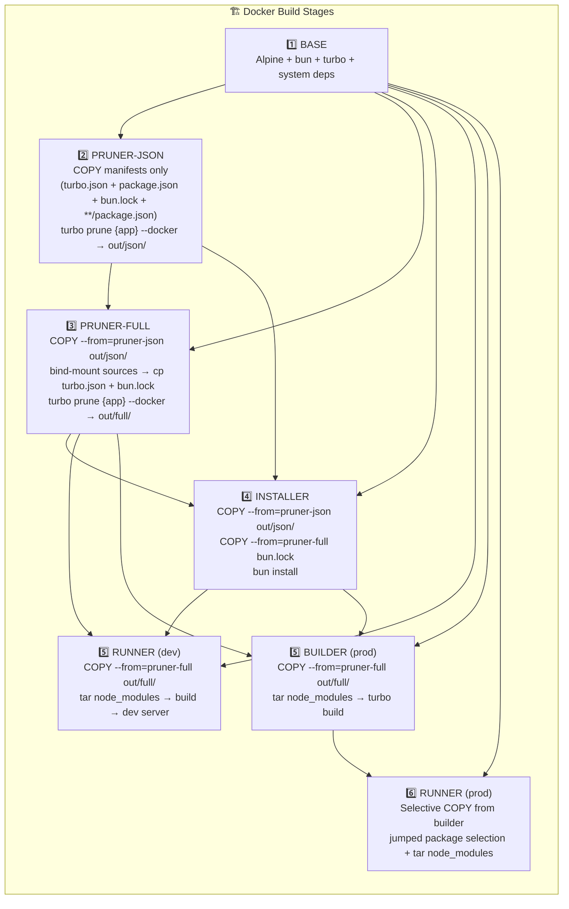

# Docker Builder AGENTS — Multi-Stage Build Architecture

This file documents the multi-stage Docker build architecture for this monorepo, designed to maximize layer caching and minimize rebuild times.

## Goals

1. **Maximize cache hits**: Source code changes should NOT invalidate `node_modules` installation
2. **Fast rebuilds**: Code-only changes should rebuild in ~10-20 seconds
3. **Preserve symlinks**: Bun/npm workspaces use symlinked `node_modules`
4. **Support postinstall**: Some packages (fumadocs) need config files during `bun install`

## Architecture Overview

All Dockerfiles follow a **5-stage architecture** (dev) or **6-stage architecture** (prod):

```
DEV:    BASE → PRUNER-JSON → PRUNER-FULL → INSTALLER → RUNNER
PROD:   BASE → PRUNER-JSON → PRUNER-FULL → INSTALLER → BUILDER → RUNNER
```

The pruner is **split in two stages** to maximize cache hit rate:

- **`pruner-json`** — only handles manifests (package.json files, turbo.json, bun.lock). Cache invalidates only when a manifest or lockfile changes.
- **`pruner-full`** — bind-mounts the build context to access source files and re-runs `turbo prune` to produce `out/full/`. Because `--mount=type=bind` does NOT participate in cache-key calculation, source-only changes in unrelated apps do NOT invalidate this stage.



> **Note**: The `source-copier` stage from the previous architecture was removed. The pruner already produces the exact pruned source in `out/full/`, so the runner/builder can copy directly from there (local image-to-image COPY, no build-context transfer).

## The `dev-dependency-builder` profile's two images

The `dev-dependency-builder` compose profile uses a different pair of images. It
is the only profile where internal packages are built ONCE, by a dedicated
container, instead of once per application image.

| Image | File | Carries | Builds internal packages |
|-------|------|---------|--------------------------|
| applications | `app/Dockerfile.app.dev` | ONE pruned application (`--build-arg APP=<name>`) | no — consumes them |
| the builder | `dependency-builder/Dockerfile.dependency-builder.dev` | the FULL workspace | yes — the union, once |

### One Dockerfile for all four applications

`app/Dockerfile.app.dev` builds api, web, setup and doc. They need the same five
stages; only the prune target differs, so an `APP` build arg selects it. All four
`*-dependency-builder` compose variants point at this one file.

**`ARG APP` is declared as LATE as possible** — immediately before the prune,
never at the top of the file. An instruction's cache key includes the build args
in scope at that point, so hoisting `ARG APP` to the top would make every layer
above it per-application and the file would share nothing.

**A shared step must also sit ABOVE the first per-application step.** This holds
even for instructions that do not mention `APP`: BuildKit's cache key for a COPY
includes the layer it is applied to, so a build-context COPY placed after a
per-application COPY is itself per-application. The entrypoint COPY was measured
NOT cached for the second application when it sat at the end of the runner stage;
moved above the pruned source, it is.

Measured, building all four from a cold cache with the builder image already
present:

```text
api    202s   CACHED=7    the first build populates the shared layers
web    159s   CACHED=11
setup  178s   CACHED=11
doc    131s   CACHED=11
```

The 11 reused steps are the whole `base` stage (apk, Node 22, global tools), the
root manifests, every package.json, the installer's manifest COPY, and the
entrypoint. The runner stage is **4 steps**, down from 6:

```text
[runner 1/4] RUN ln -sf $(which bun) /usr/local/bin/npm
[runner 2/4] COPY entrypoint-app.sh            ← shared, above the per-app steps
[runner 3/4] COPY --from=pruner-full out/full/ ← per-app, source AND lockfile
[runner 4/4] RUN tar node_modules from installer ← per-app
```

Steps that had no cacheable boundary between them are merged, since each is a
stored layer: node/npm/npx symlinks + global install → one `RUN`; three `ENV`
lines → one `ENV`; `turbo.json` + `package.json` + `bun.lock*` → one `COPY`;
pruned source + pruned lockfile → one `COPY`. The redundant `WORKDIR /app` lines
were dropped — every stage is `FROM base` and inherits it, and a redundant
`WORKDIR` is still a layer.

To make the single runner COPY possible, `pruner-full` places the pruned lockfile
inside `out/full/`, which otherwise has none at its root. It must be the PRUNED
lockfile: the original references workspaces that no longer exist, so `bun ci`
would fail with "lockfile had changes".

The `base` stage installs the UNION of what the four need — Node 22, `gcc`,
`musl-dev`, `@nestjs/cli` — even though only api/setup use some of it. A
conditional install would make that layer per-application and cost far more than
the unused tools do, since BuildKit then stores it once for all four.

### The application image does not build

`app/entrypoint-app.sh` runs at container start and:

1. points each pruned package's `dist/` at `/dep-output/packages/<npm-name>/dist`
   on the shared volume (the Dockerfile `CMD` is then the app's own dev server)
2. waits for the builder's stamp, so it never starts against a partial tree
3. `exec`s the image's `CMD`

It derives the application's name from the working directory
(`/app/apps/<name>`, which compose sets), so the shared image needs no per-app
environment beyond `APP_DIR` and `DEP_OUTPUT_ROOT`.

**The volume path is keyed by NPM NAME, not directory name.** The builder
publishes `@deployer/logger` at `packages/@deployer/logger/dist`; using the directory
(`logger`) would point the symlink at a directory nothing writes to.

### Why the builder image is NOT pruned

Every other image prunes. The builder must not: it computes the union of the
enabled applications' packages AT RUNTIME from the manifests on disk, so pruning
to any one application would remove exactly the manifests it reads. It learns
which applications are enabled by reading `COMPOSE_PROFILES` from its own
environment — the same value compose used to select the application containers —
and the applications' prune volumes are not mounted into it at all.

## Stage Details

### Stage 1: BASE

Common system dependencies for all subsequent stages.

```dockerfile
FROM oven/bun:1.4.3-alpine AS base
RUN apk add --no-cache libc6-compat curl bash python3 make g++ gcc musl-dev tar
RUN --mount=type=cache,id=deployer-bun-downloads,target=/root/.bun/install/cache,sharing=shared \
    bun install -g turbo@^2
WORKDIR /app
```

**Caching**: ✅ Rarely invalidates (only on base image or system deps change)

---

### Stage 2a: PRUNER-JSON — manifests only (very stable cache)

Determines the pruned workspace list from manifest files only. This stage is
deliberately decoupled from source files so the cache survives unrelated
edits.

```dockerfile
FROM base AS pruner-json
WORKDIR /app

# Root manifests (rarely change)
COPY turbo.json package.json ./
# bun.lock may be text or binary; copy whatever exists
COPY bun.lock* ./
# All package.json files across the monorepo (preserves directory structure)
COPY --parents **/package.json ./

# Produce the pruned dependency graph from manifests only
# `{app}` is the WORKSPACE PACKAGE NAME (`@deployer/bff`), not the directory.
RUN --mount=type=cache,id=deployer-bun-downloads,target=/root/.bun/install/cache,sharing=shared \
    bun x turbo prune {app} --docker
```

**Input**: only manifest files (turbo.json, package.json, bun.lock, **/package.json).
**Output**: `/app/out/json/` — pruned package.json structure.
**Caching**: ✅ **Super stable.** Invalidates ONLY when a manifest or lockfile changes.
Source code edits in any app or package have **zero impact** on this stage's cache.

**Why `--parents **/package.json`?** The `1-labs` syntax allows glob patterns
in `COPY --parents`. We copy every `package.json` in the monorepo while
preserving the directory structure (`apps/api/bff/package.json`, `packages/ui/package.json`, …).
This is enough for `turbo prune` to compute the dependency graph.

---

### Stage 2b: PRUNER-FULL — sources via bind mount

Re-runs `turbo prune` with the actual source files (provided by a bind mount
on the build context) so `out/full/` contains real source code, not just
manifests. Crucially, **the bind mount does NOT participate in the layer's
cache key**, so source-only changes in unrelated apps do not invalidate this stage.

```dockerfile
FROM base AS pruner-full
WORKDIR /app

# Take the pruned package.json structure (cache key: pruner-json output)
COPY --from=pruner-json /app/out/json/ ./

# Bind-mount the build context to access source files at build time.
# The bind mount does NOT participate in cache key calculation, so source
# changes in unrelated apps don't invalidate this stage.
# We copy the source files into the current directory so turbo prune can
# find them — turbo prune reads from the CWD, not from the bind-mount path.
# (turbo prune will then filter to only the workspaces needed for the target app)
RUN --mount=type=bind,target=/src \
    --mount=type=cache,id=deployer-bun-downloads,target=/root/.bun/install/cache,sharing=shared \
    cp /src/turbo.json . && \
    cp /src/bun.lock* . 2>/dev/null || true ; \
    tar -C /src -cf - apps packages 2>/dev/null | tar -xf - 2>/dev/null || true ; \
    bun x turbo prune {app} --docker
```

**Input**: `out/json/` from `pruner-json` + bind-mounted build context (sources).
**Output**:
```
/app/out/
├── json/           # Pruned package.json structure (also from pruner-json)
│   ├── package.json
│   ├── apps/web/package.json
│   └── packages/ui/package.json
├── full/           # Pruned source files (turbo's source globs)
│   ├── apps/web/src/...
│   ├── apps/web/source.config.ts (if applicable)
│   └── packages/ui/src/...
├── bun.lock        # ⚠️ BUGGY - DO NOT USE (turborepo#10783)
├── turbo.json      # Original (from bind mount)
└── bun.lock*       # Original (from bind mount)
```

**Caching**: ⚠️ Cache key = `pruner-json` output + RUN command. Source code
edits do NOT appear in the cache key (bind mount is excluded). This means
**source changes within the target app do not auto-invalidate this stage** —
a known trade-off. To force a rebuild, use `docker build --no-cache` or wipe
the cache. In practice, you only need to do this when iterating on source
code inside a service; cross-service edits in unrelated apps still hit the
cache (which is the main win).

**Why copy the source files into CWD before `turbo prune`?** `turbo prune`
reads source files relative to the **current working directory** (`/app`),
not the bind mount path (`/src`). The `tar | tar` pipe materializes the
workspaces into CWD so `turbo prune` can find them and emit a correct
`out/full/`. The intermediate `apps/` and `packages/` directories are not
shipped in the final image (the runner only copies from `out/full/`).

**Why `cp /src/bun.lock* . 2>/dev/null || true`?** The build context may
contain `bun.lock`, `bun.lockb`, or no lockfile. The glob + fallback
handles all three cases without breaking the build.

### The prune scope is the WORKSPACE PACKAGE NAME, not the directory

`turbo prune` takes a package name. Every application in this repository is
scoped (`@deployer/bff`), so the bare directory name fails outright:

```text
$ turbo prune api --docker
x Invalid scope. Package with name api in `package.json` not found.
```

Every prod pruner used the directory name — `api`, `web`, `setup`, `doc`,
`mesh-agent`, and `api web` for the unified image — so **no prod image could
build**. The dev images (`Dockerfile.app.dev`) were already correct because
compose passes `APP=@deployer/<name>` as a build arg; the prod files had the
name hardcoded and had drifted.

| Correct scope | Rejected scope |
|---|---|
| `@deployer/bff` | `bff` |
| `@deployer/web` | `web` |
| `@deployer/setup` | `setup` |
| `@deployer/doc` | `doc` |
| `@deployer/mesh-agent` | `mesh-agent` |
| `@deployer/bff @deployer/web` | `bff web` |

`turbo prune` accepts several scopes in one invocation, which is what the
unified `Dockerfile.prod` relies on.

### The root `scripts/` directory must be copied into every installer

`bun ci` runs the root `postinstall`,
`scripts/link-workspace-self-references.ts`, which creates the
`node_modules/<own-name> -> ../..` self-link that `bun install` never makes (see
that file's header for what breaks without it). A root script is not a
dependency of anything, so `turbo prune` drops it, and the install dies with:

```text
error: Module not found "scripts/link-workspace-self-references.ts"
error: postinstall script from "deployer" exited with 1
```

The error names the script but not the pruning decision behind its absence.
**Every installer stage needs `COPY scripts ./scripts`** — the dev images had
it, the prod ones did not.

### The pruning turbo writes the `turbo.json` the build parses

`turbo prune` does not copy `turbo.json` — it **re-serialises** it, filling in a
`futureFlags` snapshot taken from the version doing the pruning. Two different
turbo versions therefore write two different files from the same input:

| Written by | `futureFlags` contains |
|---|---|
| `turbo@2.11.9` (the `turbo@^2` global install in `base`) | `experimentalSetup`, … |
| `turbo@2.11.7` (the version `bun.lock` pins, used for the build) | no `experimentalSetup` |

A file written by 2.11.9 and parsed by 2.11.7 fails:

```text
x Failed to parse turbo.json.
`->   x Found an unknown key `experimentalSetup`.
```

This is the same class as the lockfile problem: **two turbo versions, one
artifact, and the prune runs the wrong one.** The pruner stages install
`turbo@^2` globally while the builds run the lockfile-pinned turbo from
`node_modules`, so the version that writes the config is not the version that
reads it. A prune NEWER than the pin also drops `remoteCache` that
`--remote-only` needs.

Every `pruner-full` therefore restores the repository's own file after pruning:

```dockerfile
turbo prune <pkg> --docker && \
cp /app/turbo.json /app/out/full/turbo.json
```

`/app/turbo.json` at that point is a verbatim copy of the bind-mounted source
(`cp /src/turbo.json .` at the top of the same `RUN`), so this makes the prune
binary's version irrelevant instead of relying on which turbo happens to win.

### Discover `node_modules` with `find`, never a glob list

The runner/builder copies `node_modules` from the installer. That path list used
to be enumerated by hand:

```dockerfile
apps/*/node_modules packages/*/node_modules packages/*/*/node_modules \
tooling/*/node_modules tooling/*/*/node_modules
```

**A hand-written glob list cannot stay correct.** It silently misses any
workspace deeper than its last pattern, and the failure does not name the
missing COPY. Measured: the workspace at `tooling/eslint/plugins/progress`
(one level past `tooling/*/*/`) was skipped, and the build died with

```text
@deployer/config-eslint-plugins-progress:build: error TS2307:
  Cannot find module 'nanospinner'
```

— which reads like a missing dependency, not a missing copy, since the package
was installed the whole time in the installer stage.

Use a depth-agnostic discovery instead:

```dockerfile
PATHS="node_modules $(find apps packages tooling -type d -name node_modules -prune -print | tr '\n' ' ')"
```

`-prune` stops `find` descending INTO a matched `node_modules` (so nested
`node_modules` inside packages are not listed separately) while still finding
every workspace depth. Measured: 37 directories, against 36 for the glob list,
with the missing one being exactly the workspace above.

### Prune devDependencies in the BUILDER, with `bun prune --production`

The prod images drop devDependencies (type defs, build tools, test runners) so
the runtime ships only what it uses. Where that runs is not a style choice.

**In the runner it cannot work at all.** The runner receives each workspace's
`node_modules` by having it COPIED out of the builder, and it never receives the
three things `bun install` reads first:

| Needed by the install | In the runner? |
|---|---|
| `bun.lock` | no — only the builder/installer get it |
| `tooling/*/package.json` (the root manifest lists them as workspaces) | no — only `apps/` and `packages/` are materialised |
| `scripts/link-workspace-self-references.ts` (the root postinstall) | no |

so the step died on the first:

```text
error: Workspace not found "tooling/eslint"      (x7, measured)
```

**And it is not even a no-op when it does run.** `bun install --production` on
an already-populated tree removes nothing, because it treats the existing tree
as already resolved:

| Tree | Before | After `--production` |
|---|---|---|
| populated (the old runner step) | 1855 pkgs / 1777 MB | **1855 pkgs / 1777 MB** |
| clean (`rm -rf node_modules` first) | — | **1271 pkgs / 1463 MB** |

The old runner step was therefore **both broken and pointless**: it could not
run, and if it had, it would have changed nothing.

So the prune belongs in the builder, immediately after the build, where
`bun.lock`, every manifest, and the source are all present.

**Use `bun prune --production`, not `rm -rf node_modules && bun install --production`.**
Both reach the same tree (1462 MB, verified), but the two differ by 20x in time
because prune deletes what `bun.lock` does not need instead of re-resolving the
whole graph:

| Strategy | Time | Size | Self-links |
|---|---|---|---|
| `rm -rf node_modules && bun install --production` | 18s | 1462 MB | present |
| `bun prune --production` | **0.9s** | 1462 MB | **removed** |
| `bun prune --production` + re-link | 1s | 1462 MB | present |

Prune is also purely local — verified to run with `--network=none`. Note the
command is **top-level `bun prune`**; `bun pm prune` does not exist (it is not
in the `bun pm` command list).

**The re-link is not optional.** `bun prune` DELETES the self-links, because
`node_modules/<own-name> -> ../..` is not an entry in `bun.lock`. Measured: the
link is present before the prune and ABSENT after. Without it, node fails to
load any dist barrel that re-imports its own package by name:

```text
node -e 'require("./dist/cjs/index.js")'   # FAIL: Cannot find module
                                           # '@deployer/contracts-common/…'
```

bun resolves a package's own name through `exports` natively, so it is OK either
way — node is not. Hence:

```dockerfile
COPY scripts ./scripts
RUN bun prune --production && \
    bun --bun run scripts/link-workspace-self-references.ts
```

Both halves need `scripts/`, and for **two different reasons**: the installer's
`bun ci` needs it for the install-time postinstall, and this builder step needs
it because prune removes the links that postinstall created. `turbo prune`
brings neither, because a root script is not a dependency of any workspace.

No cache mount is needed: prune never resolves, so there is nothing to fetch.

Verified safe for the `api` runtime after pruning: `pg`, `drizzle-orm`,
`drizzle-kit`, `@nestjs/core`, `reflect-metadata`, `@deployer/logger` and
`drizzle-orm/node-postgres/migrator` all still resolve, `dist/main` is present,
and the image has **0 dangling symlinks**. Resolution parity with the
`rm -rf` + install arm was checked for both `node` and `bun`.

The unified `Dockerfile.prod` (api + web in one image) had the same two
problems in its runner, plus a third:

1. `bun --bun install` in the runner — same `Workspace not found` failure.
2. `node_modules` copied from the ROOT ONLY. Under the isolated linker a
   workspace does not resolve through the root tree, so this was fatal on its
   own:
   ```text
   error: Cannot find module '@nestjs/core' from '/app/apps/api/bff'
   ```
3. The hand-enumerated `node_modules/*/` glob list, missing deeper workspaces.

Its runner now copies `find`-discovered paths for every workspace, and the prune
runs in the builder like the others.

---

### Stage 3: INSTALLER

Installs dependencies using ONLY the pruned `package.json` structure from
`pruner-json`.

```dockerfile
FROM base AS installer
WORKDIR /app

# Copy ONLY the pruned package.json structure (not all workspaces)
COPY --from=pruner-json /app/out/json/ .
# The root postinstall script is NOT a dependency of anything, so prune drops it.
COPY scripts ./scripts
# Use the ORIGINAL bun.lock from pruner-full (not the corrupted out/bun.lock
# produced by turbo prune — see turborepo#10783, #11074).
COPY --from=pruner-full /app/bun.lock ./bun.lock

RUN --mount=type=cache,id=deployer-bun-downloads,target=/root/.bun/install/cache,sharing=shared \
    --mount=type=cache,target=/root/.cache \
    bun install --frozen-lockfile || bun install
```

**Key insight**: This stage only depends on `pruner-json`'s output. Source
code changes don't affect this stage's cache at all.

**Caching**: ✅ Only invalidates when a manifest or lockfile changes.

**Known bug workaround**: `turbo prune` generates a slightly corrupted
`out/json/bun.lock` (see [turborepo#10783](https://github.com/vercel/turborepo/issues/10783),
[#11074](https://github.com/vercel/turborepo/issues/11074)) — the lockfile
may not be perfectly consistent with the pruned `package.json`. The fix:
**all installer stages use `bun install --frozen-lockfile || bun install`** —
the `|| bun install` fallback regenerates the lockfile when the pruned one
is inconsistent. This is the original `api dev` pattern that the repo
documented before; we extended it to all 11 Dockerfiles so the build
never fails on the pruned-lockfile bug.

**Doc app special case**: `apps/doc/source.config.ts` is needed at install
time for the fumadocs postinstall script. The dev installer copies it
**directly from the build context** (`COPY apps/doc/source.config.ts ...`)
instead of from `pruner-full`'s `out/full/`. The `COPY --from=pruner-full`
path was hitting a BuildKit snapshot race during parallel builds; the
direct COPY from the build context sidesteps that entirely. Trade-off:
this COPY invalidates the installer's cache when `source.config.ts`
changes — acceptable because the postinstall must rerun anyway when
the source changes. Prod installers skip postinstall
(`bun install --production`) so they don't need it.

---

### Stage 4: RUNNER (dev) / BUILDER (prod)

Combines source code + `node_modules` and either runs the dev server or
builds the production artifacts.

```dockerfile
FROM base AS runner
WORKDIR /app

# Pruned source from pruner-full (out/full/) — local image-to-image COPY,
# no build context transfer.
COPY --from=pruner-full /app/out/full/ .

# Root config files needed for turbo workspace resolution at dev time.
# Use the ORIGINAL bun.lock (not the corrupted out/bun.lock).
COPY --from=pruner-full /app/bun.lock ./bun.lock
COPY --from=pruner-full /app/package.json ./package.json
COPY --from=pruner-full /app/turbo.json ./turbo.json

# Copy node_modules via tar to preserve symlinks
# IMPORTANT: `cd /mnt/installer` MUST happen BEFORE the globs are expanded.
# The globs `apps/*/node_modules` etc. are expanded by the shell relative to
# the current working directory. If they run from /app (the runner's dir), they
# only match node_modules dirs that already exist in the pruned source — and
# apps/<app>/node_modules is NOT part of the source, so it would be silently
# skipped and never copied, breaking module resolution at runtime.
RUN --mount=type=bind,from=installer,source=/app,target=/mnt/installer \
    cd /mnt/installer && \
    PATHS="node_modules"; \
    for d in apps/*/node_modules packages/*/node_modules packages/*/*/node_modules; do \
        [ -d "$d" ] && PATHS="$PATHS $d"; \
    done && \
    tar -cf - --exclude='*.map' --exclude='.cache' --exclude='.turbo' $PATHS | \
    tar -xf - -C /app --owner=root --group=root
```

**Why tar?** Bun workspaces use symlinks in `node_modules`. Regular `COPY`
or `cp` breaks them.

**Caching**: ⚠️ Invalidates when `pruner-full` changes (manifests only) or
when downstream build steps change the local filesystem.

---

## Cache Behavior by Change Type

### Scenario 1: Source Code Change in the Target App (e.g., edit `apps/api/bff/src/foo.ts`)

| Stage | Status | Time |
|-------|--------|------|
| BASE | ✅ Cached | 0s |
| PRUNER-JSON | ✅ **CACHED** (only manifest would change it) | 0s |
| PRUNER-FULL | ⚠️ Re-used (bind mount = stale `out/full/`) | 0s |
| INSTALLER | ✅ **CACHED** | 0s |
| RUNNER (or BUILDER) | 🔄 Re-runs (depends on `out/full/`, which is stale) | ~5-15s |

**Total: ~5-15 seconds** ⚡

> **Trade-off note**: The bind-mount trick trades source-change cache
> invalidation for cross-service cache stability. The runner may use a
> slightly stale `out/full/` until you run `docker build --no-cache` or
> clear the cache. In typical CI, this is a non-issue because images are
> rebuilt from a fresh commit. In local dev, the bind mount in the runner
> compose files handles hot-reload, so stale `out/full/` doesn't affect
> day-to-day work.

### Scenario 2: Source Code Change in an Unrelated App (e.g., edit `apps/web/src/foo.ts` while building `api`)

| Stage | Status | Time |
|-------|--------|------|
| BASE | ✅ Cached | 0s |
| PRUNER-JSON | ✅ **CACHED** | 0s |
| PRUNER-FULL | ✅ **CACHED** (web is not in `api`'s `out/full/`) | 0s |
| INSTALLER | ✅ **CACHED** | 0s |
| RUNNER (or BUILDER) | 🔄 Re-runs | ~5-15s |

**Total: ~5-15 seconds** ⚡

> **Win**: This is the main benefit of the bind-mount pattern. Without it,
> `COPY . .` in the old pruner would invalidate the cache every time any
> file in the repo changes.

### Scenario 3: Dependency Change (e.g., edit `package.json` or `bun.lock`)

| Stage | Status | Time |
|-------|--------|------|
| BASE | ✅ Cached | 0s |
| PRUNER-JSON | 🔄 Re-runs | ~2-3s |
| PRUNER-FULL | 🔄 Re-runs (depends on pruner-json) | ~2-3s |
| INSTALLER | 🔄 Re-runs | ~30-120s |
| RUNNER (or BUILDER) | 🔄 Re-runs | ~10-30s |

**Total: ~50-160 seconds** 🐢

### Scenario 4: No Changes (rebuild)

| Stage | Status | Time |
|-------|--------|------|
| All stages | ✅ Cached | ~0.1-2s |

---

## Doc App Special Case: `source.config.ts` (RESOLVED)

The `doc` app uses **fumadocs** which has a postinstall script that imports `source.config.ts`. With the two-stage pruner:

- The dev installer runs `bun ci` (which executes postinstall) and copies
  `source.config.ts` from `pruner-full`'s `out/full/apps/doc/source.config.ts`:
  ```dockerfile
  COPY --from=pruner-full /app/out/full/apps/doc/source.config.ts ./apps/doc/source.config.ts
  ```
- Prod installers run `bun ci --production` (postinstall skipped) so they
  don't need it; the runner pulls everything from `out/full/` later.

## Compose-Level Caching

The 13 compose files with `build:` sections are configured for cross-machine cache reuse. **However, dev compose files deliberately omit `cache_to`** because Docker Compose's `cache_to` doesn't support the safer `type=local` option, and `type=inline` causes a BuildKit race condition during parallel builds.

### Dev compose files: NO `cache_to` (default BuildKit local cache)

```yaml
build:
  context: ../../..
  dockerfile: ./docker/builder/<service>/Dockerfile.<service>.<env>
  args:
    - BUILDKIT_INLINE_CACHE=1     # harmless: arg is ignored without cache_to
  # No cache_to: see "Why no cache_to in dev?" below
```

**Why no `cache_to` in dev?** Docker Compose's `cache_to` only supports `type=inline|registry|gha|s3`. There is no `type=local` option (even though BuildKit supports it natively, Docker Compose doesn't expose it through the compose file format).

- `type=inline` causes a BuildKit race condition when `docker compose up --build` runs all 5 services in parallel — concurrent writes to the inline cache metadata corrupt the snapshot, producing errors like:
  ```
  target doc-dev: failed to solve: failed to commit <snap> to <ref> during finalize:
  failed to stat active key during commit: snapshot <snap> does not exist: not found
  ```
- `type=registry` requires a registry (not available in local dev).
- `type=gha` and `type=s3` are CI-only.

Without `cache_to`, the default BuildKit local cache is used (stored in `~/.cache/buildx/` by default). This is file-based, shared across all builds on the same machine, and immune to the parallel-build race.

### Prod-like compose files still use `type=inline` (for CI)

```yaml
build:
  context: ../../..
  dockerfile: ./docker/builder/<service>/Dockerfile.<service>.<env>
  args:
    - BUILDKIT_INLINE_CACHE=1
  cache_to:
    - type=inline                  # embeds cache metadata in the image
```

`type=inline` is fine for prod-like because:
- Prod-like compose files are used for single-service production builds (no parallel race).
- The inline cache can be pulled from a registry in CI via `cache_from: type=registry`.

### Why this matters

- `BUILDKIT_INLINE_CACHE=1` (build arg) tells BuildKit to track all layers as cacheable and write the cache metadata into the image.
- `cache_to: [type=inline]` (compose) tells BuildKit where to write the cache — inline = inside the image itself.
- `cache_to: [type=local]` writes the cache to a file system directory shared across builds.

### How to use the cache across machines (CI)

To reuse the cache from a previous build, use `cache_from`:

```yaml
build:
  cache_from:
    - type=registry,ref=ghcr.io/myorg/api-dev:cache
```

Combined with `BUILDKIT_INLINE_CACHE=1` + `cache_to: type=inline`, this enables the "registry cache" pattern: every push of the image publishes the build cache alongside it, and every CI run pulls the cache before building, dramatically reducing build time.

### Other compose caching practices already in place

- `pull_policy: never` for locally-built images (one-shot jobs use `pull_policy: build`).
- The 5 mesh nodes (`api-mesh-dev-1..5`) share the same image via `image: ${COMPOSE_PROJECT_NAME:-nextjs-nestjs}-api-dev:latest` — no re-build per node.
- `docker compose ... up --watch` (dev workflow) uses `develop.watch` rules so only `package.json` / `bun.lock*` / Dockerfile changes trigger a rebuild; everything else uses fast `sync`.
- The local BuildKit cache is shared across all 5 services in dev (via `dest=/tmp/.buildx-cache-${COMPOSE_PROJECT_NAME:-default}`). Same `COMPOSE_PROJECT_NAME` = same cache = faster rebuilds.

---

## Why Not Share Dockerfile Stages?

Docker does NOT support importing stages from external Dockerfiles. Each Dockerfile must be self-contained.

**Alternatives considered:**
1. **Single unified Dockerfile with ARGs** - Possible but complex
2. **Pre-built base image** - Requires separate build + registry
3. **Copy-paste stages** - Current approach, explicit and simple

---

## Recommendations

1. **Keep postinstall scripts minimal** - Only depend on small config files
2. **Don't edit `source.config.ts` frequently** - It invalidates doc's installer cache
3. **Use BuildKit cache mounts** - `--mount=type=cache,id=deployer-bun-downloads,target=/root/.bun/install/cache,sharing=shared` (never mount `/root/.bun` itself — see "One bun download cache")
4. **Preserve symlinks with tar** - Never use plain `COPY` for `node_modules`
5. **Use original `bun.lock`** - The pruned one is buggy; always copy from `pruner-full`'s root
6. **Use single-tar pattern** - See below
7. **Use `out/full/` directly** - The pruner already produces the exact pruned source
8. **Use the two-stage pruner** - `pruner-json` + `pruner-full` is the canonical
   pattern. It eliminates the heavy `COPY . .` and gives cross-service cache
   isolation via bind mount.
9. **Wipe cache after source-only edits inside the target app** - Because the
   bind mount is not in the cache key, source changes inside the service
   you're building do not auto-invalidate `pruner-full`. Use
   `docker build --no-cache` or `docker builder prune` to force a rebuild,
   or rely on the runner's bind mounts in dev for hot-reload.

## Optimized Tar Pattern for `node_modules`

The runner/builder stages copy `node_modules` from the installer. The previous implementation used multiple independent `tar cf | tar xf` invocations (one per `node_modules` directory), which was slow (40-55s per service). The new pattern uses a single `tar -cf -` with all paths as args.

### Why a single tar

Concatenated tar streams (e.g., `{ tar -cf - ...; tar -cf - ...; } | tar -xf -`) **silently lose per-directory content during extraction** because the extraction of the first stream consumes parts of the second stream. This was confirmed during testing: per-package `node_modules` (e.g., `tooling/vitest/node_modules/@types/node`) appeared empty in the extracted image.

The fix is to pass ALL paths as arguments to ONE `tar -cf -` invocation, so a single tar archive is produced.

### The pattern

````dockerfile
RUN --mount=type=bind,from=installer,source=/app,target=/mnt/installer \
    # IMPORTANT: `cd /mnt/installer` MUST happen BEFORE the globs are expanded.
    # The globs `apps/*/node_modules` etc. are expanded by the shell relative to
    # the current working directory. If they run from /app (the runner's dir),
    # they only match node_modules dirs that already exist in the pruned source
    # — and apps/<app>/node_modules is NOT part of the source, so it would be
    # silently skipped and never copied, breaking module resolution at runtime.
    cd /mnt/installer && \
    # Build the path list first, only including existing directories
    # (avoids shell glob errors when no matches at a given depth)
    PATHS="node_modules"; \
    for d in apps/*/node_modules \
             packages/*/node_modules \
             packages/*/*/node_modules; do \
        [ -d "$d" ] && PATHS="$PATHS $d"; \
    done && \
    # Single tar -cf with all paths as args → single tar archive
    # Excludes *.map source maps, .cache and .turbo noise
    tar -cf - --exclude='*.map' --exclude='.cache' --exclude='.turbo' $PATHS | \
    tar -xf - -C /app --owner=root --group=root
````

### Why 3 globs for packages

The project has nested package directories:
- `apps/*/node_modules` (1 level deep — `apps/web/node_modules`, `apps/setup/node_modules`, …)
- `packages/*/node_modules` (1 level deep — `packages/types/node_modules`, …)
- `packages/*/*/node_modules` (2 levels deep — `tooling/vitest/node_modules`, `packages/transport/orpc/node_modules`, …)

The original `find -name node_modules` was recursive, so it caught everything. Shell globs are not recursive, so we need explicit globs at each depth.

### Performance impact

| Pattern | Cold build step | Cached rebuild |
|---|---|---|
| Old (multi-tar with `find`) | 40-55s per service | 1-2s |
| **New (single-tar with PATHS list)** | **~25s per service** | **~0.1s** |

Measured on the `mesh-6` build for `api-cli`: **43.3s → 24.9s** (~42% faster).

## Optimized Source Pattern: `out/full/`

The previous architecture had a `source-copier` stage that:
1. Did `COPY . .` (full build-context transfer, ~3.78MB)
2. Ran a complex bash script with `find` and `cp -r` to extract pruned source

But the `pruner-full` stage already produces `out/full/` containing the EXACT pruned source. The current architecture skips the `source-copier` stage entirely:

````dockerfile
FROM base AS runner
WORKDIR /app

# Pruned source from pruner-full (out/full/) — local image-to-image COPY
# No build-context transfer. out/full/ already contains source, package.json,
# bunfig.toml, .npmrc, AND the source.config.ts the doc installer needs.
COPY --from=pruner-full /app/out/full/ .
# bun.lock isn't in out/full/ (turbo prune keeps it in the pruner root) —
# copy it from pruner-full's root, which has the original (non-corrupted) file
COPY --from=pruner-full /app/bun.lock ./bun.lock
COPY --from=pruner-full /app/package.json ./package.json
COPY --from=pruner-full /app/turbo.json ./turbo.json

# .env files aren't in out/full/ (typically gitignored); restore via bind mount
RUN --mount=type=bind,from=pruner-full,source=/app,target=/mnt/pruner-full \
    mkdir -p /app/apps/api/bff && \
    for f in /mnt/pruner-full/apps/api/bff/.env*; do \
        [ -f "$f" ] || continue; \
        cp "$f" /app/apps/api/bff/; \
    done
````

### Why this works for doc (which previously needed config-copier)

The doc app needs `source.config.ts` at `bun install` time for the fumadocs
postinstall script. Previously this required a `config-copier` stage that
bound the build context. The current approach works because **`out/full/`
already contains the source.config.ts** (verified: `out/full/apps/doc/source.config.ts`
is produced by turbo prune).

The dev installer additionally copies `source.config.ts` from
`pruner-full`'s `out/full/` directly, so `bun ci` can run fumadocs' postinstall:

```dockerfile
COPY --from=pruner-full /app/out/full/apps/doc/source.config.ts ./apps/doc/source.config.ts
```

Prod installers skip postinstall (`bun ci --production`) so they don't need
this line.

### Resulting stage count

- `api` / `web` / `doc` dev: 5 stages (`base → pruner-json → pruner-full → installer → runner`)
- `api.cli` dev: 5 stages (`base → pruner-json → pruner-full → installer → runner`)
- `api` / `web` / `doc` prod: 6 stages (`base → pruner-json → pruner-full → installer → builder → runner`)
- `doc` dev: 5 stages (with the extra `source.config.ts` copy in the installer)
- `doc` prod: 6 stages (no extra copy needed)

## Why the Two-Stage Pruner?

The old single-pruner pattern (`FROM base AS pruner` + `COPY . .` + `turbo prune`)
invalidated the pruner on **every file change** in the repo — including files
in completely unrelated apps. With the two-stage pattern:

| Aspect | Old (single pruner) | New (pruner-json + pruner-full) |
|---|---|---|
| Files snapshotted into the build | ALL files in the repo | Only manifests |
| Cache key for prune stage | All files (huge) | Manifests only (tiny) |
| Source-only change in `apps/web/` (when building `api`) | Invalidates `bff` pruner | **Cached** ✅ |
| Source change in `apps/api/bff/src/...` (when building `bff`) | Invalidates `bff` pruner | Stale `out/full/` (trade-off, see Scenario 1) |
| `bun install` cache invalidation on source change | Yes | **No** ✅ |

The trade-off is that source changes inside the target app do not
auto-invalidate `pruner-full` (because the bind mount is not in the cache
key). In practice, this only matters when iterating on source code inside
the service you're building; cross-service edits in unrelated apps still
hit the cache (the main win). To force a rebuild, use
`docker build --no-cache` or `docker builder prune`.

## Turbo Build Cache (Persistent Across Builds)

The `bun x turbo run build` step in the runner writes to `/app/.turbo/`. To make the turbo cache survive between builds (and across services), wrap the build step with a BuildKit cache mount keyed on a service id:

````dockerfile
RUN --mount=type=cache,target=/app/.turbo,sharing=locked,id=turbo-bff-dev \
    --mount=type=cache,target=/app/apps/api/bff/.turbo,sharing=locked,id=turbo-bff-dev \
    --mount=type=cache,id=deployer-bun-downloads,target=/root/.bun/install/cache,sharing=shared \
    bun x turbo run build --filter=@deployer/bff... --filter=!@deployer/bff
```

Use a distinct `id` per service (`turbo-bff-dev`, `turbo-web-dev`, `turbo-doc-dev`) so each service has its own persistent cache.

## `sharing`: `shared` for bun, `locked` for everything else

A cache mount's `sharing` mode decides whether concurrent builds run in
parallel or queue behind each other.

| Cache | Mode | Why |
|-------|------|-----|
| `/root/.bun/install/cache` | **`shared`** | Bun's download cache is content-addressed and written with atomic renames, so concurrent installs add new entries safely. |
| `/root/.cache` | **`shared`** | Same reasoning; not a bun-owned path but equally append-only in practice. |
| `/var/cache/apk` | `locked` | apk's database is mutable state; concurrent writers corrupt the index. |
| `/tmp/turbo-restore` | `locked` | Extracted in place and read back by the same build. |
| `apps/*/.next/cache` | `locked` | Turbopack mutates its cache in place. |

**`sharing=locked` holds an exclusive lock for the WHOLE `RUN`**, not just the
write. Measured consequence: every image that shared the bun cache built
serially — the dependency-builder could not install while an application was
installing, and the four application images queued behind one another at each
bun step. Builds that should have run in parallel ran one after another.

Omitting `sharing` entirely gives `shared`, but the **`id` is still required**
(see below), so every bun mount states both explicitly.

**Do not "fix" this by dropping the cache mount.** The cache mount is what
keeps `bun install` from re-downloading every package on every build; removing
it trades a serialization bug for a far worse download bug.

---

## One bun download cache: the `id`, the target, and `globalStore`

Three separate defects live in this one area. All three were measured, not
inferred.

### 1. The cache `id` must be explicit, because it DEFAULTS TO THE TARGET

BuildKit derives a cache mount's id from its `target` when no `id` is given. So
`target=/root/.bun` and `target=/root/.bun/install/cache` are **two different
caches**, not one. Dockerfiles that used the former silently got a second,
independent download cache and shared nothing with the rest of the repository.

Every bun mount in this directory therefore names the cache:

```dockerfile
--mount=type=cache,id=deployer-bun-downloads,target=/root/.bun/install/cache,sharing=shared
```

That single id is what makes the packages downloadable once for the whole
repository instead of once per image.

### 2. Never mount `/root/.bun` — it hides the global tools it installs

Bun's global bin directory is `/root/.bun/install/global`, and
`/usr/local/bin/<tool>` is a **symlink into it**:

```text
/usr/local/bin/turbo -> ../../../../root/.bun/install/global/node_modules/turbo/bin/turbo
```

Mount a cache over the whole `/root/.bun` and the symlink dangles as far as the
**image layer** is concerned — the mount is not committed to it. Measured:

```text
WHOLE-mount turbo:  NONE          # --mount=target=/root/.bun
CACHEONLY-mount turbo: /usr/local/bin/turbo
```

So the mount that "looks like it caches bun's cache" actually discards the very
tool it just installed. Mount `/root/.bun/install/cache` and leave the rest of
`/root/.bun` in the layer, where the symlink resolves.

### 3. `install.globalStore = true` cannot survive a BuildKit cache mount

`bunfig.toml` sets `globalStore = true`, which links
`node_modules/.bun/<pkg>` at an **absolute** path inside the same cache mount:

```text
node_modules/.bun/zod@4.6.7 -> /root/.bun/install/cache/links/zod@4.6.7-34ecec2bd54c0415
```

`symlink()` resolves each of those links to whichever `bunfig.toml` is found
from that directory upward, and `turbo prune` copies `bunfig.toml` into both
`out/json/` and `out/full/` — so **every pruned image build inherits the
setting** whether or not anyone intended it. The links then ship without their
targets, because the cache mount is not in the layer. Measured in a built
image:

```text
$ test -d node_modules/.bun/zod@4.6.7    # with globalStore on
NO
$ ls node_modules/.bun/is-odd@3.0.1/
ls: ... No such file or directory
$ bun -e 'require("is-odd")'
error: ENOENT reading "/app/node_modules/is-odd"
```

Every Dockerfile in this directory therefore opts out for the build:

```dockerfile
ENV BUN_INSTALL_GLOBAL_STORE=0
```

The env var overrides `bunfig.toml`, so the HOST keeps the fast store (a warm
`rm -rf node_modules && bun install` is an order of magnitude faster) while the
IMAGE gets real directories. Verified on the `api` installer stage: **0 dangling
symlinks, 1855 real directories in `node_modules/.bun`**, and the remaining
intra-store links relative and resolving.

**The store is not a caching win inside a Docker build anyway** — the build's
win comes from the download cache in point 1, and the installed tree has to be
materialised into the image regardless, because a cache mount cannot be.

---

## Turbopack Build Cache (Persistent Across Builds)

`turbopackFileSystemCacheForBuild` writes Turbopack's compilation cache to
`apps/<app>/.next/cache`, which `next build` deliberately preserves when it
cleans the dist dir (`cleanDistDir` keeps `cache|dev|lock|trace`).

In a container build that directory is worthless unless it is mounted — a plain
`RUN` discards it with the layer. The build-time prod images therefore wrap the
build step in a BuildKit cache mount:

```dockerfile
RUN --mount=type=cache,target=/app/apps/web/.next/cache,sharing=locked,id=turbopack-web-prod-build \
    bunx turbo run build --filter=@deployer/web... --remote-only
```

`sharing=locked` prevents concurrent builds from corrupting the same cache; the
`id` is distinct per app (`turbopack-web-prod-build`, `turbopack-doc-prod-build`).

Two consequences to keep in mind:

1. **A BuildKit cache mount is not committed to the image layer.** The runner
   stage must recreate an empty `.next/cache` (`mkdir -p` + `chown
   nextjs:nodejs`) — the runtime still needs it writable for the incremental
   (ISR/fetch) cache.
2. **The runtime prod images build at container start**, where no BuildKit cache
   exists. They take the volume route instead (see
   `.docs/guides/DOCKER-BUILD-STRATEGIES.md`).

The swarm stack (`docker-stack.deploy.yml`) deliberately has **no** cache volume:
`update_config.order: start-first` with `max_replicas_per_node: 1` lets two
replicas overlap on one node during a rolling update, and two Turbopack processes
writing one cache directory would corrupt it.

---


---

## File Structure

```
infra/docker/builder/
├── AGENTS.md                                # This file
├── api/
│   └── Dockerfile.api.prod                  # API tier production build (one image per app: BFF + 5 services)
├── web/
│   ├── Dockerfile.web.dev                   # Web dev build
│   ├── Dockerfile.web.build-time.prod       # Web prod, build at build-time
│   └── Dockerfile.web.runtime.prod          # Web prod, build at container start
├── doc/
│   ├── Dockerfile.doc.dev                   # Doc dev build
│   ├── Dockerfile.doc.build-time.prod       # Doc prod, build at build-time
│   └── Dockerfile.doc.runtime.prod          # Doc prod, build at container start
```

---

File: `infra/docker/builder/AGENTS.md` — Documents the multi-stage Docker build architecture.
